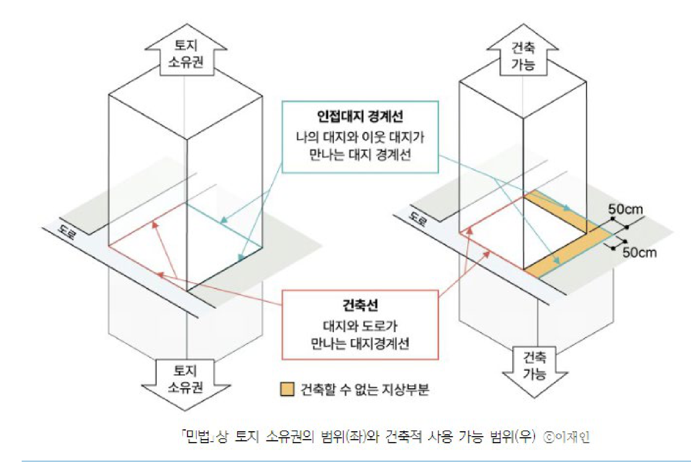
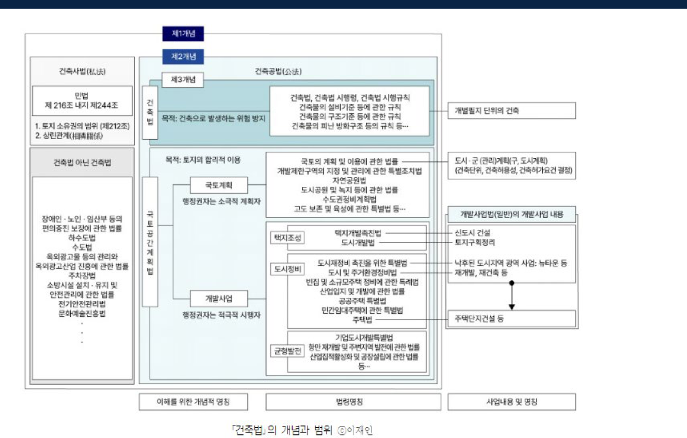
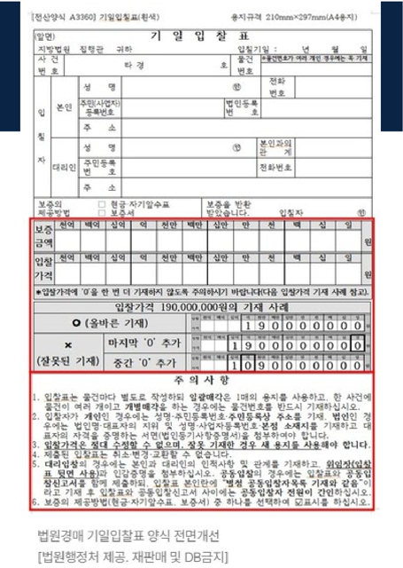
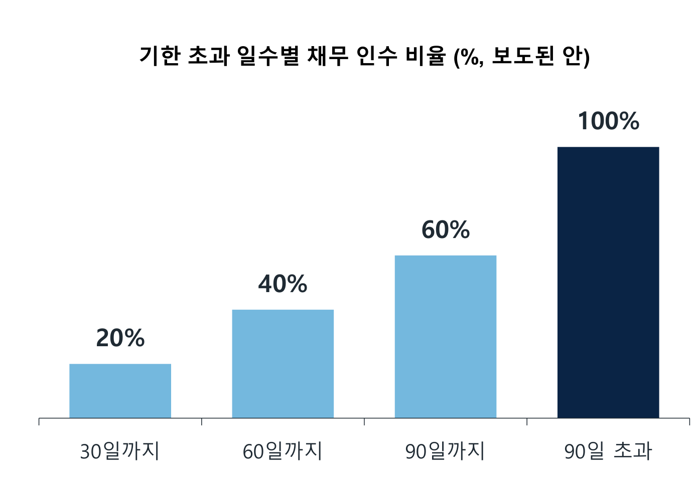
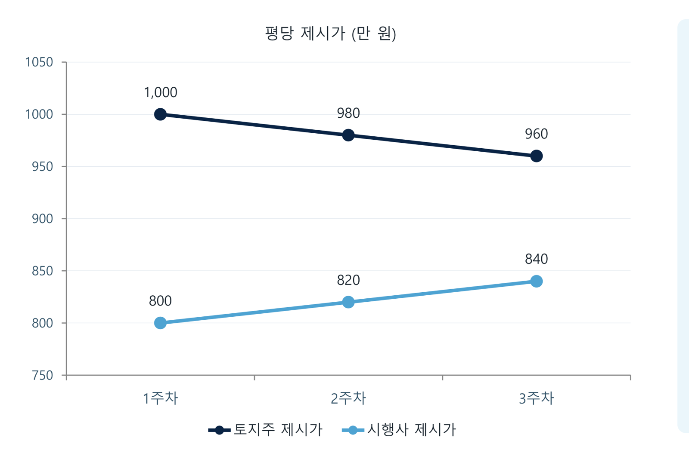
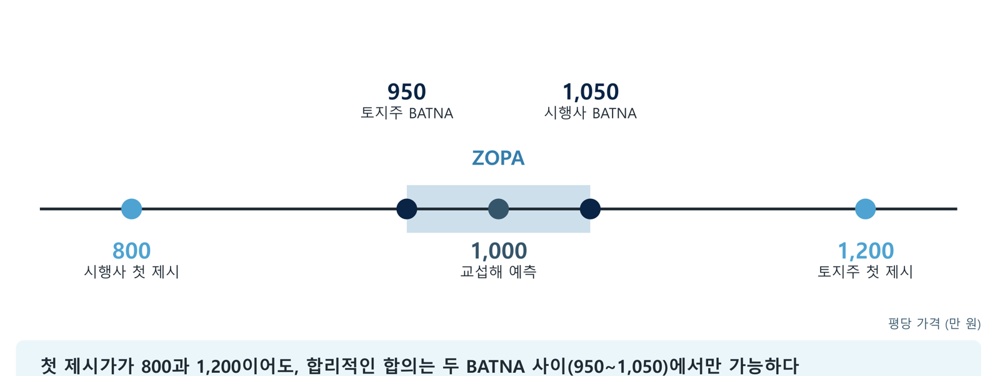
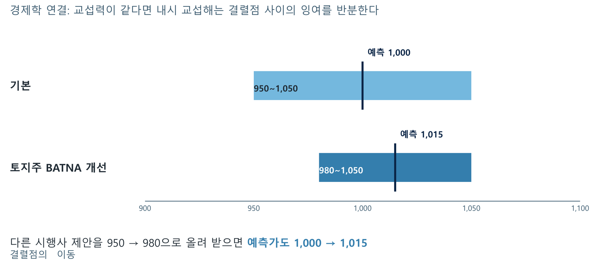

# 도시공간과부동산법 9강~11강 study note

- 범위: 9주차~11주차 (기말 폴더의 강의자료 5개 + 녹음 4개)

# 1. 중간고사 문항 리뷰 — 상린관계 · PF 개발사업 리스크 · 개발사업 분쟁

## 1.1 상린관계

**중간고사 문항**: 상린관계에 관한 설명으로 옳지 않은 것은?

1. 상린관계 규정은 동산과 부동산 모두에 적용된다.

2. 인접하는 부동산 상호 간의 이용을 조절하기 위한 권리관계이다.

3. 「민법」 제215조부터 제244조까지 규정되어 있다.

4. 소유권을 제한하는 동시에, 이웃 토지 이용이나 협력 요구를 통해 소유권을 확장하는 기능도 한다.

5. 평면적 이용관계를 전제로 만들어져 토지의 입체적 이용을 규율하는 데에는 한계가 있다.

- [강의] 정답은 1번 — 상린관계는 동산에는 적용되기 어렵다 (9주차 0:00:32~0:01:55)
- [강의] 상린관계 조항 중에는 수도 이용권, 배수·유수, 공작물, 처마물 시설의무, 수류 변경처럼 농사짓던 시대부터 있던 소유권 제한 조항이 아직 많이 남아 있다 (9주차 0:01:11~0:01:46)
- [강의] 그래도 현대에 의미가 없다고 보기는 어렵다: 땅은 연속되어 있어 담벼락·경계 같은 것이 지금도 실질적으로 영향을 많이 미친다 (9주차 0:01:56~0:02:28)
- [강의] 다만 상하에 미치는 소유권을 제한하는 면에서 보면 공중권 같은 것은 규정되어 있지 않고 하천 용수권 같은 것이 주로 있어서, 평면적 이용관계를 전제로 만들어져 입체적 이용을 규정하는 데 한계가 있다 (9주차 0:02:28~0:02:52)

### 1.1.1 상린관계(相隣關係)의 뜻

- 토지는 행정적으로 그 영역을 구분하고 있을 뿐 물리적으로는 서로 연속되어 있다. 그래서 경계부근에서 인접한 토지소유권의 문제가 발생할 수 있다.
- 「민법」에서는 이들(토지소유권 행사)을 조율하기 위하여 상린관계 규정(제216조 내지 제244조)을 마련하고 있다.
- **상린관계**: 서로 인접한 토지의 이용을 조절하는 과정에서 생기는 권리(相隣權)·의무의 법률관계
- 건축물의 건축(행위)은 토지의 소유권(사용·수익·처분) 중 건축적 사용권 행사이며, 이웃관계에 있어서는 「민법」에 의하므로 건축과정의 이웃관계 문제에 있어서는 「민법」이 일반법으로 작용한다.

### 1.1.2 소유권의 정의와 한계 — 민법 조문

- 2주차 강의자료와 같은 조문 슬라이드다. 조문 번호(제목) + 핵심 문구로 정리한다.

| **조문**                                                  | **핵심 문구**                                                                                                                                 |
|-----------------------------------------------------------|-----------------------------------------------------------------------------------------------------------------------------------------------|
| 제211조(소유권의 내용)                                    | 소유자는 법률의 범위내에서 그 소유물을 사용, 수익, 처분할 권리가 있다                                                                         |
| 제212조(토지소유권의 범위)                                | 토지의 소유권은 정당한 이익있는 범위내에서 토지의 상하에 미친다                                                                               |
| 제213조(소유물반환청구권)                                 | 그 소유에 속한 물건을 점유한 자에 대하여 반환을 청구 / 점유할 권리가 있는 때에는 반환을 거부                                                  |
| 제214조(소유물방해제거, 방해예방청구권)                   | 소유권을 방해하는 자에 대하여 방해의 제거를 청구 / 방해할 염려있는 행위를 하는 자에 대하여 예방이나 손해배상의 담보를 청구                    |
| 제215조(건물의 구분소유)                                  | 수인이 한 채의 건물을 구분하여 각각 그 일부분을 소유한 때에는 건물과 그 부속물중 공용하는 부분은 그의 공유로 추정                             |
| 제216조(인지사용청구권)                                   | 경계나 그 근방에서 담 또는 건물을 축조하거나 수선하기 위하여 필요한 범위내에서 이웃 토지의 사용을 청구                                        |
| 제217조(매연 등에 의한 인지에 대한 방해금지)              | 매연, 열기체, 액체, 음향, 진동 기타 이에 유사한 것으로 이웃 토지의 사용을 방해하거나 이웃 거주자의 생활에 고통을 주지 아니하도록 적당한 조처  |
| 제218조(수도 등 시설권)                                   | 타인의 토지를 통과하지 아니하면 필요한 수도, 소수관, 까스관, 전선 등을 시설할 수 없거나 과다한 비용을 요하는 경우 타인의 토지를 통과하여 시설 |
| 제219조(주위토지통행권)                                   | 토지와 공로사이에 그 토지의 용도에 필요한 통로가 없는 경우 주위의 토지를 통행 또는 통로를 개설 / 통행지소유자의 손해를 보상                   |
| 제220조(분할, 일부양도와 주위통행권)                      | 분할로 인하여 공로에 통하지 못하는 토지 — 다른 분할자의 토지를 통행, 보상의 의무가 없다                                                       |
| 제221조(자연유수의 승수의무와 권리)                       | 이웃 토지로부터 자연히 흘러오는 물을 막지 못한다                                                                                              |
| 제222조(소통공사권)                                       | 흐르는 물이 저지에서 폐색된 때 고지소유자는 자비로 소통에 필요한 공사                                                                         |
| 제223조(저수, 배수, 인수를 위한 공작물에 대한 공사청구권) | 공작물의 파손 또는 폐색으로 타인의 토지에 손해를 가하거나 가할 염려 — 보수, 폐색의 소통 또는 예방에 필요한 청구                               |
| 제224조(관습에 의한 비용부담)                             | 전2조의 경우에 비용부담에 관한 관습이 있으면 그 관습에 의한다                                                                                 |
| 제225조(처마물에 대한 시설의무)                           | 처마물이 이웃에 직접 낙하하지 아니하도록 적당한 시설                                                                                          |
| 제226조(여수소통권)                                       | 고지소유자는 침수지를 건조하기 위하여 또는 가용이나 농, 공업용의 여수를 소통하기 위하여 저지에 물을 통과                                      |
| 제227조(유수용공작물의 사용권)                            | 소유지의 물을 소통하기 위하여 이웃 토지소유자의 시설한 공작물을 사용                                                                          |
| 제228조(여수급여청구권)                                   | 가용이나 토지이용에 필요한 물을 얻기 곤란한 때 이웃 토지소유자에게 보상하고 여수의 급여를 청구                                                |
| 제229조(수류의 변경)                                      | 대안의 토지가 타인의 소유인 때에는 그 수로나 수류의 폭을 변경하지 못한다                                                                      |
| 제230조(언의 설치, 이용권)                                | 수류지의 소유자가 언을 설치할 필요가 있는 때 그 언을 대안에 접촉 / 손해를 보상                                                                |
| 제231조(공유하천용수권)                                   | 공유하천의 연안에서 농, 공업을 경영하는 자는 타인의 용수를 방해하지 아니하는 범위내에서 필요한 인수                                           |
| 제232조(하류 연안의 용수권보호)                           | 인수나 공작물로 인하여 하류연안의 용수권을 방해하는 때 방해의 제거 및 손해의 배상을 청구                                                      |
| 제233조(용수권의 승계)                                    | 용수에 관한 전소유자나 몽리자의 권리의무를 승계                                                                                               |
| 제234조(용수권에 관한 다른 관습)                          | 전3조의 규정은 다른 관습이 있으면 그 관습에 의한다                                                                                            |
| 제235조(공용수의 용수권)                                  | 공용에 속하는 원천이나 수도를 각 수요의 정도에 응하여 타인의 용수를 방해하지 아니하는 범위내에서 각각 용수할 권리                             |
| 제236조(용수장해의 공사와 손해배상, 원상회복)             | 원천이나 수도가 타인의 건축 기타 공사로 인하여 단수, 감수 기타 용도에 장해 — 손해배상 / 생활상 필요한 용수에 장해 — 원상회복                  |
| 제237조(경계표, 담의 설치권)                              | 인접하여 토지를 소유한 자는 공동비용으로 통상의 경계표나 담을 설치 / 비용은 쌍방이 절반, 측량비용은 면적에 비례                               |
| 제238조(담의 특수시설권)                                  | 자기의 비용으로 담의 재료를 통상보다 양호한 것으로 하거나 높이를 통상보다 높게 하거나 방화벽 기타 특수시설                                    |
| 제239조(경계표 등의 공유추정)                             | 경계에 설치된 경계표, 담, 구거 등은 상린자의 공유로 추정                                                                                      |
| 제240조(수지, 목근의 제거권)                              | 인접지의 수목가지가 경계를 넘은 때 가지의 제거를 청구 / 수목뿌리가 경계를 넘은 때에는 임의로 제거                                             |
| 제241조(토지의 심굴금지)                                  | 인접지의 지반이 붕괴할 정도로 자기의 토지를 심굴하지 못한다 (충분한 방어공사를 한 때에는 예외)                                                |
| 제242조(경계선부근의 건축)                                | 건물을 축조함에는 특별한 관습이 없으면 경계로부터 반미터 이상의 거리 / 착수 후 1년을 경과하거나 건물이 완성된 후에는 손해배상만을 청구        |
| 제243조(차면시설의무)                                     | 경계로부터 2미터 이내의 거리에서 이웃 주택의 내부를 관망할 수 있는 창이나 마루를 설치하는 경우 적당한 차면시설                                |
| 제244조(지하시설 등에 대한 제한)                          | 우물·용수, 하수 또는 오물 등을 저치할 지하시설은 경계로부터 2미터 이상 / 저수지, 구거 또는 지하실공사는 그 깊이의 반 이상의 거리              |

- 그림: 「민법」상 토지 소유권의 범위(좌)와 건축적 사용 가능 범위(우) ⓒ이재인
  - 좌: 토지 소유권은 위(↑)·아래(↓)로 미친다.
  - **인접대지 경계선**: 나의 대지와 이웃 대지가 만나는 대지 경계선
  - **건축선**: 대지와 도로가 만나는 대지경계선
  - 우: 건축 가능 범위(↑·↓). 인접대지 경계선 안쪽 50cm 띠(노란색) = **건축할 수 없는 지상부분**

### 1.1.3 민법 상린관계 — 핵심 조문 (2주차 15쪽과 같은 슬라이드)

- 인접 부동산 상호 간의 이용을 조절하는 소유권의 한계와 확장을 명시한 조항들 — 건축 이웃 분쟁의 일반법 기반
- 제211조 소유권의 내용 / 제212조 토지소유권의 범위 / 제213조 소유물 반환청구권 / 제214조 방해제거·예방청구권 / 제215조 건물의 구분소유 / 제216조 인지(隣地) 사용청구권 / 제217조 매연·진동 등 방해금지 / 제218조 수도·소수관·가스관 통관권 / 제219조 주위통행권 / 제220조 분할·일부양도와 통행권
- 건축행위로 발생하는 이웃 간 분쟁은 「건축법」이 아닌 「민법」의 상린관계 규정이 **일반법**
- 구체적 건축은 건축법으로, 이웃관계는 민법으로 — 두 체계가 동시에
- 상린관계 규정은 ==평면적 이용관계를 전제==로 작성되어 있어, 입체적 토지이용에는 한계가 있다는 점도 기억해야 한다.

### 1.1.4 건축법과 민법, 일반법과 특별법 (2주차 12쪽과 같은 슬라이드)

- 단독주택 신축이라는 행위는 건축법에 국한되지 않음 — 다른 목적의 법률이 필수불가결하게 직접 개입

| **#** | **관련 법률**        | **건축과의 연결고리**                     |
|--------|----------------------|-------------------------------------------|
| 01     | 「건축법」           | 건축허가 요건과 건축물의 안전기준         |
| 02     | 「주차장법」         | 주거용 건축물의 주차장 확보 의무          |
| 03     | 「전기공사업법」     | 전기설비의 시공·감리 기준                 |
| 04     | 「정보통신공사업법」 | 통신·정보통신설비의 시공기준              |
| 05     | 「하수도법」         | 정화조·수돗물 등 배수·급수 기준           |
| 06     | 「민법」(이웃관계)   | 건축과정에서 이웃에 피해를 주지 않을 의무 |

- 「민법」: 건축의 일반법 — 「민법」 제215조 ~ 제244조의 상린관계가 건축 과정의 분쟁에서 일반법으로 작동한다.
- 이웃 간 분쟁은 민법으로, 건축행위는 건축법으로

## 1.2 PF 개발사업 단계별 리스크

**중간고사 문항**: PF 개발사업은 각 단계의 리스크가 해소되어야 다음 단계 자금이 집행되는 워터폴(Water-fall) 구조를 갖는다. 사업 단계, 주요 리스크, 대응 장치의 연결로 옳지 않은 것은?

1. 입주/상환 — 대환(refinancing) 실패, 잔금 미납 — 지체상금, 이행보증

2. 토지확보 — 알박기, 매도청구 소송, 권리관계 하자 — 토지신탁, 매매예약 가등기, 브릿지론

3. 인허가 — 심의 지연, 사업계획 반려 — 조건부 대출약정(CP), 전문 용역사 활용

4. 착공/공사 — 공사비 급등, 시공사 부도, 공기 지연 — 책임준공 확약, 유치권 포기각서

5. 준공/분양 — 사용승인 반려, 미분양 적체 — 분양보증(HUG), 책임분양, 중도금 대출 연계

- [강의] 정답은 1번 — ==지체상금==은 공사를 제대로 못 했을(늦어졌을) 때 시공사로부터 받는 것이라 입주/상환 단계의 대응 장치가 아니다. 나머지는 앞에서 설명한 대로 (9주차 0:09:50~0:10:22)
- [강의] 이 표는 나중에 역할을 분담해 시뮬레이션을 할 때도 중요하게 볼 내용 (9주차 0:03:24~0:03:37)

**개발사업 단계별 리스크 타임라인**

| **단계**    | **RISK**                                         | **대응 장치**                                      |
|-------------|--------------------------------------------------|----------------------------------------------------|
| 1 토지확보  | 매입가 상승, 알박기, 매도청구소송, 권리관계 하자 | 토지신탁, 매매예약가등기, 브릿지론                 |
| 2 인허가    | 용도변경 불가, 민원, 심의지연, 사업계획 반려     | 조건부 대출약정(CP), 전문용역사                    |
| 3 착공/공사 | 공사비 급등, 시공사 부도, 안전사고, 공기지연     | 책임준공확약, 이행보증, 지체상금, 유치권포기각서   |
| 4 준공/분양 | 사용승인 반려, 미분양 적체, 경기침체             | 분양보증(HUG), 책임분양, 할인분양, 중도금대출 연계 |
| 5 입주/상환 | 입주거부, 잔금미납, 대환실패                     | 자금보충약정, 담보대출확약, LTV 관리, 할인입주     |

- 각 단계의 리스크가 해소(Mitigation)되어야 다음 단계 자금집행이 이루어지는 구조(Water-fall)
- [강의] 단계별 설명 (9주차 0:03:37~0:09:37)
  - 토지확보: 대규모 개발로 필지가 여러 개(1~5번)로 나뉘어 있으면 한꺼번에 사기 어렵다(같은 날짜로 계약 시기를 정해 협의한 뒤 같이 사는 시행자도 있음). 주변에 소문이 나면 매입가가 오르고, 팔기로 했는데 나가지 않는 사람도 있다 → 토지신탁, 매매예약 가등기. 가등기는 담보를 잡기 위해서도 하지만 매매를 예약했다는 의미의 가등기도 있다
  - 단계는 딱 나뉘지 않는다: 인허가와 토지확보는 동시에 진행될 수 있고, 토지를 확보하면서 인허가 가능성을 타진하기도 해서 단계가 일부 겹친다
  - 인허가: 용도변경이 안 되거나, 시끄럽다·먼지가 난다는 민원으로 일시 중단될 수 있다 → 조건부 대출약정
  - ==바이블==: PF 약정을 하면 매매계약서, 대출계약서, 연대보증계약서, 책임준공계약서 등 계약서가 굉장히 많아 법무법인에서 하나의 세트로 만든다. 업계에서는 이 세트를 '바이블'이라고 부르며, 체결 뒤 원본 한 권은 보관하고 사본은 시공사·시행사·대주(은행) 등 참여 당사자에게 나눠 각자 보관한다 (자료에 없음) [확인 필요: 받아쓰기 '범호업인' → 법무법인으로 보임]
  - 조건부 대출약정은 보통 사업계획서나 대출계약서에 들어간다. 인허가가 안 되면 대출계약은 체결하지만 돈이 나가지 못한다 → 인출선행조건
  - 착공/공사: 2019~2021년에 공사비 상승이 많았다. 자재비 상승·사고·공사 지연에 대비해 시공사가 리스크를 부담하는 책임준공 확약(천재지변이 아닌 한 준공은 해야 한다)을 받고, 돈을 안 줘도 유치권을 갖지 못하도록 유치권 포기각서를 미리 받는다
  - 준공/분양: 다 지으면 받는 것이 사용승인인데, 소방·전기 등이 잘 안 되어 구청이 사용승인을 해 주지 않을 때가 있다 → 다시 고쳐야 함. 미분양은 시행사와 돈을 빌려준 대주에게 리스크 → 분양보증, 책임분양, 할인분양
  - 입주/상환: 수분양자가 "제대로 안 지어졌다"며 입주를 거부하거나, 경기가 나빠져 분양금을 감당할 수 없게 될 수 있다. 미분양이 나면 준공된 아파트를 담보로 미분양 담보대출로 ==대환==하는데, 보통 은행 한 곳이 아니라 여러 곳을 모집하므로 모집이 안 되면 대환 실패 → 자금보충약정(시행사가 처음 넣은 에쿼티가 부족할 때 더 넣기로 하는 약정), 담보대출 확약, LTV 관리(낮은 LTV), 할인 입주 [확인 필요: 받아쓰기 '에코티' → 에쿼티(자기자본)로 보임]

## 1.3 개발사업 분쟁: 당사자와 다툼 절차

**중간고사 문항**: 개발사업에서 발생하는 분쟁의 당사자와 다툼 절차에 관한 설명으로 옳지 않은 것은?

1. 건축허가 신청이 거부된 경우, 사업자는 행정청을 상대로 거부처분 취소소송을 제기하고 필요하면 집행정지를 함께 검토한다.

2. 허가를 받은 신축 공사로 일조 침해를 주장하는 이웃은 불법행위 손해배상, 방해배제청구, 공사금지가처분으로 다툴 수 있다.

3. 개발행위허가가 거부되면 그 토지에 관한 매매계약은 당연히 무효가 되므로, 계약상 쟁점도 거부처분 취소소송에서 함께 해결된다.

4. 위반건축물에 대한 이행강제금은 처벌이 아니라 의무 이행을 강제하는 수단이므로, 시정명령을 이행할 때까지 반복하여 부과할 수 있다.

5. 사용승인 거부처분의 적법성은 행정법 문제이고, 사용승인 지연에 따른 책임을 시공사와 시행사 중 누가 지는지는 계약법 문제이다.

**공법 쟁점과 계약 쟁점은 별도** (출처 표기: 도시개발과 법적 분쟁사례)

| **같은 사건**     | **공법상 쟁점**     | **계약상 쟁점**                                                      |
|-------------------|---------------------|----------------------------------------------------------------------|
| 개발행위허가 거부 | 거부처분은 적법한가 | 매매계약은? ==당연 무효 아님== → 목적·특약·선행조건·해제사유 검토 |
| 인허가 지연       | 지연·반려의 위법성  | PF 대출 실행 선행조건 미충족 위험                                    |
| 공사중지 명령     | 명령은 적법한가     | 도급계약상 지체상금은 누가 부담하는가                                |
| 토지 확보         | —                   | 임차인·지상권·지역권·공유 지분권자 합의                              |

- 매매계약의 선행조건을 인허가와 연결해 두었는가
- [강의] 정답은 3번 — 개발행위가 거부되어도 매매계약이 당연히 무효가 되는 것은 아니다 (9주차 0:10:22~0:12:37)
  - 거부처분 취소소송은 행정소송(또는 행정심판)에서 할 일. 행정청의 행위(거부처분)를 민간이 다투는 것이 행정소송이고, 민사와는 완전히 구분된다
  - ==공법적 쟁점과 계약법적 쟁점은 완전히 별도==: 계약상 쟁점은 민법·상법으로, 공법상 쟁점은 크게 행정법으로(행정법원에서) 다툰다. 땅을 사고파는 계약은 행정청 허가 여부와 별개
  - 다만 매매계약을 할 때 "거부처분이 되면 매매계약을 무효로 한다"고 미리 약정해 두면 그렇게 될 수 있다

# 2. 국토계획법과 분쟁 — 계획재량의 범위와 재산권 보상의 균형

출처: 9주차_강의자료_보완.pdf

- [강의] 오늘의 주제는 계획재량의 범위와 재산권 보장의 균형. 국가나 지자체는 지도 위에 선을 그려 땅의 쓰임을 정할 넓은 재량을 가진다. 선을 어떻게 긋느냐에 따라 땅값이 몇 배가 되기도 하고 수십 년 동안 아무도 개발을 못 하기도 한다 → 재량이 어디까지 허용되는지, 재산권이 제한됐을 때 어디부터 보상이 필요한지가 오늘의 질문 (9주차 0:12:45~0:13:36)

## 2.1 국토계획법의 체계

- 한 필지(토지) 위에 겹쳐지는 세 층:
  - **용도지역**: 기본 바탕
  - **용도지구**: 덧붙이는 특별 규제
  - **용도구역**: 별도의 정책 규제
- [강의] 토지이용 규제의 뼈대는 용도구역·용도지구·용도지역 세 가지. 이름이 비슷해 많이 헷갈리지만 개념을 이해하면 많이 헷갈리지 않는다. 분쟁의 상당 부분이 "이 땅에 무엇을 지을 수 있는지"에서 출발하므로 잘 봐야 한다 (9주차 0:13:36~0:14:24)
- [강의] **셀로판지 비유**: 땅 위에 용도구역·용도지구·용도지역이라는 셀로판지 세 장을 겹쳐 붙인다고 생각하면 된다. 세 장이 다 모여서 그 토지에 무엇을 지을 수 있는지, 어떤 행위를 할 수 있는지를 확인할 수 있다 (9주차 0:15:00~0:15:55)
- 슬라이드 질문: '자연녹지지역'?
  - [강의] 산 땅을 토지이음에서 떼 봤더니 자연녹지지역이라고 나오면 "건물을 못 짓는 땅인가?"라고 생각할 수 있다 → 용도지역·지구·구역으로 확인한다 (9주차 0:14:24~0:15:00) — 답은 2.2.2
- 국토계획법의 단계: **도시·군기본계획**(장기 발전 방향) → **도시·군관리계획**(용도지역·지구·구역, 도시·군계획시설, 지구단위계획) → **개별 허가**(건축허가·개발행위허가)
- [강의] 땅에 건물을 지으려면 건축허가나 개발행위허가를 받아야 하는데, 그 전에 국가는 도시·군기본계획으로 이 지역을 장기적으로 어떤 방향으로 발전시킬지 정해 둔다. 오늘 중요한 것은 두 번째인 도시·군관리계획 (9주차 0:15:55~0:16:51)

- 그림: 「건축법」의 개념과 범위 ⓒ이재인 (제1개념 ⊃ 제2개념 ⊃ 제3개념)
  - **건축사법(私法)**: 민법 제216조 내지 제244조 — 1. 토지 소유권의 범위(제212조) 2. 상린관계(相隣關係)
  - **건축법 아닌 건축법**: 장애인·노인·임산부 등의 편의증진 보장에 관한 법률, 하수도법, 수도법, 옥외광고물 등의 관리와 옥외광고산업 진흥에 관한 법률, 주차장법, 소방시설 설치·유지 및 안전관리에 관한 법률, 전기안전관리법, 문화예술진흥법 …
  - **건축공법(公法)**
    - 건축법(제3개념) — 목적: 건축으로 발생하는 위험 방지 — 건축법·시행령·시행규칙, 건축물의 설비기준 등에 관한 규칙, 건축물의 구조기준 등에 관한 규칙, 건축물의 피난 방화구조 등의 규칙 등 → 개별필지 단위의 건축
    - 국토공간계획법 — 목적: 토지의 합리적 이용
    - 국토계획(행정권자는 소극적 계획자): 국토의 계획 및 이용에 관한 법률, 개발제한구역의 지정 및 관리에 관한 특별조치법, 자연공원법, 도시공원 및 녹지 등에 관한 법률, 수도권정비계획법, 고도 보존 및 육성에 관한 특별법 등 → 도시·군(관리)계획(구 도시계획)(건축단위, 건축허용성, 건축허가요건 결정)
    - 개발사업(행정권자는 적극적 시행자)
    - 택지조성: 택지개발촉진법(→ 신도시 건설), 도시개발법(→ 토지구획정리)
    - 도시정비: 도시재정비 촉진을 위한 특별법(→ 낙후된 도시지역 광역 사업: 뉴타운 등), 도시 및 주거환경정비법(→ 재개발, 재건축 등), 빈집 및 소규모주택 정비에 관한 특례법, 산업입지 및 개발에 관한 법률, 공공주택 특별법, 민간임대주택에 관한 특별법, 주택법(→ 주택단지건설 등)
    - 균형발전: 기업도시개발특별법, 항만 재개발 및 주변지역 발전에 관한 법률, 산업집적활성화 및 공장설립에 관한 법률 등
  - 아래 칸: 이해를 위한 개념적 명칭 / 법령명칭 / 사업내용 및 명칭
- [강의] 첫 시간부터 본 그림. 왼쪽은 건축사법(민법 같은 사법)과 건축법 아닌 건축법(수도법 등). 건축공법은 크게 둘: 건축법은 건물이 위험하게 지어지지 않도록 구조·설비를 정하는 것이고, 오늘 보는 것은 아래 부분인 국토의 계획 및 이용에 관한 법률 — "이 법률이 되게 중요합니다" (9주차 0:16:52~0:17:39)
- [강의] 국토계획 영역은 소극적으로 계획하는 것이고, 개발사업 영역은 행정권자가 적극적으로 재개발을 하거나 신도시를 건설하는 것. 아주 크게 다 알 필요는 없지만, 여기에 무엇을·어떻게 지을 수 있는지를 정하는 것 (9주차 0:17:39~0:18:27)

## 2.2 용도지역·용도지구·용도구역

### 2.2.1 핵심 요약

- 용도지역·용도지구·용도구역은 토지이용과 건축행위를 계획적으로 관리하기 위한 **도시·군관리계획상의 공간구분** (국토계획법 제2조)
- **용도지역**: 전국의 토지를 기본적인 이용목적과 개발밀도에 따라 구분하는 가장 기본적인 체계
- **용도지구**: 용도지역을 전제로 경관·안전·보호 등 특정 목적을 달성하기 위해 규제를 강화하거나 완화하는 체계
- **용도구역**: 용도지역과 용도지구만으로 달성하기 어려운 국토정책 목적을 위해 토지이용 규제를 별도로 강화하거나 완화하는 체계
- [강의] 셋 모두 토지이용과 건축행위를 계획적으로 관리하려는 것이고, ==모두 도시·군관리계획으로 정한다== (9주차 0:18:28~0:19:08)
- [강의] ==용도지역이 가장 중요==하다. 용도지역에 따라 흔히 말하는 제1종·제2종 주거지역처럼 나뉜다 (9주차 0:19:15~0:19:31)
- [강의] 용도지구는 용도지역 위에 셀로판지를 하나 더 덮는 것: 경관지구(경관심의로 도시를 예쁘게), 안전을 특별히 보호하는 지구, 재해 예방 지구 등. ==분홍:규제를 강화만 하는 것이 아니라 완화하는 용도지구도 있다== (9주차 0:19:31~0:20:18)
- [강의] 용도구역은 좀 특별한 것 — 용도지역·용도지구만으로 할 수 없는 특정한 정책 목적을 위해 별도로 강화하거나 완화 (9주차 0:20:19~0:20:39)

### 2.2.2 용도지역

- 개념
  - 토지의 이용, 건축물의 용도, 건폐율, 용적률, 높이 등을 제한하여 토지를 경제적·효율적으로 이용하고 공공복리를 증진
  - 서로 중복되지 않게 도시·군관리계획으로 결정 → ==하나의 토지에 원칙적으로 하나만 지정==
  - 용도지역에 따라 허용되는 건축물의 종류와 개발밀도가 크게 달라짐
- 네 가지 종류 (국토계획법 제2조, 제6조)
  - **도시지역**: 인구와 산업이 밀집하였거나 밀집이 예상되어 체계적인 개발·정비·관리·보전이 필요한 지역
  - **관리지역**: 도시지역에 준하여 관리하거나 농림업 진흥, 자연환경·산림 보전을 위해 관리할 필요가 있는 지역
  - **농림지역**: 농업진흥지역, 보전산지 등으로서 농림업을 진흥하고 산림을 보전하기 위해 필요한 지역
  - **자연환경보전지역**: 자연환경, 수자원, 해안, 생태계, 상수원, 국가유산 및 수산자원의 보전·보호를 위해 필요한 지역
- 도시지역의 세분 (국토계획법 시행령 제30조)

| **구분** | **세분**                                               |
|----------|--------------------------------------------------------|
| 주거지역 | 전용주거지역, 일반주거지역, 준주거지역                 |
| 상업지역 | 중심상업지역, 일반상업지역, 근린상업지역, 유통상업지역 |
| 공업지역 | 전용공업지역, 일반공업지역, 준공업지역                 |
| 녹지지역 | 보전녹지지역, 생산녹지지역, 자연녹지지역               |

- [강의] 우리가 사는 곳을 토지이음에서 떼 보면 많은 부분이 도시지역으로 되어 있을 것 (9주차 0:20:58~0:21:10)
- [강의] (2.1의 질문에 대한 답) ==분홍:자연녹지지역은 관리·농림·자연환경보전지역이 아니라 도시지역 안에 포함되는 녹지지역==이다. 도시지역 안에도 주거지역·녹지지역·상업지역·공업지역이 있다 — 많이 헷갈려 하는 부분 (9주차 0:21:21~0:21:54)
- 일반주거지역은 제1·2·3종으로 다시 구분되며, 제3종으로 갈수록 허용 건축물의 규모와 개발밀도가 높아지는 구조
- 구체적인 건축 가능 여부와 건폐율·용적률은 국토계획법령과 함께 지방자치단체의 도시·군계획조례도 확인

### 2.2.3 용도지구

- 개념 (국토계획법 제2조, 법제처 18-0606)
  - 용도지역의 제한을 강화하거나 완화하여 적용함으로써 용도지역의 기능을 증진하고 경관·안전 등을 도모
  - 도시·군관리계획으로 결정
  - 용도지역과 달리 ==용도지역 위에 중첩하여 지정 가능== (법제처: 특정 목적을 위해 용도지역 안에 별도로 설정되는 지역)
- 중첩 예시: 제2종일반주거지역(용도지역) + 경관지구(용도지구) → 기본적으로 제2종일반주거지역의 규제가 적용되고, 경관지구의 지정목적에 따른 건축물 형태·높이·색채 등 추가 제한이 함께 적용될 수 있음
  - [강의] 셀로판지처럼, 용도지역이 제2종일반주거지역이면 그중 일부는 경관지구로, 또 다른 일부는 안전 관련 지구로 지정할 수 있다 (9주차 0:22:15~0:22:42)
- [강의] 주요 용도지구 표는 읽어 보면 된다 (9주차 0:22:46~0:22:55)
- 주요 용도지구 (국토계획법 시행령 제31조)

| **용도지구**     | **목적**                                                                                                       | **세부 유형**                                            |
|------------------|----------------------------------------------------------------------------------------------------------------|----------------------------------------------------------|
| 경관지구         | 자연경관이나 시가지경관 등을 보호·유지·형성                                                                    | 자연경관지구, 시가지경관지구, 특화경관지구               |
| 방재지구         | 재해를 예방                                                                                                    | 시가지방재지구, 자연방재지구                             |
| 보호지구         | 역사·문화·생태계 또는 중요시설물을 보호                                                                        | 역사문화환경보호지구, 중요시설물보호지구, 생태계보호지구 |
| 취락지구         | 취락을 정비하고 주거환경을 보호                                                                                | 자연취락지구, 보호취락지구, 집단취락지구                 |
| 개발진흥지구     | 특정 기능을 중심으로 개발·정비                                                                                 | 주거·산업유통·관광휴양·복합·특정개발진흥지구             |
| 특정용도제한지구 | 주거환경·교육환경 등을 보호하기 위해 특정 용도 건축물·시설의 입지 제한                                         | -                                                       |
| 복합용도지구     | 주거·공업·관리지역에서 지정목적을 크게 해치지 않는 범위로 건축물 용도제한을 일부 완화하여 복합적 토지이용 유도 | -                                                       |

- ※ 시·도지사 또는 대도시 시장은 조례로 일부 용도지구를 추가 세분 가능. 신설 시 부득이한 사유가 필요하고 행위제한은 지정목적 달성에 필요한 최소한도

### 2.2.4 용도구역

- 개념 (국토계획법 제2조)
  - 용도지역 및 용도지구의 제한을 다시 강화하거나 완화하여 별도로 정하는 지역
  - 목적: 시가지의 무질서한 확산 방지, 계획적·단계적 토지이용, 혁신적·복합적 토지활용, 토지이용의 종합적 조정·관리
  - 용도지역·용도지구의 단순한 세분이 아니라 특별한 정책 목적을 위해 별도의 규율을 추가하는 제도
- 주요 유형

| **용도구역**     | **내용**                                                                        |
|------------------|---------------------------------------------------------------------------------|
| 개발제한구역     | 도시의 무질서한 확산을 방지하고 도시주변의 자연환경을 보전하기 위해 개발을 제한 |
| 도시자연공원구역 | 도시의 자연환경과 경관을 보호하고 시민에게 건전한 여가·휴식공간을 제공          |
| 시가화조정구역   | 무질서한 시가화를 방지하고 일정 기간 시가화를 유보하거나 조정                   |
| 수산자원보호구역 | 수산자원의 보호·육성을 위해 필요한 해역 또는 그 주변 지역을 관리                |
| 도시혁신구역     | 도시혁신계획으로 토지이용과 건축물의 용도·건폐율·용적률·높이 등을 별도로 결정   |
| 복합용도구역     | 복합용도계획으로 토지이용과 건축물의 용도·건폐율·용적률·높이 등을 별도로 결정   |

- [강의] 용도지역에 따라 용적률·건폐율 등이 기본적으로 정해지고, 용도구역은 거기에 더 제한하는 것도 있고 오히려 완화하는 것도 있다 (9주차 0:23:13~0:24:02)
  - ==분홍:개발제한구역==: 자연환경을 보전하기 위해 개발을 제한
  - ==파랑:도시혁신구역·복합용도구역 등==: 용도구역으로 지정되지만 오히려 용적률·건폐율이 훨씬 상향되는(완화되는) 역할
  - [확인 필요: 녹음에서는 완화 쪽 예로 시가화조정구역·수산자원보호구역도 함께 이어 말함 — 자료상 시가화조정구역은 시가화를 유보·조정, 수산자원보호구역은 보호·육성 목적이므로 자료를 따름]

### 2.2.5 세 제도의 비교

| **구분**  | **용도지역**                                           | **용도지구**                               | **용도구역**                                            |
|-----------|--------------------------------------------------------|--------------------------------------------|---------------------------------------------------------|
| 기본 성격 | 토지이용의 기본 구분                                   | 용도지역의 기능을 보완하는 추가 구분       | 특별한 국토·도시정책 목적을 위한 별도 구역              |
| 지정 관계 | 원칙적으로 서로 중복되지 않음                          | 용도지역에 중첩 가능                       | 용도지역·용도지구에 중첩 가능                           |
| 주요 목적 | 토지의 기본적인 이용 및 개발밀도 결정                  | 경관·안전·보호·취락·개발 등 특정 목적 달성 | 확산 방지, 시가화 조정, 자연환경 보전, 복합·혁신적 이용 |
| 규제 방식 | 건축물 용도, 건폐율, 용적률, 높이 등을 기본적으로 제한 | 용도지역 규제를 강화하거나 일부 완화       | 용도지역·용도지구 규제를 별도로 강화하거나 완화         |
| 예시      | 제2종일반주거지역, 일반상업지역, 자연녹지지역          | 경관지구, 방재지구, 개발진흥지구           | 개발제한구역, 시가화조정구역, 수산자원보호구역          |

### 2.2.6 상호 적용관계: 검토 순서 (법제처 18-0606)

1. 해당 토지의 용도지역을 확인

2. 해당 토지에 중첩된 용도지구가 있는지 확인

3. 개발제한구역 등 용도구역에 해당하는지 확인

4. 각 제도에 따른 건축물 용도, 건폐율, 용적률, 높이 및 행위제한을 종합하여 적용

5. 지구단위계획, 개발행위허가, 건축법, 산지관리법·농지법 등 개별 법령상의 제한도 함께 검토

- [강의] 용도지역을 제일 먼저 확인 — 건폐율·용적률이 몇 %인지는 시행령에 나와 있고, 그것이 기본 출발. 그다음 용도지구 → 용도구역(개발제한구역인지) → 종합 적용 → 개발행위허가·지구단위계획·조례. ==조례를 정확하게 보지 않으면 실제로 무엇이 적용되는지 알기 어렵다== (9주차 0:24:03~0:25:01)
- **하나의 대지가 둘 이상의 용도지역·용도지구·용도구역에 걸치는 경우**: 건폐율·용적률의 가중평균, 가장 넓은 면적이 속하는 구역의 적용, 각 구역별 규정의 적용 등 별도의 특례가 적용될 수 있음
- **용도지구 제한은 조례로**: 용도지역의 제한은 주로 대통령령으로, 용도지구의 제한은 법령 또는 대통령령의 기준에 따라 지방자치단체 조례로 정함

### 2.2.7 사례: 서울 서초구 서초동 1575-1번지 (지목 대 · 990.8㎡)

| **단계** | **확인 항목**         | **이 필지의 결과**                                                                                                                               |
|----------|-----------------------|--------------------------------------------------------------------------------------------------------------------------------------------------|
| 1        | 용도지역              | 도시지역, 일반상업지역(서울특별시 도시계획 조례 제33조·별표 9 등 참조)                                                                           |
| 2        | 용도지구              | 지정 없음                                                                                                                                        |
| 3        | 용도구역              | 지정 없음(상대보호구역·대공방어협조구역·토지거래허가구역은 다른 법률에 따른 지정)                                                                |
| 4        | 종합 적용             | 일반상업지역의 용도·건폐율·용적률·높이 제한이 기본 규제                                                                                          |
| 5        | 지구단위계획          | 지구단위계획구역(서초로)                                                                                                                         |
| 5        | 다른 법령상 지역·지구 | 가로구역별 최고높이 제한지역(건축법), 상대보호구역(교육환경보호법), 대공방어협조구역(군사기지 및 군사시설보호법), 과밀억제권역(수도권정비계획법) |
| 5        | 토지거래허가구역      | 외국인 등 허가대상 / 아파트 용도(부동산 거래신고법)                                                                                              |

- 용도지역·용도지구·용도구역(1~3단계)이 단순해도, 5단계의 지구단위계획과 개별 법령 제한에서 결론이 갈릴 수 있음
- ==분홍:이름에 "구역"이 붙어도 근거 법령이 다르면 국토계획법상 용도구역이 아님==
- 출처: 토지이음 토지이용계획 열람 화면(서초동 1575-1), 열람 시점 기준. 지정은 바뀔 수 있으므로 최신 열람 결과 확인
- [강의] 수업 중 토지이음 검색 시연(교수 사무실 주소). 요새 토지이음은 용도지역·지구·구역과 건폐율·용적률을 계산까지 해 준다 (9주차 0:25:01~0:26:58)
- **[강의] (중요) 그렇다고 ==이것만 믿고 땅을 거래하는 것은 절대 지양==해야 한다. 주변 건축설계사무소나, 하다못해 구청 앞 부동산에라도 꼭 물어서 토지거래허가가 있는지, 조례로 어떤 제한을 하는지, 최신 조례가 바뀐 것이 있는지, 아직 적용이 덜 된 것이 있는지 확인해야 한다 (9주차 0:26:58~0:27:32)**

### 2.2.8 정리

- **용도지역**: 이 토지를 기본적으로 어떤 용도로, 어느 정도의 밀도로 이용할 것인지 정하는 제도
- **용도지구**: 그 용도지역에 경관·방재·보호·개발 등 특별한 목적을 추가하여 규제를 보완하는 제도
- **용도구역**: 도시 확산 방지, 자연환경 보전, 시가화 조정, 혁신·복합개발 등 더 큰 정책 목적을 위하여 용도지역·용도지구의 규제를 별도로 조정하는 제도
- 실무적 이해: 용도지역 = 기본 규제 / 용도지구 = 중첩되는 추가 규제 또는 완화 / 용도구역 = 특별정책 목적에 따른 별도 규제체계

## 2.3 용도지역과 사업성

### 2.3.1 계획이 정하는 개발 규모 (국토계획법 제36조·제77조·제78조)

- **용도지역 지정**: 제36조 / **건폐율 최대한도**: 제77조 / **용적률 최대한도**: 제78조
- 법률이 용도지역별 상한을 정하고, 구체적 수치는 시행령 범위 안에서 지자체 도시·군계획조례가 정함
- 대지 1,000㎡ × 용적률 200% = **2,000㎡** / 대지 1,000㎡ × 용적률 500% = **5,000㎡**
  - 용적률 산정용 연면적의 단순 계산. 실제 허용 규모는 건폐율·높이·일조·도로·주차·지구단위계획에 따라 달라짐
- 왜 분쟁이 커지는가
  - 이 땅에 얼마나 크게 지을 수 있는지가 계획으로 결정됨
  - 사업 수익성과 토지가격이 계획 한 줄에 좌우됨

### 2.3.2 사례: 서울 강남구 삼성동 옛 한국전력 부지

| **시기**                | **내용**                                                                          |
|-------------------------|-----------------------------------------------------------------------------------|
| 2014. 9. 부지 매각     | 현대차그룹 컨소시엄 낙찰가 10조 5,500억 원 (감정가 약 3조 3,346억 원의 3배 이상)  |
| 2016. 2. 용도지역 상향 | 제3종일반주거지역(용적률 250%) → 일반상업지역, 용적률 799.13% 계획                |
| 2016. 2. 공공기여      | 사전협상으로 1조 7,491억 원 공공기여 합의 (영동대로 지하공간 복합개발 등)         |
| 그 후 재협상 쟁점       | 공공기여금 사용처를 둘러싼 서울시–강남구 갈등, 설계 변경에 따른 재협상 요구(2024) |

- ==용도지역 상향 = 개발이익 발생==
- 계획 변경으로 생긴 가치를 누가 얼마나 가져가는가 → 공공기여 협상과 분쟁의 출발점
- 출처: 한국전력 매각 결과 발표(2014.9.18), 서울시 사전협상 결과 발표(2016.2.17) 관련 언론 보도 종합
- [강의] 한국전력 부지는 지금 한창 개발 중. 그때 용도지역을 상향하고 공공기여를 협상해서 용적률을 상향했던 사례 (9주차 0:28:15~0:28:39)

## 2.4 개발행위허가

### 2.4.1 허가 대상과 기준 (국토계획법 제56조·제58조)

- 허가 대상(제56조): 건축물의 건축 / 공작물의 설치 / 토지의 형질변경 / 토석의 채취 / 토지 분할 / 물건 적치
- 허가 기준(제58조)
  - 용도지역별 특성을 고려한 개발행위 규모에 적합
  - 도시·군관리계획 및 성장관리계획에 어긋나지 않을 것
  - 도시·군계획사업 시행에 지장이 없을 것
  - 주변 환경·경관과 조화 (토지이용, 높이, 경사도, 수목, 배수 등)
  - 기반시설 설치나 용지 확보계획이 적절할 것
- **건축허가를 받으면 개발행위허가가 의제되는 경우가 많음 (건축법 제11조 제5항)**
  - → 한 사업에서 건축법과 국토계획법이 맞물려 작동, 건축허가 거부 사유가 개발행위허가 기준에서 나오기도 함

### 2.4.2 재량행위인가 기속행위인가

- **건축허가**: 조성이 완료된 대지에서 개발행위허가가 필요하지 않은 건축허가는 원칙적으로 ==기속행위(기속재량)== — 법령상 제한에 해당하지 않으면 허가해야 함
- **개발행위허가**: ==재량행위== — 허가기준이 '주변 환경이나 경관과 조화' 같은 불확정 개념 → 행정청에 넓은 판단 여지
- [강의] **기속행위**: 개발행위허가 등에 필요한 정량적인 요건·서류를 신청인이 다 준비해 왔다면 행정청이 마음대로 허가를 안 해 줄 수 없는 것 — 웬만하면 해 줘야 하고, 다 준비했는데도 안 해 주면 소송·행정심판의 대상이 될 수 있다 (9주차 0:29:25~0:30:19)
- [강의] **재량행위**: 행정청에 광범위한 재량이 있다 — 거칠게 말하면 이렇게 생각하면 이럴 수도, 저렇게 생각하면 저럴 수도 있게 행정청이 스스로 판단해서, 재량 범위 안에서 허가 여부를 결정할 수 있다 (9주차 0:30:19~0:30:45)
- 그러나 법원은 재량권의 **일탈·남용** 여부를 심사
  - **사실오인**: 판단의 기초가 된 사실을 잘못 보았는가
  - **비례원칙**: 불허로 지키는 공익과 침해되는 사익이 균형을 이루는가
  - **평등원칙**: 비슷한 다른 신청과 다르게 취급하지 않았는가
- [강의] 재량이 무한정 허용되는 것은 아니다. 사실오인은 당연히 잘못된 것이라 크게 중요하지 않고, 법원은 나머지 두 가지를 크게 본다: 불허로 지키는 공익과 허가 시 신청인이 얻는 사익이 균형을 이루는지(비례), 주변의 비슷한 사례는 해 주고 이것만 안 해 준 것은 아닌지(평등) (9주차 0:31:11~0:32:08)
- 사업자 쪽 논리: 불허 사유가 '추상적 환경 보전'에 그치지 않고, 어떤 공익이 어떻게 침해되는지 구체적으로 입증되어야 함

### 2.4.3 국내 사례: 대법원 2005. 7. 14. 선고 2004두6181 판결

- 판결 요지: 국토계획법상 도시지역 안에서 토지의 형질변경을 수반하는 건축허가는 **재량행위**
  - **기속행위**: 법원이 스스로 결론을 내고 행정청 판단과 비교
  - **재량행위**: 법원은 독자적 결론 없이 재량권 일탈·남용만 심사
  - **심사 대상**: 사실오인, 비례·평등원칙 위배 등
- 실무 포인트
  - **열쇠는 '결합'**: 개발행위허가 판단이 함께 들어간 건축허가라면 재량이 인정될 수 있음
  - 거부를 다투는 쪽은 객관적 자료로 불허 사유를 하나하나 검증: 도로폭 / 교통량 / 경사도 / 배수계획 / 절토·성토 규모 / 경관 시뮬레이션
- 행정청의 전문 판단을 존중하는 것과 무제한의 판단권을 인정하는 것은 다르다
- [강의] 판결은 너무 복잡하니 간단히 넘어간다 (9주차 0:32:16~0:32:25)

### 2.4.4 개발행위허가 분쟁의 세 가지 유형

| **유형**         | **내용**                               | **쟁점**                                        |
|------------------|----------------------------------------|-------------------------------------------------|
| 1 불허 처분 다툼 | 환경·교통·기반시설을 이유로 한 불허    | 신청인이 원고: 재량권 일탈·남용 주장            |
| 2 조건부 허가    | 허가에 붙인 조건(부관)의 적법성과 한계 | 조건이 허가 목적과 관련 있고 비례적인가         |
| 3 제3자 소송     | 허가 후 인근 주민이 허가 취소를 청구   | 원고적격, 즉 인근 주민에게 법률상 이익이 있는가 |

- [강의] 세 가지 유형 설명 (9주차 0:32:25~0:33:52)
  - 불허: 허가를 해 줬느냐 안 해 줬느냐, 비슷한 상황인데 왜 다른 사람은 해 주고 나는 안 해 줬느냐
  - ==부관== = 법률에서 조건을 부르는 말. 예: "허가는 해 주겠는데 대신 기부채납을 엄청 많이 해라" → 허가 자체가 아니라 부관만 다툰다("허가는 괜찮은데 이 조건이 너무 과하다") [확인 필요: 받아쓰기 '기분채납' → 기부채납으로 보임]
  - 제3자 소송: 요새 훨씬 많아지는 추세. 허가받은 당사자가 아니라 주변 사람(주민 등)이 소송. 예: 소를 키우는데 옆에 데이터센터를 지으면서 전자파 때문에 소가 생산을 못 한다는 다툼

## 2.5 도시·군계획시설 장기 미집행

### 2.5.1 문제 상황

- **시설 결정**: 도로·공원·학교 등 부지로 도시·군관리계획 결정
- **건축 제한**: 원칙적으로 시설이 아닌 건축물·영구 건축물 불가 (제64조)
- **장기 방치**: 사업은 시행되지 않은 채 수십 년 경과
- 계획만 있고 집행은 없는 상태 — 소유자는 짓지도 못하고, 제값에 팔기도 어렵다. 이 부담을 보상 없이 언제까지 감수해야 하는가?
- 출처: 국토계획법 제2조(정의), 제30조(도시·군관리계획의 결정), 제64조(도시·군계획시설 부지에서의 개발행위)
- [강의] 도로·공원·학교 같은 계획시설로 결정해 놓고 장기간 방치하면 소유권을 너무 오랫동안 묶어 두는 것 (9주차 0:33:54~0:34:22)
- [강의] 예전에 본 개발제한구역 헌법불합치 결정: 개발제한구역 제도 자체는 괜찮지만 그에 대해 보상하지 않는 것은 잘못이다 → 헌법에 맞지 않지만 개발제한구역이 아예 없어지면 안 되니 헌법불합치 결정. 오늘 보는 것은 장기 미집행 시설에 대한 1999년 헌법불합치 결정 (9주차 0:34:22~0:35:02)

### 2.5.2 헌법재판소 1999. 10. 21. 97헌바26 결정

| **구분**           | **내용**                                                                                                     |
|--------------------|--------------------------------------------------------------------------------------------------------------|
| 심판 대상          | 구 도시계획법 제4조 (도시계획 결정 이후의 행위제한)                                                          |
| 주문               | ==헌법불합치==                                                                                            |
| 문제 삼은 것       | 시설결정 제도 자체가 아니라, 사업이 장기간 시행되지 않는 동안 소유자의 부담을 보상할 장치가 없다는 점        |
| 핵심 논리          | 토지의 사적 이용권이 배제된 상태를 10년 이상 보상 없이 감수하게 하는 것은 재산권의 사회적 제약의 한계를 넘음 |
| 입법자에 대한 요구 | 보상 또는 해제 장치의 마련 → 2000년 도시계획법 개정(매수청구, 실효제)                                        |

- 재산권 제한의 한계를 보여 주는 두 축: 1998년 개발제한구역 헌법불합치 결정 + 1999년 장기 미집행 시설 헌법불합치 결정 (헌법재판소 1998. 12. 24. 89헌마214 등)
- 결정 요지(1~7):

1. **토지재산권 제한의 내용**: 사인의 토지가 도로, 공원, 학교 등 도시계획시설로 지정된다는 것은, 당해 토지가 매수될 때까지 시설예정부지의 가치를 상승시키거나 계획된 사업의 시행을 어렵게 하는 변경을 해서는 안 된다는 내용의 **'변경금지의무'**를 토지소유자에게 부과하는 것을 의미한다.

2. **보상에 관한 기본원칙**: 도시계획시설의 지정으로 당해 토지의 이용가능성이 배제되거나 토지소유자가 토지를 종래 허용된 용도대로도 사용할 수 없기 때문에 현저한 재산적 손실이 발생하는 경우에는, 원칙적으로 사회적 제약의 범위를 넘는 수용적 효과를 인정하여 국가나 지방자치단체는 이에 대한 보상을 해야 한다.

3. **집행지연으로 인한 보상의 필요성**: 도시계획시설로 지정된 토지가 나대지인 경우, 토지소유자는 더 이상 그 토지를 종래 허용된 용도(건축)대로 사용할 수 없게 됨으로써 토지의 매도가 사실상 거의 불가능하고 경제적으로 의미있는 이용가능성이 배제된다. 사업시행자에 의한 토지매수가 장기간 지체되어 토지를 계속 보유하도록 하는 것이 경제적 관점에서 더 이상 요구될 수 없다면, 입법자는 매수청구권이나 수용신청권의 부여, 지정의 해제, 금전적 보상 등 다양한 보상가능성을 통하여 재산권에 대한 가혹한 침해를 적절하게 보상하여야 한다.

4. **'언제 보상을 요구할 수 있는가'의 문제**: 도시계획사업이 국가 및 지방자치단체에 의하여 이행되어야 할 필요적 과제이자 중요한 공익이라는 관점과, 시행 지연으로 재산적 손실을 입는 토지소유자의 이익(헌법상의 재산권)을 함께 고려하여 양 법익이 서로 조화와 균형을 이루도록 하여야 한다.

5. **보상규정을 두어야 할 입법자의 의무**: 입법자는 재산권의 사회적 제약이 보상을 요하는 수용적 효과로 전환되는 시점, 즉 보상의무가 발생하는 시점을 확정하여 보상규정을 두어야 한다. 일정한 기간까지는 토지소유자가 집행지연으로 인한 재산권의 제한을 수인해야 하지만, 일정 기간이 지난 뒤에는 입법자가 보상규정의 제정을 통하여 과도한 부담에 대한 보상을 하도록 함으로써 집행계획은 비로소 헌법상의 재산권 보장과 조화될 수 있다.

6. **보상규정에 관한 입법형성권의 한계**: 입법자는 전반적인 법체계, 외국의 입법례 등과 기타 현실적인 요소들을 종합적으로 참작하여 적정하다고 판단되는 기간을 정해야 한다. 그러나 어떠한 경우라도 토지의 사적 이용권이 배제된 상태에서 토지소유자로 하여금 ==10년 이상을 아무런 보상없이 수인==하도록 하는 것은 과도한 제한으로서 헌법상의 재산권보장에 위배된다.

7. **잠정적용을 명하는 불합치결정을 하는 이유**: 도시계획을 시행하기 위해서는 계획구역 내 토지소유자에게 행위제한을 부과하는 법규정이 반드시 필요한데, 위헌결정으로 당장 법률의 효력을 소멸시킨다면 근거규범이 존재하지 않게 되어 도시계획의 수행이 불가능하게 된다. 도시계획은 잠시도 중단되어서는 안 되기 때문에, 입법개선 시까지 잠정적으로 적용하는 것이 바람직하다.

- 출처 표기(슬라이드): 법제처 18-0606
- [강의] 결정 요지 설명 (9주차 0:35:02~0:39:51)
  - 변경금지의무: 도로나 학교로 지정되면 그 땅의 소유자는 거기에 뭘 짓거나 할 수 없게 된다
  - 사회적 제약의 범위를 넘는 수용적 효과: 사인과 사인 사이에서는 ==수인한도== 이론을 배웠는데, 여기서는 국가와 사인 사이에서 사회적 제약의 범위를 넘으면 반드시 보상해야 한다는 것
  - 결정된 것 자체만으로 보상하는 것이 아니라 ==집행이 지연==된 것이 문제. 나대지는 원래 허용되는 용도대로 건축할 수 없어 집행이 계속 지연되면 재산권 침해가 가혹하다. 공원으로 지정해 놓고 만들지도 않고 놔두면 소유자는 보상도 못 받고 아무것도 못 하는 상태 = 장기 미집행
  - 소유자의 헌법상 재산권과 공익을 함께 고려 — 처음부터 계속 나오는 ==이익형량==, 비례의 원칙. 한쪽만 완전히 배제하는 방향은 적절하지 않다. 일정 기간은 수인해야 하지만 한참 동안 아무것도 안 하면 과도한 부담이니 보상해야 공익과 재산권 보장이 조화된다
  - 언제까지인지는 딱 몇 년이라 말하기 어려운데, 헌법재판소가 결단: 어떤 경우에도 ==10년 이상== 아무 보상 없이 수인하게 하는 것은 과도한 제한
  - 위헌이라고 하면 당장 적용할 법이 없어지니, 위헌 결정이 아니라 ==헌법불합치 결정==을 하고 입법 개선 시까지 잠정 적용

### 2.5.3 현행 제도: 매수청구(제47조)와 실효제(제48조)

| **매수청구 (제47조)**                                     | **실효제(일몰제) (제48조)**                             |
|-----------------------------------------------------------|---------------------------------------------------------|
| 결정 고시일부터 ==10년== 이내 사업 미시행              | 결정 고시일부터 ==20년==이 지날 때까지 사업 미시행   |
| 지목이 '대'인 토지(건축물·정착물 포함) 소유자가 매수 청구 | → 20년이 되는 날의 다음 날 결정 효력 상실               |
| 6개월 이내 매수 여부 결정, 매수 결정 시 2년 이내 매수     | 2000. 7. 1. 이전 결정 시설은 기산일을 2000. 7. 1.로 봄 |
| 매수하지 않으면 일정 건축물 설치 허용                     | → 2020. 7. 1. 대규모 일괄 실효                          |

- **함께 볼 제도 — 해제 신청(제48조의2)**: 10년 이내 미시행이고 실효 시까지 집행계획이 없으면 소유자가 결정 해제를 위한 입안을 신청할 수 있음
- 출처: 국토계획법 제47조, 제48조, 제48조의2, 법률 제6655호 부칙 제16조
- [강의] 흔히 말하는 ==일몰제==: 고시일부터 20년이 지날 때까지 사업이 시행되지 않으면 20년이 되는 다음 날 효력 상실, 2000년 이전 결정은 2000. 7. 1.로 봄 → 실제로 대규모로 공원 등으로 지정됐던 것들이 일몰제로 실효됐다 (9주차 0:39:51~0:40:21) [확인 필요: 녹음은 실효 시점을 '2000년도'로 말함 — 자료는 2020. 7. 1.]

### 2.5.4 실효 이후의 쟁점

- **실효된 땅**: 원래 용도지역으로 환원 → 난개발 우려
  - 지방자치단체: 도시 공원 등 필수 공공 공간을 지키려 함
  - 토지 소유자: 수십 년 묶였던 땅의 개발이익을 기대
- 지자체의 대응
  - 부지 매입(지방채 발행 등), 민간공원 특례사업 같은 민간 개발 방식 활용
  - 도시자연공원구역(용도구역) 지정 등 다른 규제 수단으로 전환
  - 늘 남는 숙제: 재원 부족
- 사유재산권 보호 ↔ 도시 공공 공간 보존: '20년'이라는 기한은 입법자가 한 번 선택한 균형점

## 2.6 계획재량과 신뢰보호

- [강의] 2.5.4 이후(2.6~2.7)는 "한번 읽어 보면 될 것 같고"로 넘어감. 계획재량이 행정청으로서는 넓지만 무제한은 아니고, 재산권 제한에 대한 보상이나 공익과 사익의 형량이 필요하다 (9주차 0:40:22~0:40:44)

### 2.6.1 계획재량과 형량명령

- 도시계획 = 행정계획
  - 판례는 행정계획에 폭넓은 **계획재량**을 인정
  - 도시계획결정 자체가 항고소송의 대상인 처분 (대법원 1982. 3. 9. 선고 80누105 판결 등)
- 계획재량의 한계: **형량명령**
  - 관련 공익과 사익을 정당하게 비교·형량해야 함
  - 형량을 빠뜨리거나 잘못하면 → 형량하자 → 계획은 위법
- 형량하자의 세 가지 모습 (대법원 2003두5426 판결 등)
  - **형량 해태**: 이익형량을 전혀 하지 않음
  - **형량 흠결**: 고려해야 할 사항을 누락함
  - **오형량**: 형량했으나 정당성·객관성이 결여됨

### 2.6.2 신뢰보호원칙의 요건과 국내 사례

- 신뢰보호 주장의 요건

1. 행정청의 공적 견해 표명

2. 사업자에게 귀책사유 없음

3. 그 견해를 믿고 어떤 조치를 함

4. 신뢰보호가 공익과 비교해 우월함

- 대법원 2005. 11. 25. 선고 2004두6822 판결
  - 사안: 숙박시설 건축허가신청 반려처분
  - 판단: 학생의 교육환경과 인근 주민의 주거환경 보호라는 공익이 신청인이 잃는 이익보다 커서 신뢰보호원칙 위반 아님
  - 볼 점: 계획 고시·도서 열람으로 신뢰가 생겼어도 더 큰 공익이 있으면 보호받지 못함 / 그 공익은 교육·주거환경처럼 구체적이었음 → 공익이 얼마나 구체적으로 입증되느냐가 결론을 가름
- 실제 소송에서는 매우 엄격 — '허가가 날 줄 알았다'는 기대만으로는 보호받기 어려움

## 2.7 도시·군관리계획 입안 제안 (국토계획법 제26조)

- 주민(이해관계자 포함)은 입안권자에게 도시·군관리계획의 입안을 제안할 수 있음. 제안서에는 도시·군관리계획도서와 계획설명서를 첨부하고, 입안권자는 반영 여부를 제안자에게 통보

| **제안 대상(예)**                                  | **토지소유자 동의**       |
|----------------------------------------------------|---------------------------|
| 기반시설의 설치·정비·개량                          | 대상 토지 면적의 4/5 이상 |
| 지구단위계획구역 지정·변경, 지구단위계획 수립·변경 | 2/3 이상                  |
| 산업·유통개발진흥지구 등 일부 용도지구 지정·변경   | 2/3 이상                  |

- 동의 대상 면적에서 국·공유지는 제외. 그 밖의 제안 대상과 세부 요건은 시행령 제19조의2 최신 조문 확인
- 분쟁 포인트: **입안 제안·신청의 거부는 다툴 수 있다** — 도시계획구역 내 토지 소유자에게는 입안을 신청할 법규상·조리상 신청권이 있으므로, 그 거부는 항고소송의 대상인 처분 (대법원 2004. 4. 28. 선고 2003두1806 판결)
- 연결: 한전부지도 사전협상 결과를 담은 지구단위계획 주민 제안서 제출로 절차가 진행됨

## 2.8 오늘의 정리

| **주제**             | **기억할 핵심**                                                                                        |
|----------------------|--------------------------------------------------------------------------------------------------------|
| 세 장의 필름         | 용도지역(기본) + 용도지구(추가·완화) + 용도구역(별도 정책) → 지구단위계획·개별 법령까지 겹쳐 봐야 결론 |
| 계획 한 줄의 가치    | 용도지역·용적률 변경이 가치를 만들고, 그 가치의 배분(공공기여)이 분쟁이 됨                             |
| 개발행위허가         | 재량행위지만 일탈·남용 심사 — 불허 사유는 구체적으로 입증되어야 함                                     |
| 장기 미집행 시설     | 헌법불합치(97헌바26) → 매수청구(10년)·실효제(20년)·해제 신청                                           |
| 계획 변경과 신뢰보호 | 형량명령, 신뢰보호 4요건, 입안 제안 거부도 처분으로 다툴 수 있음                                       |

- **계획재량은 넓지만 무제한이 아니고, 재산권 제한에는 보상과 형량이라는 한계가 있다**

**  
**

# 3. 행정심판과 행정소송

출처: 9주_행정심판과_행정소송_강의.pdf

- [강의] 원래 이날은 등기부 읽는 법을 보려 했는데 시간이 많이 걸릴 것 같아 다음 시간(10주차)에 1시간 40분 정도로 한꺼번에 하고, 원래 다음 시간에 하기로 했던 행정심판·행정소송의 차이를 간단히 봄 (9주차 0:40:44~0:42:02)

## 3.1 도입 — 건축허가 거부 사례

- 시행사의 상황: 서울 외곽 근린생활시설 건축허가 신청 / 구청장: "경관 부조화, 교통 혼잡 우려" → 거부 / 토지 매입 완료, PF 이자는 매달 발생
- 대표가 묻는 세 가지: ① 다툴 수 있는가? ② 어디에 다투나 — 행정심판? 행정소송? ③ 얼마나 걸리나?
- 인허가 거부·개발행위 불허·과징금·이행강제금 — 개발 실무의 상시 쟁점
- [강의] 근처에 4차선밖에 없는데 지으면 차가 맨날 밀리지 않겠느냐며 거부. 시행사는 이미 땅을 샀고 PF로 매달 이자가 나가니 하루하루가 돈 → 대표는 법무팀에 어떻게 다툴 수 있는지, 얼마나 걸리는지 물어본다 (9주차 0:42:04~0:43:19)

## 3.2 행정쟁송의 큰 그림

- **행정구제 = 손해전보 + 행정쟁송**
  - **손해전보**: 이미 생긴 손해를 돈으로 메운다 — 국가배상(위법한 행위), 손실보상(적법한 공용수용 등)
  - **행정쟁송**: 잘못된 처분 자체를 바로잡는다 — 행정심판, 행정소송
- 사례의 시행사가 원하는 것은 배상금이 아니라 허가 그 자체 → **행정쟁송의 영역**
- [강의] 행정작용으로 국민이 피해를 받았을 때(예: 땅까지 다 샀는데 개발행위를 거부) 바로잡는 방법이 행정구제. 손해전보는 실제로 손해가 났을 때 돈으로 주는 것이고, 시행사가 원하는 것은 돈이 아니므로 행정쟁송 (9주차 0:43:19~0:44:14)

## 3.3 행정심판

### 3.3.1 개념 (헌법 제107조 제3항 · 행정심판법 제1조·제5조)

- **행정심판**: 행정청의 위법 또는 부당한 처분·부작위에 대해 **행정기관이** 심리·판단하는 쟁송절차
- 헌법 제107조 제3항: 재판의 전심절차로서 행정심판을 할 수 있다. 행정심판의 절차는 법률로 정하되, 사법절차가 준용되어야 한다.
- ① 행정기관이 판단: 행정부 안 행정심판위원회 — 행정의 자기통제
- ② **위법 또는 부당**: 합법이지만 적절하지 않은 재량 행사까지 심사
- [강의] **전심절차**: 우리나라는 법원에서 1심·2심·3심(보통 대법원)이 있고, 요새는 재판소원까지 있어 실질적으로 4심이라고도 한다. 행정심판은 그 1심의 전(前)심 절차로 할 수 있다는 것이 헌법에 있는 제도 (9주차 0:44:14~0:44:49)
- [강의] 행정심판은 재판이 아니라 '심판'이라 부르고, 판결이 아니라 '결정'이라고 한다. 절차는 법률로 정하되 재판 절차와 유사하게(사법절차 준용) 해야 한다 (9주차 0:44:50~0:45:19) [확인 필요: 자료의 용어는 '재결'(인용재결·기각재결)]
- [강의] ==분홍:위법과 부당== (9주차 0:45:21~0:46:59)
  - 행정소송은 ==위법한 사안에 대해서만== 한다: 행정청이 거부했거나 잘못을 했을 때 그 행정이 위법하다고 다툼
  - 행정심판은 ==부당한 것까지== 심사한다: 위법은 법에 어긋나는 것이고, 부당은 올바르지 않다·억울하다·적절하지 않다는 느낌으로 법 위반까지는 아닌 것. 실제 행정심판위원회에서 "위법하다고 보기는 어렵지만 행정심판이니 부당한지도 봐야 하지 않느냐"는 말을 굉장히 많이 한다 → 더 광범위한 권리구제

### 3.3.2 행정심판은 왜 따로 있는가 — 헌법재판소가 꼽은 세 가지 기능

- **자율적 행정통제**: 법원에 가기 전 행정이 스스로 하자를 고칠 기회
- **전문성 보완**: 건축·환경·조세 등 행정기관의 전문지식 활용
- **시간·비용 절약**: 분쟁을 심판 단계에서 끝내 법원 부담 경감
- 전치절차의 취지 = 처분행정청에 스스로 재고·시정할 기회를 주는 것
- 출처: 헌법재판소 2002. 10. 31. 2001헌바40 결정, 대법원 1994. 11. 22. 선고 93누11050 판결
- [강의] 행정청 = 흔히 말하는 구청장·시장 같은 사람. 사람이 하는 일이라 항상 잘못이 있을 수 있는데 행정심판을 거치며 스스로 고칠 기회를 한 번 더 빠르게 갖는다. 건축·환경처럼 전문지식이 필요한 것은 행정기관의 전문성으로 보완, 시간·비용도 굉장히 절약 (9주차 0:46:59~0:47:59)

### 3.3.3 행정심판의 종류 (행정심판법 제5조)

| **종류**       | **내용**                                                         |
|----------------|------------------------------------------------------------------|
| 취소심판       | 위법·부당한 처분의 취소·변경 (예: 영업정지 취소, 과징금 감경)    |
| 무효등확인심판 | 처분이 처음부터 효력이 없음 또는 존재하지 않음을 확인            |
| 의무이행심판   | 거부·무응답에 "처분을 하라" — ==행정소송에는 대응 유형 없음== |

- [강의] 종류는 읽어 보면 된다. 재미있는 점: 행정소송은 건축허가를 거부했을 때 거부한 것을 취소해 달라(= 다시 받아들여 달라)거나 거부가 아예 무효임을 확인해 달라는 것밖에 없다. 행정심판에는 행정청이 어떤 일을 하지 않았을 때 그 처분을 직접 해 달라는 ==의무이행심판==이 있다 (9주차 0:47:59~0:48:44)

### 3.3.4 누가 판단하는가 — 행정심판위원회 (행정심판법 제6조)

- 중앙행정기관의 장 · 시·도지사의 처분 → **중앙행정심판위원회** (국민권익위원회 소속)
- 시장·군수·구청장의 처분 → **시·도 행정심판위원회** (예: 서울특별시 행정심판위원회)
- 사례: ○○구청장의 건축허가 거부 → 서울특별시 행정심판위원회
- [강의] 관할은 읽어 보면 된다 (9주차 0:48:44~0:48:49)
- [강의] 교수는 경기도 행정심판위원회 위원을 했는데, 심사 날 법원이 아니라 경기도청 회의실에 간다. 행정심판위원 10명 정도가 둘러앉아 한 건 한 건 심사한다 (9주차 0:50:51~0:51:25) (자료에 없음)

### 3.3.5 특별행정심판 — 개별 법률이 정한 별도의 심판 절차

- 조세심판(조세심판원) / 소청심사(공무원 징계 등) / 토지수용 이의신청(중앙토지수용위원회) / 특허심판(특허심판원)
- 부동산 실무에서는 **토지수용 이의신청**이 특히 중요 — 기간도 일반 행정심판과 다르다
- 출처: 행정심판법 제4조, 국세기본법, 국가공무원법, 토지보상법, 특허법
- [강의] 행정심판 대상은 굉장히 다양하다(예: 사고로 장애인이 된 사람이 보조금이나 주차 표지를 받으려고 장애 등급을 다투는 것, 건축허가 거부처분 취소). 일반적인 것은 일반 행정심판에서 처리하고, 대신 특별한 심판 제도가 따로 있다 (9주차 0:48:49~0:50:50)
  - 세금은 세무사라는 직역이 따로 있을 정도로 고난도 전문지식이 필요 → 조세심판원에서 먼저 다툼
  - 공무원 징계 → 행정심판이 아니라 소청심사위원회
  - 건축 쪽에서 중요하게 볼 것: 토지수용 이의신청 → 토지수용위원회
  - 특허 → 특허심판원에서 전심 절차

## 3.4 행정소송

### 3.4.1 개념 (행정소송법 제1조, 헌법 제27조)

- **행정소송**: 위법한 처분 등으로 권리·이익을 침해당한 사람이 **법원에** 그 위법성을 다투는 재판절차

|          | **행정심판**   | **행정소송** |
|----------|----------------|--------------|
| 판단기관 | 행정기관       | 법원         |
| 심사대상 | 위법 또는 부당 | ==위법==  |

- 행정심판 = 행정의 자기통제 | 행정소송 = 독립된 사법부의 외부 통제 · 최종적 구제수단(헌법 제27조)
- [강의] 행정심판은 동네의 소소한 심판일 수도 있지만, 대상 금액이 아주 큰(자릿수가 엄청 큰) 사안도 행정심판으로 온다 — 위법이냐 부당이냐는 금액의 차이가 아니다 (9주차 0:51:42~0:52:08)

### 3.4.2 행정소송의 종류 (행정소송법 제3조, 제45조)

- **항고소송**: 처분·부작위에 불복하는 소송 — 실무에서 "행정소송"이라 하면 거의 이것
- **당사자소송**: 공법상 법률관계 — 공무원 보수, 공법상 계약
- **민중소송**: 선거소송 등 — 법률 규정이 있을 때만
- **기관소송**: 기관 간 권한 분쟁 — 법률 규정이 있을 때만

### 3.4.3 항고소송과 행정심판 (행정소송법 제4조 · 행정심판법 제5조)

| **행정심판**   | **항고소송**                   |
|----------------|--------------------------------|
| 취소심판       | 취소소송                       |
| 무효등확인심판 | 무효등확인소송                 |
| 의무이행심판   | 부작위위법확인소송 (대응 아님) |

- 부작위위법확인은 "처분을 하라"가 아니라 "응답하지 않은 것이 위법"만 확인 — ==분홍:의무이행소송은 현행법에 없다==
- [강의] 행정심판에서는 의무를 이행해 달라고 요구할 수 있지만, 재판에서는 아직 그런 것이 없고 "안 한 게 잘못됐다" 정도만 확인한다 (9주차 0:52:09~0:52:27)

### 3.4.4 어느 법원에서, 누구를 상대로 (행정소송법 제9조, 제13조)

- 3심제: 1심 **행정법원** → 2심 고등법원 → 3심 대법원
  - 행정법원이 없는 지역: 지방법원 본원 행정부가 1심 담당
- **피고 = 처분을 한 행정청**: 국가·지자체가 아니라 "○○구청장" — 민사소송과 다른 점
- [강의] 행정법원이 없는 곳은 지방법원에서 한다. 예: 창원(마산)에는 행정법원이 없어 법원 안의 행정재판부가 담당하고, 서울은 양재동에 행정법원이 있어 행정법원에서 한다 (9주차 0:52:27~0:53:19) [확인 필요: 녹음 "서울행정법원 말고는 아마 없는 것으로 알고 있다" — 교수의 기억으로 말한 것]

## 3.5 행정심판, 꼭 먼저 거쳐야 하나 — 전치주의

### 3.5.1 원칙은 임의적 전치 — 예외는 개별 법률

- ~ 1998. 2.: 필요적 전치(원칙) → 1998. 3. 1. ~ 현재: **임의적 전치 — 선택(제18조 ①)**
- 예외 — 개별 법률이 전치를 요구하는 경우
  - 국세·관세·지방세: 심사·심판청구 필수
  - 공무원 징계 등: 소청심사
  - 운전면허 처분: 도로교통법상 행정심판
- 국세: 결정 통지 후 90일 내 소송 · 전치 사건에서 심판이 각하되면 뒤의 소송까지 부적법
- 출처: 행정소송법 제18조, 국세기본법 제56조, 관세법 제120조, 지방세기본법, 도로교통법 제142조, 국가공무원법 제16조
- [강의] 행정심판을 꼭 먼저 할 필요는 없다. 빠르고 간편하게 하고 싶으면 임의로 할 수 있어, 행정심판을 할 수도 있고 바로 행정소송을 할 수도 있다. 다만 행정소송을 먼저 하면 행정심판을 할 수는 없다. 아주 예외적으로 조세심판원, 소청(공무원 징계) 등은 반드시 먼저 거치라는 법률이 있어 그 경우에만 심판 청구를 먼저 한다 (9주차 0:53:19~0:54:02)
- [강의] 3.5.2~3.5.4는 넘어감 (9주차 0:54:02)

### 3.5.2 행정소송법 제18조 제2항과 제3항 (필요적 전치 사건의 예외)

| **제2항 — 재결 없이 소송 (심판 청구는 해야 함)** | **제3항 — 심판 없이 소송 (청구 자체가 불필요)** |
|--------------------------------------------------|-------------------------------------------------|
| 청구 후 60일이 지나도 재결 없음                  | 동종 사건에 이미 기각재결                       |
| 중대한 손해 예방의 긴급한 필요                   | 관련·단계적 처분이 이미 재결 거침               |
| 위원회가 재결할 수 없는 사유 등                  | 행정청이 "거칠 필요 없다"고 잘못 알림           |

- **대법원 91누3857 (철거 계고처분)**: 긴급해도 심판 청구 자체는 생략할 수 없다 · 불복 방법을 "안 알린" 것만으로는 면제되지 않는다 (대법원 1992. 2. 14. 선고)

### 3.5.3 관련 처분 예외는 좁다 — 대법원 1994. 11. 22. 선고 93누11050 판결

- 교육감의 교사 해임처분(행정심판 거침) → 병무청장의 현역병 입영명령(행정심판 안 거침) → **소송 각하** (전치 요건 불충족)
- 왜? 처분청이 다르고, 내용상 관련되거나 단계적으로 진행되는 처분이 아님
- **기준: 뒤의 처분청이 이미 고칠 기회를 가졌는가?**
- 1998년 이전 사건 — 현행 필요적 전치 사건에도 같은 법리

### 3.5.4 필요적 전치의 헌법적 한계 — 헌법재판소 2001. 6. 28. 선고 2000헌바30 결정 (지방세 이중 전치 위헌)

1. 사법절차 준용 결여 → 헌법 제107조 ③ 위반: 판단기관의 독립성·공정성, 대심구조, 당사자 절차권이 없는 기관을 필수로 거치게 함

2. 무용한 절차 강요 → 재판청구권 침해: 제18조 ②③ 예외까지 배제

- 연혁: 2001 이중 필요적 전치 위헌 → 2001~2020 임의적 전치로 운영 → 2021~ 필요적 전치 재도입 — 조세심판원 심판청구 등 (지방세기본법 2019. 12. 개정, 2021. 1. 시행)
- 임의적 전치라면 사법절차가 덜 갖춰져도 위헌 아님 — 곧바로 소송할 선택권

## 3.6 일곱 가지 비교 기준 — 행정심판 vs 행정소송

- ① 판단기관(누가 판단하나) ② 심사범위(무엇까지 보나) ③ 청구의 종류(무엇을 구하나) ④ 기간(언제까지) ⑤ 절차·비용(어떻게, 얼마에) ⑥ 효력과 불복(결과의 힘) ⑦ 가구제(급한 불 끄기)

### 3.6.1 ① 판단기관 · ② 심사범위 — 독립성과 전문성 · 부당까지 보느냐

- ① 행정심판위원회: 행정부 소속, 전문성↑, 외부 위원이 참여 / 법원: 사법부, 독립성↑
- ② 재량처분 — 영업정지 2개월이라면
  - 행정소송: 재량 범위 안이면 유지 / 일탈·남용일 때만 취소(제27조)
  - 행정심판: "이 사안에 2개월은 과하다 → 1개월" — **부당을 이유로 감경 — 일부 인용**
- 출처: 행정소송법 제27조, 행정심판법 제5조 제1호
- [강의] ① 행정심판위원회는 행정부 소속(경기도는 경기도, 중앙은 중앙행정기관)이라 전문성이 조금 더 있고, 법원은 삼권분립에 따른 사법부라 독립성이 있다. 행정심판위원회에는 법원과 달리 외부 위원이 참석한다 — 교수 같은 변호사들, 위원장은 연차가 아주 오래된 교수나 예전 법제처장 같은 분, 위원은 보통 로스쿨 교수 등 (9주차 0:54:12~0:55:00)
- [강의] ② 재량처분 예 — 청소년에게 술을 판 경우 (9주차 0:55:00~0:57:04) (자료에 없음)
  - 청소년에게 술을 팔면 일단 영업정지 1~2개월로 시작한다(이전 정부에서 모르고 판 경우를 많이 구제해 주는 지침이 생기고 시행령도 바뀌어 많이 완화되기는 했음). 소상공인은 1~2개월 영업을 못 하면 정말 어려워 행정심판이 많이 들어온다
  - 행정소송: 2개월 이내라는 범위 안의 처분이면 재량 범위 안이라, 큰 재량의 일탈·남용이 없으면 취소가 잘 되지 않는다
  - 행정심판: 생계형 감경 같은 제도가 있어 영업장 면적이 50㎡ 이하, 처음 위반 등 몇 가지를 충족하면 거의 절반으로, 3~4가지를 더 충족하면 1/4로 깎이기도 한다 → 위법은 아니지만 너무 부당하게 길다며 2개월을 1개월로 줄여 준다 [확인 필요: 받아쓰기 '생계용이라는 부재 제도']

### 3.6.2 ③ 청구의 종류 — "하라"고 할 수 있는가 (건축허가 거부를 다툴 때)

- 행정심판: **의무이행심판** → 처분명령재결 "허가를 하라" → 불이행 시 직접처분 · 간접강제
- 행정소송: **거부처분 취소소송** → 취소판결(재처분의무 · 간접강제) → 다른 사유로 재거부 — ==분홍:한 번 이겨도 안 끝날 수 있음==
- 출처: 행정심판법 제49조·제50조·제50조의2, 행정소송법 제30조·제34조

### 3.6.3 ④ 기간 — 기간을 넘기면 내용과 무관하게 각하

|          | **안 날부터** | **있은(있었던) 날부터** |
|----------|---------------|-------------------------|
| 행정심판 | ==90일==   | ==180일==            |
| 행정소송 | ==90일==   | ==1년==              |

- 심판을 거친 뒤 소송: 재결서 정본 송달일부터 90일
- 고지 특례(행정심판): 길게 잘못 알림 → 그 기간 · 안 알림 → 180일
- 출처: 행정심판법 제27조, 행정소송법 제20조
- **[강의] (중요) "이게 정말 중요합니다" — 기간을 제대로 지키지 않으면 ==각하==되어 판단을 제대로 받아 보지도 못한다 (9주차 0:57:06~0:58:38)**
  - ==인용== = 청구인의 말이 맞다 / ==기각== = 이유가 없다(말이 틀렸다) / ==분홍:각하== = 소송 요건 자체가 안 돼 아예 판단을 안 하는 것
  - 민사에서는 친구에게 빌려준 돈을 못 받으면 상인이 아닌 이상 소멸시효가 10년이라 9년 11개월째 소송을 해도 문제없다. 그런데 여기는 안 날부터 90일, 있었던 날부터 180일 — 변호사를 알아보고 주변에 물어보다 보면 90일이 금방 지나가므로 시기를 잘 판단해야 한다

### 3.6.4 ⑤ 절차와 비용 — 서면·무료·빠름 vs 구술·유료·충실

- 행정심판: **약 56일** — 중앙행정심판위원회 평균 재결기간(2024), 단 90일 초과 사건 14.3% / 서면심리 원칙 · 수수료 없음 · 온라인 청구 · 국선대리인 · 조정
- 행정소송: **약 267일** — 행정소송 1심 평균 처리기간(2019), 2심 약 202일 · 3심 약 154일 / 구술·공개심리 · 인지대·송달료 · 사실상 변호사 · 증거조사 충실
- 대신 소송은 증거조사·증인신문·감정 같은 절차가 충실하게 보장된다
- 출처: 프레시안(2025. 9.) 국민권익위원회 자료, 2020 사법연감(비즈한국 2020. 10. 28.)
- [강의] 소송 기간: 2019년 자료밖에 없어 이걸로 했지만 지금은 훨씬 더 길 것으로 예상 (9주차 0:58:39~1:01:19)
  - 소장 접수 → 피고에게 송달: 우체국 직원이 직접 가서 사인을 받아야 하는데 낮에는 사람들이 회사에 가서 집에 없어 한 달 정도 걸림 → 피고 답변서 제출에 또 한 달 → 첫 변론기일까지 보통 3~4개월
  - 첫 기일에는 서로 주장만 하고, 다음 기일은 5주 정도 뒤. 그 사이 서면으로 주장을 주고받는다. 쟁점이 길어질수록 한 번에 30~40일 간격 → 267일보다 지금은 훨씬 더 걸릴 것
- [강의] 행정심판 재결기간(접수부터 결정까지) 평균 56일로 굉장히 빠르다. 그런데 90일이 지나서 청구한 것이 14%나 된다 → 기간을 잘 지키는 것이 굉장히 중요 (9주차 1:01:19~1:01:57) [확인 필요: 자료는 "90일 초과 사건 14.3%"(재결까지 90일 넘게 걸린 사건으로 읽힘) — 녹음은 청구 기간을 넘긴 것으로 설명]
- [강의] 서면심리 원칙: 소송에서는 당사자가 출석해 "판사님 한마디만 할게요" 하면 짧게 말하게 해 주기도 하는데, 행정심판은 서면심리가 원칙이라 구술심리가 반드시 필요하다고 입증하지 않으면 서면으로만 주고받아 금방 끝난다. 대신 소송은 감정인 감정, 전문가 증언, 증인 출석 등을 충실하게 할 수 있다 (9주차 1:01:58~1:02:56)

### 3.6.5 ⑥ 결과의 효력 — 비대칭 구조: 이기면 확정, 지면 한 번 더

- 행정심판 청구
  - **인용재결** → 처분청·관계 행정청 기속 → ==처분청은 불복 불가== (대법원 97누15432)
  - **기각재결** → 재심판 청구는 불가 → 국민은 행정소송 가능, 원처분을 다툼(**원처분주의**)
- **불이익변경금지** — 심판을 청구했다고 원처분보다 불리해지지 않는다
- 출처: 행정심판법 제47조·제49조·제51조, 행정소송법 제19조, 대법원 1998. 5. 8. 선고 97누15432 판결
- [강의] 인용되면 처분청은 불복할 수 없다 — 물리적으로 불가능한 것은 아니지만 ==기속력==이 있어 실질적으로 구속된다. 우리가 지더라도 행정소송으로 갈 수 있고, 심판했다고 원처분보다 불리해지지 않으니 비대칭적인 결과 (9주차 1:02:56~1:03:33)

### 3.6.6 ⑦ 가구제 — 결과 전에 급한 불 끄기

- **집행부정지 원칙**: 다투는 동안에도 처분은 진행된다 — 청구·소 제기만으로 처분이 멈추지 않는다 → **집행정지를 따로 신청**
- 행정심판: 집행정지(제30조) ✓ / **임시처분(제31조)** ✓ — 거부처분처럼 집행정지로는 안 되는 공백을 메움
- 행정소송: 집행정지(제23조) ✓ / 임시처분 ✗ 없음 — 거부처분 집행정지는 실익 없음(판례)
- [강의] 가구제는 가압류를 해 놓는 것처럼 임시로 하는 것. 영업정지 2개월 처분은 기간이 지나면 바로 집행된다 → 심판 결과 1개월로 줄 수도 있으니 "영업정지 시작을 한 3달 있다가 해 달라"고 집행정지를 신청할 수 있다 (9주차 1:03:33~1:04:11)

### 3.6.7 한 장으로 보는 차이

| **기준**     | **행정심판**                      | **행정소송**                       |
|--------------|-----------------------------------|------------------------------------|
| 판단기관     | 행정심판위원회(행정부 소속)       | 법원(행정법원 → 고등법원 → 대법원) |
| 심사범위     | 위법 + 부당                       | 위법만(재량은 일탈·남용만)         |
| 의무이행청구 | 의무이행심판 있음                 | 없음(부작위위법확인소송만)         |
| 기간         | 안 날 90일 / 있은 날 180일        | 안 날 90일 / 있은 날 1년           |
| 절차·비용    | 서면심리 원칙, 무료, 평균 약 56일 | 구술·공개심리, 비용 발생, 장기간   |
| 효력·불복    | 인용재결에 처분청 불복 불가       | 3심 후 확정                        |
| 가구제       | 집행정지 + 임시처분               | 집행정지만                         |

## 3.7 어느 길로 갈 것인가

### 3.7.1 행정심판을 먼저 거치는 실익 — 국민 입장에서는 잃을 것이 거의 없는 한 번의 기회

- **싸고 빠르다**: 수수료 없음, 두세 달
- **부당까지 다툰다**: 감경이라도 받아낸다
- **비대칭 구조**: 이기면 확정, 지면 소송
- **소송에 없는 무기**: 의무이행·직접처분·임시처분
- **정보와 시간**: 답변서·기록 확보, 재결 후 90일
- 2025년 상반기 중앙행정심판위원회 일반사건 인용률 **27.4%** (전년 동기 15.7% → 11.7%p 상승)
- 출처: 국민권익위원회 발표(뉴스서울 2025. 7. 23.), 행정소송법 제25조
- [강의] 정리: 행정심판은 도청에 가서 하고 행정부 소속, 위법뿐 아니라 부당까지, 서면심리 원칙, 평균 56일, 인용되면 처분청이 불복 불가, 수수료 없이 싸고 의무이행심판도 있다. 인용률 27%는 굉장히 높은 인용률 (9주차 1:04:11~1:05:09)
- [강의] 90일 안에 행정심판만 청구해 두면 그동안 행정소송 기간이 진행되지 않아 시간을 벌 수 있다 (9주차 1:04:29~1:04:57) [확인 필요: 녹음 '처분이 있은 다음 날부터 90일 이내에 이것만 신청하면 행정소송의 기간이 진행되지 않는다' — 자료 표현은 '재결 후 90일']

### 3.7.2 행정심판의 한계 — 공정하게 보면 세 가지

- **처분이 멈추지 않는다**: 철거·영업정지·과징금 → 집행정지를 함께
- **기각되면 더 늦어진다**: 심판 두세 달 + 소송 다시 시작
- **같은 주장 반복은 효과 낮다**: 입장을 굳힌 처분청이면 실익 감소
- 심판에 잘 맞는 사건: 처분청이 자료를 제대로 안 봤다 · 사실관계를 잘못 인정했다 · 새로운 증거가 있다
- [강의] 집행정지를 하지 않으면 처분의 효력이 계속 유지되고, 기각되면 빨리 해결해야 하는 사람은 더 늦어지며, 특별히 새로운 것 없이 같은 주장을 반복하면 효과가 낮다 (9주차 1:05:09~1:05:33)

### 3.7.3 소송으로 바로 가는 것이 나은 경우 — 그리고 세 번째 길, 병행

- 순수한 법령 해석 쟁점 / 행정청 전체가 같은 해석 고수 / 증인신문·감정 등 사실심리 필요 / 손해배상까지 — 취소소송에 병합(제10조) / 어차피 소송까지 갈 사건
- **병행도 가능**: 심판에서 이기면 소송 정리, 지면 소송 계속
- **오해: "급하니까 소송"** — 집행정지는 심판에도 있다. 기준은 어느 기관이 더 빨리 결정해 주느냐
- **무효를 다투면**: 제소기간 제한·전치 없음 (단, 무효 인정 문턱은 높다)
- 출처: 행정소송법 제10조, 제18조, 제38조
- [강의] 증인이 꼭 필요하거나 감정이 있어야 하는 경우에는 보통 소송으로 바로 가는 게 낫다. 그런 것이 필요 없고 처분청과 서면으로만 다퉈도 충분히 승산이 있으면 빠르게 심판으로 해결하는 것이 좋다 (9주차 1:05:33~1:05:52)
- [강의] 무효확인으로 90일 제한을 피하는 방법 — "이걸 뒤집을 수 있는 절호의 찬스 같은 방법" (9주차 1:06:20~1:11:47)
  - 거부처분이 너무나 중대하고 명백하게 잘못되었다면 취소가 아니라 무효 → ==무효등확인심판==은 처분이 처음부터 효력이 없었던(존재하지 않았던) 것이라 ==90일 제한을 피해 갈 수 있다==
  - 교수 사례(공유수면매립): 인천에서 강이 계속 넘치는 곳을 메워 새 땅을 만드는 공유수면매립에는 국가 하천을 메우는 것이라 매립 면허가 필요하다. 오랜 기간 걸려 면허를 딴 시행사가 돈을 많이 준다고 해서 면허를 제3자 매수인에게 이전했는데, 면허 이전에도 행정청이 관여한다. 원래 면허권자(매도인)가 행정청의 면허 이전이 잘못이라며 소송했지만 이미 4~5년 전 일이라 1년도, 안 날부터 90일도 한참 지나 취소로는 다툴 수 없었다 → ==중대하고 명백한 하자==(중대명백설)를 주장: 중대·명백한 하자가 있으면 같은 처분이라도 취소를 구할 수도 무효 확인을 구할 수도 있다. 무엇이 중대·명백한지는 판례가 사건별로 기준을 제시한다. 실제로는 누가 면허 신고를 접수했는지 같은 사소한 문제여서 무효가 되지 않고 마무리됨 (자료에 없음) [확인 필요: 면허를 따는 데 걸린 기간을 녹음에서 '30년'과 '3년'으로 다르게 말함]

### 3.7.4 처분서를 받은 날부터 — 불복 시간표

- 처분 → **30일**: 이의신청(처분청, 행정기본법 제36조) → **90일**: 심판·소송(처분이 있음을 안 날부터) → **180일**: 행정심판(처분이 있었던 날부터) → **1년**: 행정소송(처분이 있은 날부터)
- 이의신청을 했다면 → 결과를 통지받은 날부터 90일 안에 행정심판 또는 행정소송
- 출처: 행정기본법 제36조, 행정심판법 제27조, 행정소송법 제20조
- [강의] 처분 후 30일 이내에 이의신청을 할 수 있고, 이의신청에 따라 결과가 바뀔 수도 있다. 안 바뀌면 90일 이내에 심판이나 소송. 있었던 날부터 180일이 행정심판의 마지막이고, 행정소송은 1년 이내 (9주차 1:05:53~1:06:18)

## 3.8 사례

### 3.8.1 사례 ① 건축허가 거부 — 다시 시행사로 (경관·교통을 이유로 한 거부)

- 거부 사유: "경관과 조화되지 않고 교통 혼잡 우려"

1. **재량 판단에 가까운 사유**: 법원 — 일탈·남용 입증의 벽 / 심판 — "부당하다" 주장 가능

2. **원하는 것은 허가 그 자체**: 처분명령재결 → 직접처분·간접강제

3. **시간이 돈**: 두세 달 안 결론, 지면 소송

- 전략: ==서울시 행정심판위원회에 의무이행심판(필요 시 임시처분) → 사업 규모·시급성에 따라 취소소송 병행==

### 3.8.2 사례 ② 영업정지·과징금 같은 제재처분 — 위반은 인정, 다툴 것은 "수위"

- 숙박시설 영업정지 2개월: 첫 적발, 참작할 사정 있음
- 결론을 움직이는 소명 자료: 위반 정도가 경미하다 / 처분으로 입는 피해가 지나치게 크다 / 이미 시정·재발방지 조치를 했다 / 비슷한 사례보다 처분이 무겁다
- 기대할 결과: 정지 기간 감경, 과징금 전환 등 일부 인용 — 주장할 수 있다 ≠ 받아들여진다
- ⚠ **집행정지 동시 신청**: 안 하면 재결 전에 정지 기간이 끝나 이겨도 실익 없음

### 3.8.3 사례 ③ 제3자가 다투는 경우 — 인근 주민의 행정심판으로 허가가 취소되면

- 구청 → 건축주 A에 건축허가 → 인근 주민 B(일조권 침해 주장)의 심판 청구 → 인용재결(건축허가 취소)
  - 구청: 불복 불가, 재결에 기속
  - A → **재결 취소소송** (재결 고유의 위법)
- **원처분주의의 예외가 작동하는 장면** (행정소송법 제19조 단서)
- 허가를 받았다고 끝이 아니다 — 인근 주민·경쟁업체·조합원의 심판 청구를 리스크로 관리

### 3.8.4 참고 — 토지수용재결에 불복할 때 (토지보상법의 특별절차, 기간이 다르다)

- 수용재결서 수령 → **30일** 안에 이의신청(중앙토지수용위원회) → 행정소송: 이의재결서 받은 날부터 **60일**
- 수용재결서 수령 → 바로 행정소송: 재결서 받은 날부터 **90일**
- ==분홍:일반 행정심판(90/180일)과 혼동하지 않기==
- 출처: 공익사업을 위한 토지 등의 취득 및 보상에 관한 법률 제83조, 제85조

## 3.9 정리와 체크리스트

- 핵심 세 줄

1. 행정심판은 위법과 부당을 함께 보는 행정의 자기통제, 행정소송은 위법만 보는 최종적 사법절차

2. 행정심판은 싸고 빠르고, 부당까지 다투며, 의무이행·임시처분이 있고, 이기면 처분청이 불복할 수 없다

3. 재량·수위는 심판, 법령 해석은 소송, 급하고 큰 사건은 병행 — 기간과 집행정지가 먼저

- 처분서를 받았을 때 — 순서대로 여섯 가지

1. **안 날은 언제인가**: 심판·소송 기간을 각각 계산

2. **전치 규정이 있는가**: 조세·징계·운전면허·토지수용

3. **무엇을 구하나**: 취소 · 무효확인 · 거부처분

4. **위법인가, 부당인가**: 심판·소송 선택의 출발점

5. **회복 어려운 손해가 생기나**: 집행정지·임시처분 함께

6. **처분청이 고칠 여지는**: 새 자료 · 소송 준비 병행

- [강의] 3.8의 사례·나머지 판례는 너무 자세해서 읽어 보면 된다 (9주차 1:11:49~1:11:59)
- [강의] 일곱 가지 기준 정리 (9주차 1:11:59~1:12:58)
  - 판단기관(위원회 / 법원), 심사범위(위법·부당 / 위법), 기간(90일·180일 / 1년)
  - 비용: 행정소송에는 ==인지대==가 있다 — 민사처럼 소송 금액에 따라 정해져 100억짜리면 훨씬 크고 1억짜리면 적다. 행정심판은 공짜
  - 불복: 행정심판 후 행정소송으로 갈 수 있지만, 행정소송에서 행정심판으로 다시 갈 수는 없다
- [강의] 어느 쪽을 고를까 — 교수 권고 (9주차 1:12:58~1:15:17)
  - 행정청과 분쟁이 있으면 적극적으로 행정심판을 고려해 볼 것을 권한다
  - 다만 사례처럼 PF 이자가 매달 나가 빨리 끝내야 하는데, 쟁점이 복잡해 현장 검증이 꼭 필요하고 증인도 필요하다면 행정심판으로 이기기 쉽지 않다(행정심판에서 현장 검증은 명시적으로 안 된다고 돼 있지는 않지만 된다고 돼 있지도 않아 보통 하지 않음). 그럴 때 심판을 거치면 심판 후 소송까지 하게 되어 오히려 느리므로 ==바로 행정소송==이 낫다
  - 반대로 주변에 비슷한 사례가 있고, 허가를 해 줘야 하는 경우가 절반 이상이거나 거의 기속행위 정도라면 소송 갈 필요가 전혀 없고 ==행정심판으로 50~60일 안에 빠르게 해결==하는 것이 훨씬 낫다
  - 반드시 행정심판이 더 좋다고 볼 수 없고, 빠른 해결 가능성·명백성·현장 검증이나 증인 필요 여부를 비교해 판단

# 4. 부동산 경매 — 법원이 운영하는 강제적 거래시장

출처: 도시공간과 부동산법 10주차 강의자료.pdf

- [강의] 경매를 흔히 "집을 싸게 사는 방법" 정도로 생각하고 재테크 책·유튜브도 많은데, 오늘은 권리관계 분석으로 새롭게 본다 (10주차 0:00:00~0:00:16)

## 4.1 경매의 두 얼굴과 시장 동향

- **집행 절차**: 채권자가 신청하면 국가가 대신 매각 / 소유자의 의사와 무관하게 진행 / 목적: 채권 회수
- **공개 경쟁시장**: 최고가 밀봉입찰로 가격이 정해짐 / **낙찰가율 = 낙찰가 ÷ 감정가** / 일반 매매시장의 온도를 먼저 보여 주는 지표
- 오늘의 목표: 절차 이해 → 권리분석의 논리 → 도시공간·주거정책과의 연결
- [강의] 일반 매매는 매도인이 원하는 가격이 안 맞으면 팔지 않으면 되지만, 경매는 집주인이 빚을 못 갚았을 때 소유자가 원하지 않아도 채권자가 직접 신청해서 팔 수 있다 (10주차 0:00:22~0:00:50)
- [강의] **집행절차**: 소송에서 받은 판결문은 사실 종이에 불과하고, 실제로 내 통장으로 돈을 회수하는 절차가 집행절차. 판결문은 거기 적힌 사람에게만 효력이 있다 — 예: 법인으로 되어 있는데 법인에 돈이 없으면 대표이사 개인 재산으로 받을 수 없다 → 받을 돈이 있으면 반드시 누구를 상대로 하는지 생각해야 한다 (10주차 0:01:03~0:02:14)
- [강의] ==낙찰가율==과 ==분홍:낙찰률==은 다르다 (10주차 0:02:43~0:03:55)
  - 감정평가사가 주변 시세·입지·층수 등을 보고 감정가를 정해 공개하는데, 낙찰은 감정가대로 되는 것이 아니라 사람들이 각자 써 내므로 감정가보다 몇 % 높게(낮게) 낙찰됐는지가 낙찰가율
  - ==파랑:낙찰률==은 경매 물건(예: 100건) 중 실제로 낙찰된 숫자의 비율
- [강의] 감정가는 낙찰 시점 가격이 아니라 경매개시결정 뒤 몇 달 전에 정한 가격이다. 경매는 순조로우면 1년 정도 걸리므로 시장이 빠르게 움직이면 감정가와 현재 시세 사이에 차이가 나고, 그 시차가 낙찰가율에 그대로 나타난다 → 그래서 연구자들이 낙찰가율을 선행지표로 많이 쓴다 (10주차 0:04:56~0:05:59)
- 2026년 서울 아파트 낙찰가율: 과열에서 조정으로
  - 107.8%: 2026년 1월 서울 아파트 낙찰가율 — 1년 전보다 14.5%p 상승
  - 94.7%: 2026년 9월 서울 아파트 낙찰가율 — 1년 7개월 만에 최저
  - 79.5%: 9월 성수동 트리마제 152㎡ — 두 차례 유찰 후 감정가 아래 낙찰
  - 고가 아파트는 감정가 아래, 중저가 지역은 여전히 100% 이상: 경매가 시장 온도를 더 먼저, 더 선명하게 보여 준다
  - 자료: 지지옥션 경매동향보고서(뉴시스 2026.2.5, 아이뉴스24 2026.10.7, MTN 2026.10.9 보도)
  - [강의] 같은 9월에 강북·노원 같은 중저가 지역은 여전히 100%가 넘었다. 고가 아파트는 대출 규제나 보유세 부담을 직접 받고, 중저가 아파트는 실수요가 받쳐 주고 있어 지역별로 차이가 난다 (10주차 0:04:25~0:04:55)
  - [강의] 작년 말부터 올해 초까지 경매시장이 뜨거웠던 이유는 금리·기대도 있었지만, 경매가 토지거래허가 규제를 합법적으로 피할 수 있는 방법이었기 때문 (10주차 0:06:00~0:06:28) → 4.5.1

## 4.2 경매의 법적 구조와 절차 (1부)

### 4.2.1 강제경매와 임의경매

| **구분**    | **강제경매**                              | **임의경매(담보권 실행 경매)**        |
|-------------|-------------------------------------------|---------------------------------------|
| 신청 근거   | 집행권원(확정판결, 지급명령, 집행증서 등) | 저당권·근저당권·전세권 등 담보권      |
| 대표 상황   | 소송에서 이긴 채권자가 상대 부동산을 압류 | 은행이 대출금을 못 받아 근저당을 실행 |
| 등기부 표시 | 강제경매개시결정 등기                     | 임의경매개시결정 등기                 |

- [강의] 강제경매라서 강제로 하는 것이 아니다 — 임의경매도 빚진 사람이나 담보 제공자가 원하지 않아도 강제로 한다 (10주차 0:07:08~0:07:24)
- [강의] 강제경매의 근거(집행권원) (10주차 0:07:24~0:08:48)
  - 확정판결, 그리고 판결과 같은 효력을 가지는 법원의 조정·화해
  - **지급명령**: 민사소송의 인지대는 청구 금액에 비례하는데(재벌 재산분할 소송은 인지대만 몇백억이라는 기사도 나옴) 지급명령은 보통 그 1/10. 상대방이 다툴 여지가 없으면 일반 소송보다 지급명령이 낫다
  - **집행증서** = 공증
- [강의] 임의경매는 (근)저당권 — 은행이 대출금을 못 받았을 때 근저당을 실행하는 경우뿐 아니라, 개인 간에도 집을 담보로 저당권을 설정하고 돈을 빌려주면 임의경매를 할 수 있다 (10주차 0:08:48~0:09:33)
- **[강의] (중요) 공증할 때 "되게 조심해야 되는 것" (10주차 0:09:35~0:11:39) (자료에 없음)**
  - 공증 문구에 '청구인낙'이라는 단어가 들어가는지 봐야 한다. 이 단어가 들어가면 그 공증 서류만으로 확정판결과 똑같은 효력이 있어 바로 경매를 시작할 수 있다 (예: 대학원 동기끼리 돈을 주고받으며 별생각 없이 공증을 써 줬다가 문제가 된 사례)
  - 반대로 돈을 빌려줄 때 상대방에게 재산이 있다면 반드시 그런 공증을 받아 둬야 나중에 소송을 거치지 않고 바로 경매에 붙일 수 있다
  - [확인 필요: 받아쓰기 '청구인낙/청구입락' — 녹음 그대로 적음]
- [강의] 경매 절차는 민사집행법이 자세히 정하고 있고, 경매 하나로 한 학기를 강의할 수 있을 정도로 쟁점이 많다. 오늘은 실생활에서 가장 많이 쓸 ==임차권이 경매 때 소멸하는지==를 중심으로 본다 (10주차 0:11:46~0:12:31)
- [강의] 등기부 예시(교수가 담당했던 실제 소송): 표제부에는 건물이 어떻게 생겼는지·면적, ==갑구==는 소유권에 관한 사항, ==을구==에는 근저당권 등. 한남동의 유명 건축가가 지은 건물로, 조합원들이 모여 리모델링 수준으로 사업을 해 신탁등기가 있고, 을구 3번 근저당권(채권최고액 5억 5천만 원)의 근저당권자가 임의경매를 신청 → 근저당권이 있을 때 신청하는 것이 임의경매 (10주차 0:12:36~0:15:00) (자료에 없음)

### 4.2.2 공신력: 대금을 다 내면 담보권이 소멸해도 소유권 유지 (민사집행법 제267조)

- **민사집행법 제267조(대금완납에 따른 부동산취득의 효과)**: 매수인의 부동산 취득은 담보권 소멸로 영향을 받지 아니한다.
- 핵심 의미: 임의경매가 진행되는 도중 담보권이 소멸하더라도, 경매절차가 취소·정지되지 않고 매각대금이 완납되면 매수인의 소유권 취득은 영향을 받지 않는다
  - 예: 경매개시 당시에는 유효한 근저당권이 있었는데, 그 후 채무자가 채무를 변제하여 근저당권이 소멸하였더라도, 경매절차가 계속되어 매수인이 대금을 완납하면 매수인은 소유권을 취득
  - 매수인은 민사집행법 제135조(소유권의 취득시기)에 따라 **매각대금을 전부 지급한 때** 매각의 목적인 권리, 즉 부동산 소유권을 취득
- 예시 순서: 유효한 근저당권 설정 → 근저당권자가 임의경매 신청 → 법원이 경매개시결정 → 그 후 소유자가 채무를 변제하여 근저당권 소멸, 그러나 경매절차가 정지·취소되지 않고 진행 → 매수인이 매각대금 완납
  - → 근저당권은 소멸하였지만, 그 소멸 때문에 매수인의 소유권 취득이 무효가 되지는 않음 (대법원 98다51855, 대법원 2000다57801)
  - 원래 소유자는 부동산 자체를 돌려받기보다는, 이미 소멸한 근저당권을 근거로 배당받은 채권자에게 배당금 반환을 청구하는 문제가 발생 (대법원 2018다205209)
- 경매개시 전 소멸과의 차이 — 제267조가 모든 담보권 소멸에 적용되는 것은 아님

| **구분**                                  | **매수인의 소유권 취득**                                   |
|-------------------------------------------|------------------------------------------------------------|
| 경매개시결정 ==후== 담보권 소멸        | 원칙적으로 매수인의 취득에 영향 없음                       |
| 경매개시결정 ==분홍:전에 이미== 담보권 소멸 | 원칙적으로 경매가 무효이고 매수인은 소유권을 취득하지 못함 |

- 단, 경매개시결정 전에 이미 소멸한 담보권에 기한 경매는 무효(대법원 2022년 전원합의체). 매수인에게는 '등기부의 근저당이 정말 살아 있는가'도 위험 요소
- **[강의] (중요) "이게 좀 중요할 것 같은데" (10주차 0:15:04~0:18:17)**
  - 상식적으로는 경매 도중 돈을 갚았으면 경매가 취소되어야 할 것 같지만, 절차가 취소·정지되지 않으면 대금 완납 시 매수인이 소유권을 가져간다 → ==돈을 갚아도 내 부동산을 뺏길 수 있다==
  - 소유권은 원칙적으로 등기를 해야 이전되는데, 경매는 ==등기를 하지 않아도 소유권이 이전되는 몇 안 되는 예외==. 매각대금을 경매 법원에 전부 납부하면 등기 없이 자동으로 취득
  - 그래서 저당권이 설정된 내 부동산에 경매가 진행 중인데 돈을 다 갚았다면 ==바로 경매절차 정지 신청==을 해야 한다. 안 하면 소유권이 넘어가고, 이미 소멸한 근저당권으로 배당받은 채권자에게 돈만 돌려 달라고 할 수 있을 뿐이다
  - 정지 신청을 하면 실제로 일주일 안에 정지되고, 법원도 갚았는지 다툼이 있으면 분쟁이 끝날 때까지 정지해 두는 경향

### 4.2.3 경매 절차의 흐름

| **순서** | **단계**       | **내용**                             |
|----------|----------------|--------------------------------------|
| 1        | 신청           | 채권자 → 관할 법원                   |
| 2        | 개시결정·압류  | 등기부에 개시결정 기입               |
| 3        | 배당요구종기   | 첫 매각기일 전, 임차인 배당요구 마감 |
| 4        | 현황조사·감정  | 감정가 = 첫 최저매각가격             |
| 5        | 매각물건명세서 | 매각기일 1주 전 공개                 |
| 6        | 매각기일(입찰) | 보증금 10%, 유찰 시 20~30% 저감      |
| 7        | 매각허가결정   | 매각기일부터 1주 내                  |
| 8        | **대금납부**   | ==이때 소유권 취득==              |
| 9        | 등기촉탁       | 이전등기 · 소멸 권리 말소            |
| 10       | 배당           | 순위에 따라 분배                     |
| 11       | 인도명령       | 대금 납부 후 6개월 내 신청           |

- 신청부터 배당까지 보통 1년 안팎
- [강의] 절차 설명 (10주차 0:18:23~0:26:40)
  - 신청: 관할 법원에 신청 — 예: 한남동(용산구) 건물은 서울중앙지방법원이 아니라 ==서울서부지방법원==. 인터넷에 다 나와 있다
  - 개시결정·압류: 법원이 등기부를 검토해 개시결정을 하면 바로 등기부에 압류를 기입해 모든 사람이 알 수 있게 한다. 매각기일 전에 배당요구를 해야 하는 경우가 있다
  - 현황조사·감정: 감정평가사가 현장에 파견되어 주변 시세와 물건 특징을 보고 감정가를 정한다
  - 매각물건명세서: 경매로 사고 싶은 물건이 있으면 ==반드시 확인== — 많은 정보가 들어 있다
  - 매각기일: 법원마다 조금 다르지만 대부분 정해진 기일에 법원에 봉투에 가격을 써서 낸다. 가장 높은 가격을 쓴 사람이 ==최고가매수신고인==. 예: 감정가 20억 원 물건에 A 21억, 다른 사람 20억 5천만, 19억 → A가 최고가매수신고인, 나머지 사람의 보증금은 그 자리에서 돌려받음 [확인 필요: 녹음은 보증금을 "20억의 10%", "2억 1천만 원"으로 말함 — 자료는 '최저매각가격의 10%']
  - 매각허가결정: 매각기일 일주일 정도 뒤. 법원이 절차에 문제가 있는지 확인하고, 문제가 있으면 일주일 안에 항고로 다툴 수 있다
  - 대금 납부 → 소유권 취득. 법원이 매수인 명의로 소유권이전등기를 촉탁해 자동으로 등기된다
  - 인도명령: 낙찰받은 집에 누가 살고 있을 때 힘으로 끌어내면(자력구제) 절대 안 된다 — 형사 문제가 된다. 법원 집행관을 대동해 인도명령에 따라 인도받아야 한다. 경매가 아니라면 인도 소송을 해야 하고, 끌려고 하면 1년 이상 끌 수 있다 → 경매 절차에는 대금 납부 후 6개월 안에 신청하면 간편하게 집행관이 인도해 주는 인도명령 제도가 있다
  - 실제로는 협상으로 명도하는 것이 ==경매의 꽃==이라고 할 만큼 쉽지 않아, 이사비용을 주고 합의하는 경우가 굉장히 많다

### 4.2.4 입찰 서류와 정보 사이트

- 입찰하려면 **최저매각가격의 10%** — 매수신청보증금
- 기사: "'10억 적으려다 100억'…법원경매 입찰표 양식 전면개선" — 실수로 '0' 추가 기재해 의도보다 높은 가격에 낙찰받기도
- [강의] 예: 20억 원짜리에 실수로 210억 원을 쓰면 210억 원이 낙찰가가 된다. 나머지를 낼 수 없어 오류라며 보증금을 돌려받을 것이라 생각하지만, ==보증금을 돌려주지 않는 것이 대법원 판례==. 잊을 만하면 이런 사람이 나와서 2026년 10월 입찰표 양식을 전면 개선했다 — 마지막이나 중간에 0을 추가하지 말고 금액을 정확하게 쓰도록 (10주차 0:21:53~0:23:31)

- 그림: 법원경매 기일입찰표 양식 전면개선 [법원행정처 제공]
  - 입찰가격 190,000,000원의 기재 사례: ○(올바른 기재) 1 9 0 0 0 0 0 0 0 / ×(잘못된 기재) 마지막 '0' 추가, 중간 '0' 추가
  - "입찰가격에 '0'을 한 번 더 기재하지 않도록 주의" / 주의사항: 입찰가격은 절대 수정할 수 없으며, 잘못 기재한 경우 새 용지를 사용해야 합니다
- 대한민국 법원 법원경매정보 사이트(https://www.courtauction.go.kr/pgj/index.on) — 물건상세검색, 매각물건명세서/현황조사서 열람
- 대한민국 법원 인터넷등기소 — 부동산 등기사항전부증명서(말소사항 포함): 표제부, 갑구(소유권에 관한 사항), 을구(소유권 이외의 권리에 관한 사항) 화면 예시 [원문 확인: 화면 캡처라 세부 글자는 작음]
- [강의] 사이트 시연 (10주차 0:26:41~0:35:18)
  - 지지옥션·탱크옥션 같은 사설 경매 정보 사이트가 많고, 대한민국 법원 경매정보에서는 물건상세검색, 공매, NPL 등도 볼 수 있다
  - ==경매 컨설팅 회사 주의==: 대법원이 무자격자의 경매 컨설팅 계약을 무효로 본 판례가 있을 정도로 악용하는 사람이 많다. 수수료는 낙찰을 받아야 받을 수 있으므로 20억 원짜리를 22억 원에 쓰도록 비싸게 입찰가를 컨설팅하는 업자도 있다 → 전문가 도움을 받거나 스스로 공부하는 것이 훨씬 좋다 (자료에 없음)
  - 매각물건명세서 시연(서울중앙지법 관악구 봉천동 단독주택): 사법보좌관이 작성. 사건번호, 점유자, 현황조사에서 확인한 임차인(호실별), 확정일자, 보증금, 임대차기간이 나온다. 비고란에 "최선순위 설정일자보다 대항요건을 먼저 갖춘 경우"나 인수하는 권리가 적혀 있다 → 인터넷으로 물건만 봐서는 정확히 알 수 없으니 ==매각물건명세서가 굉장히 귀중한 자료==
  - 감정평가서: 맨 앞에 감정평가 결정 의견(건물·토지 금액, 합계)이 있고, 뒤에 가격 형성 근거·비교 사례·주변 환경
  - 감정평가는 경매뿐 아니라 주택 담보대출 때도 중요: 담보 감정평가 금액에서 LTV를 정하므로 얼마를 대출받을 수 있는지가 이것으로 정해지는 경향. 공시지가도 감정평가사들이 매년 조사한다
  - 현황조사서: 예를 들어 임차인이 7명이고, 301호에는 누가 있고 302호에서는 누구를 만나 조사했는지 등 점유관계가 나온다
  - 결론: 매각물건명세서·현황조사서·감정평가서를 보고 물건을 정확히 파악

### 4.2.5 매수인은 언제 소유자가 되는가?

- 등기할 때가 아니라 ==매각대금을 다 낸 때==
  - 민사집행법 제135조: 대금 완납 시 소유권 취득
  - 민법 제187조: 법률의 규정에 의한 물권변동 → 등기 없이 취득
  - 매매는 등기를 해야 소유권이 넘어가는 것과 대비
- 2026년 1월 변화: **가등기권리자 정보가 경매 시스템에 자동 반영** — 정보 누락으로 절차가 흔들리던 위험 감소. 경매제도 개선의 방향은 '정보 비대칭 줄이기'
- [강의] 가등기는 나중에 부동산을 사기로 한 경우 등에 해 두는 것으로, 장래에 큰 영향을 미치는데 정보가 누락되어 계속 문제가 되어 시스템에 자동 반영하게 했다 (10주차 0:35:50~0:36:21)

## 4.3 권리분석 (2부)

- **[강의] (중요) 권리분석은 ==경매에서 가장 중요한 것== (10주차 0:36:24~0:39:14)**
  - 등기부에는 은행 근저당, 압류(예: 세무서가 재산세 때문에 한 압류), 강제경매개시결정(빨간 빗금은 말소된 것) 등이 붙어 있다. 후순위 근저당권자가 경매를 신청하면 앞의 은행 근저당권은 어떻게 되는지, 임차인은 어떻게 되는지 알아봐야 한다
  - 경매 때 등기부의 권리가 전부 깨끗이 지워진다면 감정가만 보고 입찰하면 되겠지만, 실제로는 어떤 권리는 없어지고 어떤 권리는 매수인이 그대로 떠안는다 → 이것을 가려내는 것이 권리분석
  - 예: 20억 원에 낙찰받았는데 임차보증금 5억 원을 떠안아야 한다면 실제로는 25억 원에 산 것

### 4.3.1 말소기준권리

- **말소기준권리** = 다음 중 등기부에서 가장 먼저 설정된 것 / 매각물건명세서상의 '최선순위 설정일자'
  - (근)저당권 / (가)압류 / 담보가등기 / 경매개시결정등기 / 배당요구한 선순위 전세권
- 말소기준권리보다
  - **앞선 권리 → 매수인이 인수 (인수주의)**: 선순위 지상권·전세권·등기된 임차권 / 선순위 가처분·소유권이전청구권 가등기 / 대항력 있는 임차인의 보증금
  - **뒤의 권리 → 매각으로 소멸 (소제주의)**: 말소기준권리 자신과 후순위 저당권·가압류·압류 / 후순위 용익권 / 배당요구를 통해 보증금 전액을 변제받은 임차권 / 대항력 없는 임차인(배당만 가능)
- 근거: 민사집행법 제91조 · 선순위 전세권은 전세권자가 배당요구하면 소멸
- [강의] 말소기준권리는 법률 용어가 아니라 실무에서 만든 용어로, 민사집행법 내용을 쉽게 설명하려는 도구 (10주차 0:39:14~0:39:28)
- [강의] 다섯 가지(저당권, 가압류, 담보가등기 — 저당권과 비슷하다고 생각하면 됨, 경매개시결정등기, 배당요구한 선순위 전세권) 중 ==가장 먼저 설정된 것==. 보통은 근저당권이다. 말소기준권리보다 먼저 등기된 권리는 대부분 인수, 뒤에 등기된 권리는 대부분 말소된다고 일단 생각하면 쉽다 (10주차 0:39:29~0:40:41)
- [강의] 상식으로 생각하기: 은행이 아무것도 없는 깨끗한 집에 근저당을 설정하고 5억 원을 빌려준 것은 경매에 붙이면 5억 원은 회수할 수 있다고 봤기 때문. 그 뒤에 붙은 가압류 등이 말소되지 않고 매수인에게 남는다면 은행은 손해를 본다 → 그래서 근저당권 이후 설정된 것은 대부분 삭제된다 (10주차 0:40:42~0:42:31)
- [강의] 근저당권보다 뒤에 있는데도 인수되는 권리: 법정지상권, 관습법상 법정지상권, 구분지상권(예: 지하철이 다니도록 지하 일부만 구분해 쓰는 권리) (10주차 0:42:32~0:43:07) (자료에 없음)

### 4.3.2 등기부에 나타나지 않는 리스크

| **리스크**   | **내용**                                                                                                                                          |
|--------------|---------------------------------------------------------------------------------------------------------------------------------------------------|
| 1 유치권     | 공사대금을 못 받은 업자가 건물을 점유 / 매수인이 채권 변제 책임(제91조 ⑤) / 압류 후 점유로 취득한 유치권은 대항 불가 / 허위·과장 신고 다툼이 많음 |
| 2 법정지상권 | 경매로 토지·건물 소유자가 갈릴 때 성립(민법 제366조) / 저당권 설정 당시 동일 소유자였던 경우 / 토지만 낙찰받으면 사용·수익이 막힐 수 있음         |
| 3 분묘기지권 | 남의 땅의 분묘를 보호하는 관습법상 권리 / 임야 경매의 단골 쟁점 / 2021년 전원합의체: 지료 청구일부터 지료 지급 의무                               |

- ==등기부만 보면 안 됨: 현황조사서·매각물건명세서·현장 확인을 함께==
- [강의] **유치권** (10주차 0:43:40~0:48:09)
  - 공사가 중단된 건물 앞의 "유치권 행사 중" 현수막(옆에 명도·인도·유치권 전문 명함들). 그 물건에 돈을 투입한 시공사 등이 돈을 받을 때까지 물건을 깔고 앉아 계속 점유할 수 있는 권리
  - ==유치권은 등기를 할 수 없다== — 짓던 건물에도 성립하고 점유만 하면 성립하므로 등기부에 나타나지 않는다. 예: 시공업체가 3억 원을 안 주면 못 나간다고 버티면 20억 원짜리가 23억 원이 될 수 있다
  - 유치권은 현장에 가 보면 가장 정확히 알 수 있다. 24시간 지키고 있을 수는 없으니 누구나 알 수 있게 외부에 표시해야 한다 → 현수막, 말뚝을 박고 끈을 쳐 통행을 막기, 실무에서 가장 많이 쓰는 방법은 보안업체 장비 설치. 문이 잠겨 있는지, 자물쇠를 갖고 있는지가 유치권 유무의 중요한 기준
  - 허위·과장 유치권: 채무자의 지인(시공·인테리어 업자)이 "디자인 가치가 높아 인테리어 비용이 10억 원이다, 안 주면 못 나간다"며 허위 유치권을 신고하는 경우가 많다 → ==유치권 부존재 확인 소송==으로 많이 다툰다
  - 여러 사람이 봐도 유치권 행사 중인 줄 모를 정도로만 표시했다면 유치권 부존재 확인 소송에서 대부분 진다 (10주차 0:53:03~0:53:17)
- [강의] **법정지상권** (10주차 0:48:09~0:49:53)
  - 우리나라는 땅과 건물이 별개의 부동산이라 경매로 땅 주인과 건물 주인이 달라질 수 있다. 이때 건물을 철거하면 사회적으로 큰 낭비이므로 건물 주인에게 건물을 소유하기 위한 만큼의 땅을 쓸 권리를 인정
  - 저당권 설정 당시 토지와 건물이 모두 A 소유였는데 경매로 소유자가 달라지면 A는 법정지상권을 가진다
  - "토지만 매각"으로 굉장히 싸게 나오는 물건 주의 — 건물을 철거할 수 없고 지료(땅 빌리는 값)만 받고 땅을 전혀 쓰지 못하는 낭패를 볼 수 있다
- [강의] **분묘기지권** (10주차 0:49:54~0:52:51)
  - 유교문화권이라 관습법상 남의 땅에 있는 무덤도 보호한다. 산(임야) 경매에서 쟁점이 굉장히 많고, 행정소송에서도 많이 나온다
  - 할아버지 옆에 할머니, 그 밑에 큰아버지·작은아버지 식으로 묘가 늘어나고 이장해 크게 만들기도 해 땅 주인은 굉장히 힘들어진다
  - 남의 땅에 무덤을 설치하고 일정 기간 평온하게 유지·관리하면 보호하는 것이 관습법상 분묘기지권. 경매로 땅을 샀어도 원칙적으로 분묘를 마음대로 옮길 수 없다. 전원합의체(대법관 전원이 모여 하는 재판)에서 지료는 청구할 수 있다고 했다
  - 현장에 가 보면 알 수 있다 — 무덤은 봉분이 있어야 하므로(수목장이나 뿌린 경우 주변 땅을 보호하는 것은 없음)
- [강의] 결론: 법정지상권(토지만 싸게 나온 물건은 현장에 건물이 있는지), 유치권(현수막) 모두 현장에 가면 알 수 있다. 현장에 안 가 보고 사는 사람도 많은데 ==반드시 임장==을 해야 한다 (10주차 0:52:51~0:53:45)

### 4.3.3 임차인의 권리

| **권리**         | **요건**                                             | **효과**                                             |
|------------------|------------------------------------------------------|------------------------------------------------------|
| **대항력**       | 주택 인도 + 전입신고 → 다음 날 0시 발생              | 매수인에게도 임대차 주장, 보증금 다 받을 때까지 거주 |
| **우선변제권**   | 대항요건 + 확정일자                                  | 매각대금에서 후순위 권리자보다 먼저 배당             |
| **최우선변제권** | 소액임차인 + 경매개시결정등기 전 대항요건 + 배당요구 | 보증금 중 일정액을 담보권자보다도 먼저 배당          |

- 핵심 질문: ==임차인의 대항력 발생일이 말소기준권리보다 빠른가?== → 빠르면 미배당 보증금은 매수인 부담
- 서울 최우선변제: 보증금 1억 6,500만 원 이하 → 5,500만 원까지(2023년 2월 개정 기준) · 기준 시점은 최선순위 담보물권 설정일
- [강의] 지상권·전세권·가처분 등을 다 볼 수는 없고 실무에서 크게 문제가 되지도 않는다. ==제일 잘 알아야 하는 것은 임차인(임차보증금)==. 우리나라는 전세가 발달했지만 전세권 등기를 하지 않는 경우가 많고, 전세권 등기를 하지 않으면 말로는 전세 세입자여도 법적으로는 임차인이다. 주택 경매에서 가장 문제가 되는 것이 임차인 (10주차 0:53:46~0:55:16)
- [강의] **대항력은 왜 다음 날 0시인가**: 상가임대차(인도 + 사업자등록)에서 배웠듯이 전입신고·사업자등록은 등기부에 나타나지 않는다. 당일에 대항력이 생기면, 임차인이 입주·전입신고를 한 그날 집주인이 은행에서 근저당을 설정할 경우 임차인과 은행의 선후관계가 불분명해진다 → 그래서 다음 날 0시부터 발생 (10주차 0:55:23~0:56:25)
- [강의] ==분홍:대항력==은 집주인이 바뀌어도(경매로 새 매수인이 와도) 임차인임을 주장하고 보증금을 다 받을 때까지 ==살 수 있는(버틸 수 있는)== 권리, ==파랑:우선변제권==(대항력 + 확정일자)은 매각대금에서 후순위보다 ==돈을 먼저 받을 수 있는== 권리 (10주차 0:56:25~0:57:40)
- [강의] 최우선변제권은 전액이 아니라 보증금 중 일부만 순위와 상관없이 제일 선순위보다 먼저 받는 것. 은행에는 손해일 수 있지만 임차인은 현황조사서·매각물건명세서·현장 확인으로 어느 정도 알 수 있고, 순위와 상관없이 최소한의 주거안정이 필요하다는 ==사회정책적 장치== (10주차 0:57:42~0:59:17)
- **[강의] (중요) "이게 핵심이에요" — 임차인의 대항력이 말소기준권리보다 빠른지 느린지 (10주차 0:59:23~1:02:07)**
  - 비교 대상은 ==분홍:확정일자(우선변제권)가 아니라 대항력==
  - 대항력이 말소기준권리(최선순위 근저당권)보다 빠르면 선순위 임차인 → 배당요구를 해서 받을 수도 있고, 배당요구를 하지 않고 매수인에게 보증금을 요구할 수도 있다. 대항력 있는 선순위 임차인이 있는 물건은 ==유찰이 계속되는 경우가 많고 가격이 많이 떨어진다== — 낮은 가격만 보고 입찰하면 안 된다
  - 대항력이 말소기준권리보다 늦으면 임차인은 배당만 받고 나가야 하고, 못 받은 보증금은 매수인과 상관없다 → 전세사기 때 많이 문제가 됐다

### 4.3.4 사례로 보는 권리분석

| **일자** | **권리**                             | **결과**             |
|----------|--------------------------------------|----------------------|
| 2020.5   | 임차인 갑 전입·확정일자 (보증금 3억) | 대항력 있음          |
| 2021.3   | A은행 근저당                         | **말소기준권리**     |
| 2022.8   | B 가압류                             | 소멸                 |
| 2023.1   | 임차인 을 전입                       | 대항력 없음 · 배당만 |
| 2025.6   | A은행 임의경매개시결정               | 소멸                 |

- 갑이 배당요구를 한 경우? 3억을 전액 배당받으면 매수인 부담 없음. 부족분이 남으면 그 차액은 매수인이 인수
- 갑이 배당요구를 하지 않은 경우? 매수인이 보증금 3억 원 전액 인수 → 입찰가는 그만큼 낮아져야 한다
- 슬라이드 질문: 앞 사례에서 임차인 갑이 배당요구를 하지 않았다면, 매수인은 얼마를 떠안을까요? → (바로 앞 슬라이드) 보증금 3억 원 전액
- [강의] 사례 풀이 (10주차 1:02:07~1:05:12)
  - 을은 전입신고가 근저당권보다 늦어 대항력이 없고 배당만 받을 수 있다 — 배당에서 못 받으면 나가야 한다
  - 갑이 배당요구를 했는데 3억 원이 아니라 2억 원만 배당받았다면 ==나머지 1억 원은 매수인이 인수==해 돌려줘야 한다
  - 갑이 배당요구를 하지 않으면 배당에 참여하지 않고 전액을 매수인에게 요구하며 계속 살 수 있다 → 합리적인 입찰자는 시세에서 3억 원을 빼고 입찰가를 정해야 한다
  - 보증금이 얼마인지는 ==매각물건명세서==에서 확인할 수 있다 (화면 예: 임차인별 보증금 기재)

## 4.4 배당과 분쟁 (3부)

### 4.4.1 배당 순서: 앞 순위가 다 받아야 다음으로

| **순위** | **항목**      | **내용**                                                   |
|----------|---------------|------------------------------------------------------------|
| 1        | 집행비용      | 경매 진행에 든 비용                                        |
| 2        | 필요비·유익비 | 제3취득자가 지출한 비용                                    |
| 3        | 최우선변제    | 소액임차인 일정액, 최종 3개월 임금·3년 퇴직금·재해보상금   |
| 4        | 당해세        | 그 부동산 자체에 부과된 국세·지방세                        |
| 5        | 순위 배당     | 저당권·확정일자 임차인·법정기일 앞선 조세 등이 날짜순 경쟁 |
| 6        | 일반 우선채권 | 일반 임금채권, 일반 조세, 공과금                           |
| 7        | 일반채권      | 가압류채권자 등이 안분배당                                 |

- 이 순서의 논리: 사회적 약자(소액임차인·근로자) 먼저 → 그다음 국가의 조세 → 그다음 거래의 시간 순서
- 은행은 이 순서를 보고 대출한도(LTV)를 정한다: 최우선변제액만큼 깎는 **'방공제'**
- [강의] 집행비용(인지대 등)이 제일 먼저이고 필요비 등은 읽어 보면 된다. ==중요한 것은 최우선변제와 당해세== (10주차 1:05:35~1:06:57)
  - 당해세는 그 사람이 내야 할 모든 세금이 아니라 그 부동산 자체에 부과된 국세·지방세
  - 예(금액은 과장): 20억 원 집에 은행이 5억 원 근저당을 설정했는데 그 부동산에 대한 당해세가 17억 원이면, 은행은 5억 원을 다 받을 수 없다
  - 순서의 논리: 사회적 약자인 최우선변제 일부 금액 → 국가의 조세 → 시간 순서. 은행은 이 순서를 보고 LTV를 정하므로 중요

### 4.4.2 당해세 vs 임차보증금: 전세사기 관련 배당 순서

- **2023년 4월 이전**: 당해세 > 확정일자 임차인
  - 임차인이 먼저 확정일자를 받아도 당해세에 밀림
  - 집주인이 세금을 체납하면 보증금 손실 위험
- **2023년 4월 이후(국세기본법 개정)**: 늦은 당해세 몫은 보증금에 먼저
  - 확정일자보다 법정기일이 늦은 당해세의 배분 예정액을 임차보증금 변제에 우선 사용
  - 지방세도 같은 취지로 정비
- [강의] 2023년 4월까지는 집주인이 종합부동산세 같은 세금을 안 내면 임차인이 확정일자를 먼저 받았어도 당해세에 밀려 보증금을 잃을 위험이 있었다. 세금 체납은 매년 생기고 가산세도 계속 붙는다 → "왜 국가가 제일 먼저 가져가야 하느냐"는 문제가 제기되어 2023년 국세기본법 개정: 임차인의 확정일자와 세금의 법정기일 선후를 따져, ==임차인이 들어온 뒤에 생긴 세금 때문에 임차인이 손해 보지 않도록== 했다. 국세·지방세 모두 (10주차 1:07:01~1:08:22)

### 4.4.3 배당과 인도 관련 분쟁

- **1주 — 배당이의**: 배당기일에 이의 후 1주 안에 배당이의의 소 제기를 증명 / 단골 쟁점: 최우선변제를 노린 **'가장임차인'**
- **6개월 — 인도명령**: 대금 납부 후 6개월 안에 신청(채무자·소유자·대항력 없는 점유자) / 기한이 지나면 명도소송: 시간·비용 급증
- 실무: 법적 절차와 이사비 협상을 병행 — **'법의 그림자 아래에서 이뤄지는 협상'**
- [강의] 배당이의: 매수인이 대금을 다 내면 그 돈으로 최선순위부터 나눠 준다. 이때 소액 임차인을 가짜로 잔뜩 끼워 넣어(친척·지인을 임차인처럼 전입시켜) 최우선변제로 먼저 받아 가게 하는 사람들이 있다 → 채권자는 "계약서만 형식적으로 썼고 실제로 보증금을 낸 적이 없다"며 배당이의로 다툰다 (10주차 1:08:22~1:09:38)
- **[강의] (중요) 인도명령 — "이게 좀 중요합니다" (10주차 1:09:38~1:11:25)**
  - 대금 납부 후 6개월 안에 신청하면 인도명령은 소송이 아니라 ==결정==이라 굉장히 빠르다(판결이 아닌 것은 행정심판 결정과 비슷)
  - 사례: 교수 사무실 앞 서초동의 낡은 상가 건물을 낙찰받아 PF로 빌딩을 올리려 했는데 1층 김치찌개집 하나가 안 나가고 "유치권 행사 중"을 1년 정도 붙여 놨다 → 낙찰자는 금융비용(특히 초기 금융비용은 이자가 더 비쌈) 때문에 굉장히 손해
  - 6개월 안에 신청하지 않으면 명도소송을 해야 해서 비용이 더 든다
  - 실무에서는 법적 절차와 함께 이사비를 협상한다 → 그래서 ==명도가 경매의 꽃==: 깔고 앉아 있는 사람을 협상으로 잘 내보내는 것이 중요

## 4.5 도시공간과 경매의 접점 (4부)

- [강의] 지금까지는 채권자·채무자·매수인 사이의 사법적 절차를 봤다. 그런데 경매 대상은 결국 도시의 토지·건물이므로, 경매는 토지거래허가제도·농지 규제·주거정책 같은 공법적 규제와 밀접하게 관계가 있다 (10주차 1:11:25~1:12:03)

### 4.5.1 토지거래허가구역과 경매: 규제의 우회로

- 왜 경매로?
  - 허가구역에서 주택 매수 = 허가 + 실거주 의무
  - 민사집행법에 따른 ==경매 취득은 허가 대상에서 제외== (부동산거래신고법 시행령)
  - 갭투자가 막힌 지역에서 사실상 유일한 우회로
- 동작구 139.2% / 성동구 131.7%: 2026년 1월 아파트 낙찰가율 · 정비사업 기대 지역
- 질문: 경매 예외는 규제의 구멍인가, 채권 회수라는 집행제도의 기능을 지키기 위한 불가피한 예외인가?
- [강의] (10주차 1:12:04~1:14:23)
  - 허가구역에서 주택을 사면 허가를 받고 실거주 의무(주거용은 2년 정도)도 있어, 전세를 끼고 사는 갭투자가 사실상 불가능해졌다
  - 경매 예외의 취지: 경매는 국가가 채권 회수를 위해 강제로 파는 것이라 투기 목적의 자발적 거래와 성격이 다르다 → 경매로 낙찰받으면 실거주 의무가 없다. 다만 정책은 계속 바뀌므로 업데이트해서 봐야 한다
  - 2026년 1월 동작구 낙찰가율이 140% 가까이 급등: 작년 대책 이후 서울 상당 부분이 허가구역으로 묶이면서 차이가 부각 — 감정가 10억 원 아파트가 13~14억 원에 팔렸다. 공통점은 재건축 등 정비사업 기대가 큰 지역이라 규제 예외를 노린 수요가 경매로 몰림 [확인 필요: 받아쓰기 '작년에 15 대책']
  - 양면: 경매만 예외로 하는 것은 규제 형평상 불공평하다는 지적이 있고, 반대로 경매까지 허가 대상으로 하면 응찰자가 줄고 낙찰가가 떨어져 채권자가 돈을 회수하지 못할 수 있다 → 충돌 지점이라 조정이 필요

### 4.5.2 토지·정비·주거정책

- **농지 경매**: 농지취득자격증명(농취증) 필요 / 매각결정기일까지 미제출 → 불허가, 보증금 몰수 가능 / 경자유전 원칙이 경매에도 관철
- **재개발·재건축 물건**: 투기과열지구 조합원 지위 양도 제한(도시정비법 제39조) / 금융기관 채무불이행 경매 등은 예외 / 예외가 아니면 현금청산 위험
- **전세사기 피해주택**: 피해 임차인에게 경매 우선매수권 / LH에 양도 → LH가 매입해 공공임대로 제공 / 경매가 주거안정 정책의 도구로
- [원문 확인: 슬라이드 번호가 2·3·4로 시작함 — 1번 항목은 앞 슬라이드(토지거래허가구역)로 보임]
  - [강의] 녹음도 토지거래허가구역 → 농지 → 재개발·재건축 → "네 번째로는" 전세사기 피해주택 순서로 설명 (10주차 1:12:04~1:17:26)
- [강의] 농지: 농사짓는 사람만 농지를 가질 수 있다는 ==경자유전== 원칙 때문에 경매에서도 농취증이 있어야 한다. 대부분 법원이 농지 물건에 ==특별매각조건==을 붙여, 매각허가결정기일까지 농취증을 받아 오지 않으면 매각허가를 할 수 없고 보증금을 몰수한다고 명시한다 → 농지 경매에는 예외가 없다 (10주차 1:14:25~1:15:52)
- [강의] 재개발·재건축: 정책적으로 바뀔 가능성도 있지만, 투기과열지구에서는 ==재건축은 조합설립인가 이후, 재개발은 관리처분계획인가 이후== 조합원 지위가 양도되지 않는다 → 집을 사도 조합원이 되지 못하고 현금청산될 위험. 예외: 금융기관 채무를 불이행해 경매가 된 경우에는 사도 조합원이 될 수 있다 (10주차 1:15:54~1:16:51)
- [강의] 전세사기 피해주택: 기존 법을 바꾼 것이 아니라 새로 법이 생긴 것. 다른 사람이 입찰해도 피해 임차인이 같은 가격으로 우선 매수할 수 있고, 직접 살 여력이 없으면 이 권리를 LH에 넘겨 LH가 사들여 피해자에게 공공임대로 제공 (10주차 1:16:52~1:17:26)

## 4.6 정리 — 권리분석 문제와 경제학적 시사점

### 4.6.1 권리분석 문제

| **일자** | **권리**                |
|----------|-------------------------|
| 2019.4   | C은행 근저당            |
| 2020.9   | 임차인 병 전입·확정일자 |
| 2022.2   | D의 처분금지가처분      |
| 2024.7   | E의 강제경매개시결정    |

1. 말소기준권리는?

2. 임차인 병은 매수인에게 대항할 수 있나?

3. D의 가처분은 어떻게 되나?

4. 토지거래허가구역이라면 낙찰자는 허가를 받아야 하나?

5. 낙찰자가 소유자가 되는 때는?

- [강의] 풀이 원칙 (10주차 1:20:04~1:20:33)
  - 말소기준권리는 (근)저당권 등 다섯 가지 중 가장 먼저 설정된 것
  - 임차인은 ==분홍:확정일자(우선변제권)가 아니라 대항력==, 즉 전입신고 날(다음 날 0시)이 말소기준권리보다 빠른지로 매수인이 책임져야 하는지를 본다 — "확정일자가 아니에요"
- [강의] 수업 중 풀어 본 예 (화면에 쓴 날짜를 녹음으로 옮김, 10주차 1:20:38~1:22:36)
  - 예 1: 임차인이 1월 10일 인도·전입신고 → 대항력은 다음 날 0시인 1월 11일. 2021년 3월 1일 근저당권 → 근저당권이 말소기준권리, 매각되면 근저당권은 소멸. 임차인은 대항력이 말소기준권리보다 앞서므로, 배당요구를 해서 일부만 배당받으면 나머지는 매수인 책임, 배당요구를 안 하면 전액을 매수인이 인수
  - 예 2: 근저당권을 먼저 설정했고 전입신고는 2월 1일 → 대항력은 2월 2일. 근저당권이 말소기준권리이고 대항력은 후순위 → 매수인에게 인수되지 않는다(버틸 수 없다). 근저당권 실행으로 후순위 임차권도 함께 소멸해 매수인에게 보증금 반환이나 임대차 존속을 주장할 수 없고, 배당은 받을 수 있다
  - [원문 확인: 예 1·2의 연도 일부는 녹음에서 들리지 않음]
- [강의] 문제 3~5번은 다음 시간에 복습 겸 같이 풀기로 함 (10주차 1:22:36~1:22:45)

### 4.6.2 경제학의 눈으로 본 경매

- **최고가 밀봉입찰**: 법원 기일입찰 = first-price sealed-bid auction
  - 합리적 입찰자는 자기 평가액보다 낮게 입찰
  - 공통가치 성격이 강하면 **'승자의 저주'**: 가장 낙관적인 사람이 낙찰받아 평균적으로 비싸게 산다
- **법적 위험↑** (선순위 임차인·유치권·명도 비용) → 입찰가↓ · 유찰↑
- **정보 공개↑** (매각물건명세서·가등기 자동 반영) → 위험 할인↓ · 낙찰가↑
- [강의] (10주차 1:17:57~1:19:45)
  - 법원 기일입찰은 경매이론의 최고가 밀봉입찰: 다른 사람의 입찰가를 모른 채 봉투에 가격을 써서, 가장 높은 가격을 쓴 사람이 그 가격으로 낙찰받는다
  - 합리적 입찰자는 자기가 생각하는 가치보다 조금 낮게 써야 한다 — 가치 그대로 쓰면 이익이 없다
  - 아파트처럼 모든 사람에게 비슷한 가치가 있는 것이 ==공통가치==. 모두 같은 가치를 추정하지만 각자의 추정에 오류가 있어, 공통가치가 강한 물건에서 승자의 저주가 생긴다 → 시세보다 훨씬 높게 입찰가를 제안하고 수수료를 받으려는 이상한 컨설팅 업체를 조심해야 한다
  - 가등기 같은 정보가 자동으로 반영되면 위험한 부분이 낮아진다

# 5. 부동산 개발과 PF 당사자들의 법률관계와 리스크 분담구조

출처: 11주_PF_법률관계와_리스크분담_강의 (1).pdf

- [강의] 녹음 '11주차_부동산(2)'(24분)가 이 장을 다룬다. "기존에 했던 PF 흐름에 일부 추가하고 정리, 계약서를 잠깐 보고" 진행했고, 5.3.4 진술 및 보장까지 설명한 뒤 "생각보다 너무 길어져서 여기까지만 하고 다음 시간에 짧게 마무리"로 끝남 → 5.3.5 이후는 녹음에 없음 (11주차(2) 0:00:02~0:00:40, 0:24:14~0:24:20)

## 5.1 PF의 구조와 당사자

### 5.1.1 기업금융 · 담보대출 · PF

| **구분** | **기업금융**                     | **담보대출**                | **PF**                                              |
|----------|----------------------------------|-----------------------------|-----------------------------------------------------|
| 상환재원 | 기업 전체의 영업 현금흐름        | 담보물 처분가치와 차주 소득 | **프로젝트 자체 현금흐름 (분양·임대수입)**          |
| 심사기준 | 재무제표, 신용등급, 부채비율     | 담보가치(LTV), 차주 DTI/DSR | **사업성, 미래 현금흐름(DSCR), 신용보강**           |
| 담보     | 신용(무담보) 또는 포괄적 자산    | 특정 부동산 (저당권 설정)   | **미래 현금흐름 + 사업권·주식 양도담보 + 신용보강** |
| 차주     | 기업 본체 (차주 = 사업주체)      | 담보 소유자                 | **SPC·PFV (차주와 실질 사업주체의 절연)**           |
| 리스크   | 기업 경영 악화, 시장 점유율 하락 | 부동산 가격 하락, 금리 인상 | **개발 단계별 불확실성 (인허가~준공~분양)**         |

- ==기업금융은 사람을, 담보대출은 물건을, PF는 프로젝트를 본다.==
- [강의] 핵심은 ==상환재원==이 다르다는 것: 기업금융은 차주가 사업 주체이고 상환재원은 기업 전체의 영업 흐름, 담보대출은 담보물 처분가치와 차주 소득, PF는 프로젝트 자체의 현금흐름 (11주차(2) 0:00:40~0:01:55)
- **[강의] (중요) 그래서 계약서·당사자 구조를 볼 때 결론적으로 ==리스크를 누가 지느냐==가 PF에서 가장 중요한 쟁점. 시간(단계)별로 누가 어떤 리스크를 부담하는지, 당사자별로 어디서 문제가 생기면 누가 해결하고 책임지는지가 가장 핵심적인 요소 (11주차(2) 0:01:55~0:03:02)**

### 5.1.2 프로젝트파이낸스의 본질

- "현금흐름을 담보로, 주체를 절연하고, 신용을 보강하여 마치 '무담보·무신용'처럼 보이는 대규모 대출을 가능케 하는 금융 기법"
  - **현금흐름을 담보로**: 분양·임대수입이 상환재원이다. 담보는 땅이 아니라 앞으로 생길 현금흐름이다
  - **주체를 절연**: SPC·PFV는 그 사업만을 위한 회사다. 사업이 잘못돼도 시행사의 다른 재산으로 번지지 않게 한다
  - **신용을 보강**: 시공사·신탁·보증기관의 신용을 계약으로 끌어와 차주의 약한 신용을 메운다
- **소구권 제한(Non/Limited Recourse)**: 원칙적으로 책임재산이 사업 자산으로 한정되므로, 대주단은 계약서로 방어
- [강의] (11주차(2) 0:03:23~0:06:04)
  - 예: 시행사가 빈 땅이나 낡은 집을 사서 높은 오피스 건물과 공원으로 개발하려 할 때, 지금의 빈 땅을 담보로 빌릴 수 있는 돈은 굉장히 적다(담보가치가 낮음). PF는 빈 땅을 담보로 하는 것이 아니라 앞으로 생길 사업성과 현금흐름을 보고 대출하는 금융기법
  - 주체 절연: 법인과 개인이 다른 것처럼, SPC·PFV를 만들면 이 사업이 분양이 안 돼 손해가 나도 시행사가 다른 지역에서 하는 프로젝트는 정상 운영된다. 대출기관 입장에서도 시행사 이름으로 빌려주면 시행사가 다른 데서 망했을 때 돈을 못 받으므로 절연한다
  - 빈 껍데기인 SPC를 보고 어떻게 빌려주나 → 시공사·신탁사·보증기관이 신용을 보강해 차주의 약한 신용을 메운다 — 이것이 프로젝트 파이낸스의 본질

### 5.1.3 PF의 당사자 구도

- 당사자: 대주단 · 토지주 · 시공사 · 보증기관 · 신탁사 · 수분양자 — 가운데 **SPC·PFV(시행사)**. 대출·도급·신탁·분양이 SPC를 중심으로 연결
- 핵심 구도
  - 하나의 프로젝트를 위한 계약서는 여러 개
  - 당사자마다 지위가 다르다: 채무자, 채권자, 수급인, 수탁자, 매수인
  - 법률관계는 한 덩어리가 아니라 계약마다 따로 성립
  - 책임은 "누가 어떤 계약의 당사자인가"에서 출발

### 5.1.4 당사자별 법적 지위와 역할

| **당사자**          | **법적 지위**                   | **주된 계약**                             | **부담하는 것**                           |
|---------------------|---------------------------------|-------------------------------------------|-------------------------------------------|
| 시행사 (SPC·PFV)    | 차주 · 도급인 · 위탁자 · 분양자 | 대출약정, 도급계약, 신탁계약, 분양계약    | 자기자본, 인허가·분양 리스크, 후순위 손실 |
| 대주단              | 채권자 · 우선수익자             | 대출약정, 담보·신탁계약, 자금관리약정     | 원리금 회수 불능 위험 (CP·약정으로 통제)  |
| 시공사              | 수급인 · 확약자 · 보증인        | 도급계약, 책임준공확약, 연대보증·자금보충 | 공기·공사비·준공 리스크, 신용보강 부담    |
| 신탁사              | 수탁자 (담보·자금 관리)         | 신탁계약, 자금관리약정                    | 계약상 순서대로 신탁재산 관리·배분        |
| 수분양자 · 보증기관 | 매수인 · 보증인                 | 분양계약, 분양보증                        | 계약금·중도금 지급, 분양대금 보호         |

### 5.1.5 대출약정서의 당사자와 대출조건

- 서명란이 말해 주는 것
  - 당사자: 차주(시행사), 대주단, 대리금융기관, 시공사, 신탁사
  - ==시공사와 신탁사는 돈을 빌리지 않는데도 대출약정서에 서명== — 책임준공과 자금관리 의무를 대주에게 직접 부담시키기 위해서
  - 누가 서명란에 있는지를 보아야
- 트랜치는 위험과 수익을 순서대로 줄 세운 것
  - **선순위**: 가장 먼저 상환받는다. 위험이 낮은 만큼 금리도 낮다
  - **중순위**: 선순위와 후순위 사이
  - **후순위**: 가장 나중에 상환받는다. 먼저 손실을 입는 대신 금리가 높다
- 취급·주선·대리금융기관 수수료가 금리와 별도로 붙어, 실제 금융비용은 약정 금리보다 높아지는 경우가 많다
- [강의] 실제 대출약정서 시연 — 이천 물류창고 개발 PF (11주차(2) 0:06:39~0:11:49) (자료에 없음)
  - 대출약정서는 파일 하나가 아니다. 모든 계약서를 출력해 한 권의 책자 같은 원본(==바이블==)을 만들어 주 채권자가 갖고, 복사본을 각 당사자가 나눠 가진다
  - 묶음 구성: 대출약정서, (당사자가 다 같이 서명하는) 사업약정서, 연대보증계약서, 시행권 포기 각서, 유치권 포기 각서, 유동화를 하면 유동화 관련 서류, 주식 근질권 등 → 패키지로서의 계약서
  - 차주는 시행사 본체가 아니라 SPC·PFV(예시 계약서에서는 물류창고 개발을 위해 세운 SPC). 대주단은 돈을 빌려주는 여러 명이라 대리금융기관이 있다. 예시 계약서는 트랜치를 선순위·중순위·후순위로 나눴다
  - ==계약서마다 날인한 사람이 다르다==: 대출약정서에는 SPC·연대보증인·대주 등이 날인, 연대보증계약서는 연대보증인·SPC·채권자만, 대출약정서에 신탁사가 날인하는 경우도 있다. 예금채권 근질권 설정 계약서는 SPC·대주·대리금융기관 3곳만 날인 → 사업약정·대출약정에 날인한 모든 사람이 모든 계약서에 날인하는 것이 아니므로, 어떤 약정서에 누가 날인했는지를 봐야 누구에게 의무를 지울 수 있는지 안다 [확인 필요: 받아쓰기 '울산 보증인' → 연대보증인으로 보임]
  - 대출약정서의 틀은 거의 비슷하다: 사업 개요, 대출 금액, 인출선행조건·인출후행조건, 이자, 상환, 담보 순서

## 5.2 계약 패키지와 리스크 지도

### 5.2.1 PF는 계약의 묶음

| **계약**                  | **무엇을 정하는가**                                                 | **포인트**                         |
|---------------------------|---------------------------------------------------------------------|------------------------------------|
| 1 대출약정서              | 중심 계약. 자금용도, 인출 조건, 준수사항, 기한이익상실, 담보 패키지 | 다른 계약의 위반이 EOD 사유가 된다 |
| 2 사업약정서 · 토지매매   | 사업부지와 사업권의 확보, 시행사의 의무와 지분 구조                 | 토지 확보는 대출 실행의 선행조건   |
| 3 공사도급 · 책임준공확약 | 시공사의 공사 의무와 대주에 대한 직접 약속                          | 준공 지연 시 채무인수·손해배상     |
| 4 신탁계약 · 자금관리     | 담보와 자금을 신탁사가 관리, 분양수입금 배분 순서                   | 자금 집행의 통행증                 |
| 5 담보계약 · 분양계약     | 질권·양도 각서 등 담보 문서, 수분양자와의 매매                      | 분양대금이 곧 상환재원             |

- 대출약정서를 중심으로 수십 건의 문서가 한 묶음으로 체결
- [강의] PF는 계약의 묶음·패키지. 메인 계약서는 대출약정서 또는 사업약정서이고, 사업약정서나 토지매매계약서는 쓸 때도 안 쓸 때도 있다. 여기에 시공사의 책임준공 확약서, 신탁계약, 담보계약 등이 붙는다. 클로징하는 날에는 서명할 문서가 수십 가지인 경우가 많고, 약정하는 날에는 당사자들이 한곳에 모여 다 같이 계약서를 작성한다 (11주차(2) 0:12:03~0:13:25)

### 5.2.2 법률관계의 근거는 어디에 있나

| **영역**            | **주요 근거**                                | **실무 쟁점**                           |
|---------------------|----------------------------------------------|-----------------------------------------|
| 대출 · 담보         | 민법 (저당권 · 질권 · 보증), 약정            | 담보 실행, 기한이익상실의 효력          |
| 도급 · 책임준공확약 | 민법 (도급 · 채무인수 · 보증)                | 확약의 성격, 면책 사유, 지체상금        |
| 시공사 유치권       | 민법 (유치권)                                | 유치권 포기각서의 효력, 담보권과의 충돌 |
| 신탁                | 신탁법, 자본시장법 (신탁업)                  | 우선수익권, 배분 순서, 수탁자 책임      |
| 분양                | 주택법 (분양보증), 건축물의 분양에 관한 법률 | 수분양자 보호, 분양관리신탁             |
| 인허가 · 토지       | 국토계획법, 건축법, 주택법                   | 인허가 지연, 용도변경, 매도청구         |

- [강의] 지금까지 본 것들(민법의 저당권·보증, 시공사 유치권, 국토계획법·건축법의 인허가)이라 읽어 보면 된다 (11주차(2) 0:13:25~0:13:46)

### 5.2.3 개발 단계별 리스크와 대응 장치

- 1.2의 타임라인 표와 같은 내용이다(11주 자료 11쪽). 차이: 인허가 리스크에 "사업계획 반려" 없음, 대응 장치 "인허가 전문 용역" / 준공·분양 대응 장치에 "할인분양" 없음 / 입주·상환 대응 장치에 "할인입주" 없음
- 각 단계의 리스크가 해소되어야 다음 단계의 자금이 집행된다 (Water-fall)
- **[강의] (중요) 가장 중요한 것은 ==리스크== — 개발 단계별로 리스크가 어떤지, 누가 책임질지, 언제 어떤 리스크가 발생하는지. 예: 공사비가 급등했다는 새 사실이 생기면 책임준공 확약·지체상금을 두고 이해관계를 어떻게 조정할지 협의해야 한다. 시공사 리스크에 대한 장치는 책임준공 확약서, 이행보증, 유치권 포기각서, 채무인수 등 (11주차(2) 0:13:46~0:14:49)**

### 5.2.4 리스크별 3자 분담구조

| **리스크** | **시행사**                                      | **시공사**                                | **대주단**                                    |
|------------|-------------------------------------------------|-------------------------------------------|-----------------------------------------------|
| 토지확보   | 자기자본 투입, 계약금 몰취 위험                 | (필요시) 사업비 대여, 브릿지론 연대보증   | 토지담보신탁 1순위 수익권, LTV 통제           |
| 인허가     | 주도적 수행, 지연 시 금융비용 부담              | 설계 VE 지원, 착공 지연 리스크 분담       | 인허가 완료 조건부 대출(CP), 기한이익상실     |
| 준공       | 설계변경에 따른 공사비 증액 부담                | 책임준공 확약, 지체상금, 시공권 포기 각서 | 미이행 시 채무인수 요구, 시공사 교체권        |
| 분양       | 분양가 책정, 마케팅 비용, 미분양 시 후순위 손실 | 책임분양, 미분양 담보대출 확약            | LTV 범위 내 선순위 회수, 분양수입금 우선 상환 |
| 상환       | 후순위 이익 배당 (성공 보수)                    | 공사비 유보, 자금보충 의무                | 자금관리(신탁) 통제, Waterfall 우선순위       |

- **PF는 위험을 쪼개어 최적의 주체에게 분담시키고, 그 대가를 지불하면서 성립한다**
- [강의] (11주차(2) 0:14:49~0:17:33)
  - 토지확보: 시행사가 계약금을 몰취당할 위험을 안고 자기자본을 먼저 투입해 땅을 확보한다
  - 시공사는 초기에 시행사의 에쿼티(자기자본)가 부족할 때 사업비를 빌려주기도 한다 — 이해관계는 여러 가지지만 주로 ==시공권==을 얻기 위해서("사업비를 대여해 주는 대신 이 프로젝트 시공은 우리에게, 신용보강도 하겠다") [확인 필요: 받아쓰기 '에코티' → 에쿼티]
  - 인허가는 시행사가 주도적으로 하고, 지연되면 그 부담도 시행사
  - 준공: 설계대로 그대로 시공되는 경우는 없다고 봐야 하고 계약서도 계속 업데이트된다. 공사비가 줄어드는 경우는 거의 미미하고 보통 늘어나는데, ==설계변경에 따른 공사비 증액은 시행사 부담==. 예: 교통·환경 조사 후 민원 때문에 보도육교를 추가로 설치하지 않으면 인허가가 힘들게 된 사정변경 → 설계변경 → 늘어난 공사비는 시행사가 분담
  - 반면 공기 지연·공사비 상승은 책임준공 확약을 써 준 시공사가 부담하고, 유치권 포기각서도 시공사가 낸다
  - 대주단: 준공이 잘 안되면 보통 시공사의 모기업 등에 채무인수나 책임준공 확약에 따른 손해배상·이행책임을 지워 리스크를 헤지하고, 시공사를 교체하기도 한다

### 5.2.5 분양 리스크: 분양률 시나리오

| **시나리오**  | **분양률**                    | **결과**                                                                 |
|---------------|-------------------------------|--------------------------------------------------------------------------|
| CASE 1 · 성공 | 90% 이상 (조기 완판)          | 전 순위 대출 상환, 시행사 개발이익 실현, 시공사 공사비 전액 회수         |
| CASE 2 · 보통 | 75% 내외 (손익분기점 수준)    | 후순위·자기자본 일부 손실, 공사비 일부 대물변제 가능성                   |
| CASE 3 · 위험 | 60% 미만 (대출원금 회수 불능) | 선순위 원금 손실 가능, 자기자본 전액 손실, 시공사 책임준공·채무인수 이행 |

- 대응: **분양보증(HUG)**(시행사 부도 시 분양대금 환급 또는 분양 이행을 보증) / **책임분양·매입확약**(미분양 물량을 시공사·신탁사가 인수해 현금흐름 보전) / **에스크로·Waterfall**(분양수입금 계좌를 신탁사가 통제) / **유연한 가격 정책**(할인 분양, 중도금 무이자 등으로 수요 진작)
- ※ 분양률 수치는 사업별로 달라지는 예시 기준
- [강의] 일종의 스트레스 테스트. 75%를 보통 손익분기점이라고 하지만 실제로는 사업장마다 굉장히 다르고, 요새는 분양을 하지 않는 사업장도 많다. 분양이 있는 사업장에서 60% 미만이면 대출원금 회수가 불가능할 수 있어 선순위도 원금 손실, 에쿼티를 넣은 시행사는 자기자본 전액 손실, 시공사는 책임준공을 부담 → 할인분양을 하거나, 미분양 물량을 시공사나 신탁사가 인수하는 매입확약으로 현금흐름을 보전 (11주차(2) 0:17:33~0:19:29)

## 5.3 대출약정서와 리스크 분담

### 5.3.1 인출선행조건(CP)

| **조건**                           | **리스크 관점**                     |
|------------------------------------|-------------------------------------|
| 인허가 (사업계획승인 · 건축허가)   | 인허가 리스크를 걸러낸다            |
| 토지 (소유권 확보, 신탁사 앞 이전) | 토지 확보 리스크를 걸러낸다         |
| 담보 (약정 담보의 유효한 설정)     | 담보가 비어 있는 상태를 막는다      |
| 관련 계약 (도급 · 신탁계약 체결)   | 시공·자금관리 장치가 갖춰진 뒤 인출 |
| 자기자본 (시행사 선투입)           | 시행사가 먼저 위험을 부담한다       |

- **누가 부담?** 인허가와 토지 확보 단계의 리스크는 대주가 아니라, 시행사와 그 이전 단계의 브릿지론 대주가 부담
- **인출후행조건**: 조건을 다 채우지 못하면 일부를 면제하거나 인출 후 이행으로 미룬다. 면제에는 대주단 전원 동의를 요구하는 경우가 많아 협상 대상이 된다
- [강의] 계약서에 날인을 해도 이 조건이 충족되지 않으면 돈이 나가지 않는다 — 자금관리를 하고 있기 때문 (11주차(2) 0:19:31~0:19:56)

### 5.3.2 자금관리: 통제 구조

- 계좌: ① 대출금 계좌(대출금이 들어오는 계좌) ② 분양수입금 계좌(분양대금이 들어오는 계좌) ③ 운영 계좌(사업비를 지출하는 계좌) ④ 적립 계좌(이자를 미리 쌓아 두는 계좌)
- 인출 통제
  - 계좌는 대개 신탁사 명의로 관리하고, 예금채권에 대주를 위한 질권을 설정한다
  - 사업비를 쓰려면 지출 내역을 제출하고 대리금융기관·신탁사(때로는 시공사)의 동의를 받는다
  - 목적은 자금이 사업 외의 용도로 빠져나가는 것을 막는 것이다
- ==PF에서 차주는 자기 돈을 마음대로 쓰지 못함. 일반 기업대출과 가장 다른 점==
- [강의] 프로젝트가 시작되면 대출금 입금 계좌, 분양수입금 계좌, 사업비 지출 계좌를 따로 트는 경우가 많고, 보통 신탁사가 갖고 있다. 시공사가 "기성이 이만큼 됐으니 돈을 달라"고 인출요청서를 내면 시행사와 대주단이 날인하고, 신탁사가 운영계좌에서 시공비를 지출하는 식으로 자금을 관리한다 → 차주는 굉장히 큰돈을 빌리지만 마음대로 쓸 수 없다 (11주차(2) 0:19:56~0:20:59)
- [강의] 워터폴(5.3.3)은 "저번 시간에 봤고" (11주차(2) 0:20:59)

### 5.3.3 워터폴 — 분양수입금이 들어오면?

1. 제세공과금

2. 필수사업비 (분양 관련 비용 · 신탁보수)

3. 대출 이자 · 원금

4. 공사비

5. 시행사 이익 (남는 돈)

- 읽는 법
  - 순서가 뒤에 있을수록 못 받을 위험이 크다. 분양이 부진하면 물은 중간에서 끊긴다
  - 가장 치열한 다툼: 시공사는 공사비를 원금보다 먼저(적어도 일정 비율) 받고 싶어 하고, 대주는 일부를 상환 뒤로 미루려 한다
  - 뒤로 밀린 공사비가 **유보 공사비**다. 유보 비율이 높을수록 시공사가 분양 리스크를 더 많이 진다

### 5.3.4 진술 및 보장, 준수사항

- **진술 및 보장: 현재에 관한 약속**
  - 적법한 설립, 유효한 인허가, 진행 중인 소송 없음, 제출 자료의 정확성을 확인해 준다
  - 거짓으로 드러나면 기한이익상실 사유가 된다
  - 대주가 실사로 다 확인할 수 없는 정보 부족의 리스크를 차주에게 돌리는 장치다
- **준수사항: 미래에 관한 약속**
  - 해야 할 일: 진행 상황 보고, 인허가 유지, 보험 가입, 일정 분양률·공정률 달성
  - 하지 말아야 할 일: 대주 동의 없는 추가 차입, 자산 처분, 담보 제공, 사업계획 변경, 분양가 할인
- 대주는 주주가 아닌데도 준수사항으로 사업을 통제. 분양가 할인 동의권 등 갈등
- **[강의] (중요) "이게 좀 중요해요" — 진술 및 보장은 PF 계약서에만 있는 것이 아니라 M&A 계약, 각종 사업 협약, 특허 계약 등 굉장히 많은 계약서에 있다 (11주차(2) 0:21:18~0:24:14)**
  - 진술 및 보장 = "지금 현재 나는 이렇다": 유효하게 인허가를 얻었고, 관련해 진행 중인 소송이 없고, 제출한 자료는 거짓이 아니며 적법한 권한에 따라 냈다
  - 앞으로 진행 상황을 잘 보고하고 보험에 가입하겠다는 것은 준수사항
  - 기업 인수 과정에서 진술 및 보장 위반으로 인수가 무산되는 경우도 있어 꼼꼼히 확인해야 한다
  - 계약서 예시 문구: 차주는 진술 및 보장이 대출금이 상환 완료될 때까지 언제라도 진실하고 정확하게 유지되도록 해야 한다 / 약정의 효력, 이사회 결의, 주주총회, 정관이 유효하고, 담보물을 다른 곳에 담보로 제공하지 않았고, 거짓이 없다는 등 일종의 선언
  - 제대로 지키지 않거나 잘못 쓰면 계약 자체가 무너질 수 있으므로, 어떤 계약서든 진술 및 보장 조항이 너무 과하게 쓰여 있지 않은지 확인해야 한다

### 5.3.5 상환과 기한이익상실(EOD)

- 상환
  - 만기 일시상환이 원칙
  - 분양대금의 일정 비율을 의무적으로 조기상환
  - 분양률 미달 시 분양가를 낮춰서라도 분양을 촉진한다. 시행사 이익을 줄여 원금을 지키는 구조
- 기한이익상실 사유: 원리금 연체 / 진술 및 보장 위반 / 준수사항 위반 / 공사 중단·현저한 지연 / 책임준공 미이행 / 인허가 취소 / 차주·시공사의 부도, 회생절차 개시 / 교차부도(다른 채무의 불이행)
- ==차주의 잘못이 아닌 사유도 들어 있음. 시공사가 부도나면 시행사가 잘못이 없어도 기한이익상실 사유가 될 수 있음==
- 사유가 발생하면 대주는: **전액 즉시 상환 청구**(만기 전에 대출금 전액) / **담보 실행**(신탁재산 공매, 주식 질권 실행) / **시행사·시공사 교체**(사업을 이어 감) / **신용보강 이행 청구**(시공사·신탁사에 청구)

### 5.3.6 EOD 협상의 초점과 현실

1. **사유의 범위**: 사소한 위반까지 사유가 되지 않도록 "중대한"이라는 문구를 넣으려 한다

2. **치유기간**: 위반을 일정 기간 안에 바로잡으면 사유로 보지 않는 기간을 얼마나 줄 것인가

3. **선언 방식**: 사유가 생기면 자동으로 상실되는가, 대주단의 결의가 있어야 하는가

- 사유가 생겨도 대주는 곧바로 선언하지 않는 경우가 많다. 공매로 넘기면 회수율이 크게 떨어지기 때문. 만기 연장이나 조건 변경 같은 재구조화 협상이 먼저 진행된다
- **EOD 조항은 쓰기 위한 칼이라기보다, 협상 테이블에서 대주가 쥐는 지렛대다**

### 5.3.7 대주 간 관계: 이해관계

- 의사결정 방식
  - 통상의 사항: 대출 잔액 기준 다수결
  - 금리 인하, 만기 연장, 담보 해지 같은 중요 사항: 전원 동의
  - 대리금융기관은 이 결정에 따라 대주단을 대표해 통지하고 자금을 관리한다
- **선순위 대주**: 빨리 담보를 처분해 원금을 회수하고 싶어 한다. 처분 대금으로 자기 몫은 건질 수 있다
- **후순위 대주**: 처분하면 남는 것이? 시간을 더 주어 사업을 살리려 하는 경향
- 누가 EOD를 선언하고 담보 실행을 결정하는가가 트랜치 간 협상의 핵심

## 5.4 담보와 신용보강

### 5.4.1 차주가 제공하는 담보

1. **사업부지 신탁**: 대주를 우선수익자로 지정

2. **시행사 주식 근질권**: 시행사 지배권 확보

3. **예금계좌·보험금 질권**: 예금채권과 보험금 청구권

4. **사업시행권 포기·양도 각서**: 미리 써 두는 각서

- 담보의 두 가지 목적
  - **채권 회수**: 담보를 처분해 대출금을 회수한다
  - **사업 인수**: 시행사를 교체해 사업을 이어 간다. 짓다 만 건물은 담보가치가 낮아, 대주에게는 처분보다 완공이 나은 경우가 많다
- 한계: 착공 시점의 토지 가치는 대출금에 미치지 못함. 그래서 다른 당사자의 신용을 끌어온다. 이것이 **신용보강**

### 5.4.2 책임준공 확약의 법적 성격

- 정의: 시공사는 공사비를 받지 못하더라도, 천재지변이나 전쟁 같은 극히 제한된 사유가 없는 한, 약정한 기한 안에 준공하겠다고 대주에게 직접 약속한다
- 1 **성격**: 도급계약의 부수 약속인가, 대주에 대한 독자적 채무(보증·채무인수 성격)인가
- 2 **범위**: 사용승인까지인가 준공까지인가. 불가항력·인허가 지연·발주자 귀책은 면책되는가
- 3 **효과**: 미이행 시 시공사가 원리금 채무를 인수하거나 대주의 손해를 배상한다. 종전에는 하루만 늦어도 전액
- 도급계약과 다른 점: 도급계약에서는 발주자가 공사비를 주지 않으면 시공사가 공사를 멈출 수 있다. 확약은 이 권리를 대주에 대한 관계에서 포기시킨다. 공사비 증가와 공기 지연의 위험이 시공사에게 넘어간다
- ==형식은 준공 약속이지만, 실질은 대출금 보증에 가깝다==

### 5.4.3 확약은 보증인가, 채무인수인가

| **구분**               | **보증**                                                   | **채무인수**                                       | **손해담보 · 이행확약**              |
|------------------------|------------------------------------------------------------|----------------------------------------------------|--------------------------------------|
| 채무의 성격            | 주채무에 딸린 채무 (부종성)                                | 인수인이 직접 부담하는 채무                        | 약속 위반 시 손해를 배상하는 채무    |
| 원채무자와의 관계      | 일반 보증은 보충적, 연대보증은 주채무자와 같은 정도로 책임 | 병존적이면 함께 책임, 면책적이면 원채무자는 벗어남 | 약정 문구에 따라 정해짐              |
| 주채무가 무효·소멸하면 | 보증채무도 함께 영향을 받는다                              | 인수한 채무를 기준으로 판단                        | 독립적으로 유지될 여지가 있다        |
| PF에서의 쓰임          | 브릿지론 연대보증                                          | 준공 기한 위반 시 대출 채무 인수                   | 책임준공 확약을 이렇게 구성하기도 함 |
| 다툼 포인트            | 항변권, 보증 범위                                          | 인수 조건과 범위, 대주단 동의                      | 손해의 범위와 인과관계               |

- 어느 쪽으로 읽히느냐에 따라 시공사가 주장할 수 있는 항변과 책임 범위가 달라짐
- ※ 일반론이며, 개별 계약의 해석은 문언과 계약 전체의 취지에 따름

### 5.4.4 책임준공 개선: 늦은 만큼만 인수

- 그래프: 기한 초과 일수별 채무 인수 비율 (%, 보도된 안) — 가로축 기한 초과 일수, 세로축 인수 비율
  - 30일까지 20% / 60일까지 40% / 90일까지 60% / 90일 초과 100%
- **비례 인수**: 기한을 넘긴 일수에 따라 90일에 걸쳐 단계적으로 채무를 인수하고, 90일을 넘어야 전액이다
- **기한 연장 사유 확대**: 국토부 표준도급계약서를 준용하고, 연장 기간의 상한을 90일로 정했다 (2025년 3월 관계부처 합동)
- **자기자본비율 40% 이상**: 해당 사업장은 책임준공 의무를 면제할 수 있게 했다
- **2026년 4월 유권해석**: 중동 전쟁 상황을 불가항력 사유로 인정. 모범규준 제정 이후 체결된 계약에만 적용

### 5.4.5 신탁: 누가 돈과 담보를 쥐는가

| **신탁**         | **구조**                                                                | **핵심**                                                                                        |
|------------------|-------------------------------------------------------------------------|-------------------------------------------------------------------------------------------------|
| 1 담보신탁       | 위탁자(시행사)가 소유권을 신탁사에 이전하고, 대주단이 우선수익자가 된다 | 채무불이행 시 신탁사가 공매로 환가해 순위대로 배분한다                                          |
| 2 관리형토지신탁 | 신탁사가 사업비 집행과 자금을 관리하고, 시공은 시공사가 맡는다          | 책임준공형은 시공사가 준공하지 못하면 신탁사가 대신 준공하겠다고 확약한다. 높은 신탁보수가 대가 |
| 3 분양관리신탁   | 분양수입금을 신탁사가 관리해 사업 목적에만 쓰이게 한다                  | 수분양자 보호 장치. 주택은 HUG 분양보증, 비주거 건축물은 분양관리신탁이 대표적이다              |

### 5.4.6 사례: 신탁사 책임준공 소송

| **시기**   | **사건**                                | **결과**                                                                                 |
|------------|-----------------------------------------|------------------------------------------------------------------------------------------|
| 2025년 5월 | 평택 물류센터 (신한자산신탁)            | 대주단 승소. 대출 원리금 전액과 지연손해금 배상 판결. 이후 한동안 1심은 모두 신탁사 패소 |
| 2026년 초  | 인천 간석동 오피스텔 (기한을 하루 넘김) | 신탁사는 대주단의 자금 집행 지연을 주장했으나, 70억 원과 지연손해금 배상을 명함          |
| 2026년 7월 | 서울중앙지법 (KB부동산신탁)             | 대출 원금 396억 원 전액 배상. 손해배상액의 예정으로 보았고 감액도 인정하지 않음          |
| 2026년 9월 | 후순위 대주의 청구 (KB부동산신탁)       | 미상환 원리금 약 40억 원 청구를 전부 기각. 실제 손해를 배상하는 약정으로 봄              |

- ==같은 신탁사, 같은 유형의 계약인데 결론이 다름==
- ※ 언론보도 기준이며 대부분 1심 단계. 상급심의 판단 기다려 보아야 함

### 5.4.7 계약서 문구의 중요성

| **구분**    | **396억 원 사건(2026년 7월)**         | **약 40억 원 사건(2026년 9월)**           |
|-------------|---------------------------------------|-------------------------------------------|
| 조항의 성격 | 손해배상액의 예정                     | 대주가 실제로 입은 손해를 배상하는 약정   |
| 판단 기준   | 실제 손해가 아니라 약정한 금액이 기준 | 실제 손해와 인과관계를 대주가 증명해야 함 |
| 결론        | 원금 396억 원 전액 배상, 감액 불인정  | 청구 전부 기각                            |

1. ==분홍:시공사는 채무를 인수하고, 신탁사는 손해를 배상== — 법적 성격이 다름

2. "대출 원리금 상당액"인가, "실제 손해"인가 — 손해배상 조항의 문구에 따라 결론이 달라질 수 있음

### 5.4.8 계약서에서 확인할 다섯 가지

1. **인출선행조건과 면제**: 조건이 구체적이고 검증 가능한가. 면제에 누구의 동의가 필요한가

2. **워터폴과 유보 공사비**: 공사비와 원리금의 순위, 유보 비율은 어떻게 정했는가

3. **책임준공의 면책·비례 인수**: 연장 사유와 상한, 인수 비율이 어떻게 적혀 있는가

4. **EOD의 범위·치유기간·선언**: 중대한 위반만인가. 자동 상실인가, 대주단 결의인가

5. **손해배상 문구**: "원리금 상당액"인가, "실제 손해"인가

- 계약서를 받으면 **누가, 어떤 순서로, 얼마만큼 손실을 보는가를 확인해야 함**

## 5.5 정리

- **리스크가 현실화되었을 때, 누가, 어떤 순서로, 얼마만큼 손실을 보는가가 핵심**

**  
**

# 6. Getting to Yes: 원칙협상의 이해

출처: 11주_Getting_to_Yes_원칙협상_강의 (1).pdf (피셔·유리 『Getting to Yes』 읽기 · 120분 강의)

- [강의] 녹음 '11주차_부동산'(49분)이 이 장을 다룬다. 이 책의 고전적 내용을 30분 정도로 요약해 본다고 했고, 6.4.6 협상 유술 설명 중간(0:48:49)에서 녹음이 끝남 → 6.4.7 이후는 녹음에 없음 (11주차 0:01:52~0:02:42)

## 6.1 협상이란 무엇인가

- 도입 질문: 최근 일주일 동안 누군가와 협상한 경험을 하나 떠올려 보세요 — ① 무엇을 요구했나요? (숫자나 조건을 먼저 말했나요?) ② 어떻게 양보했나요? (상대가 반대하면 조금씩 물러섰나요?) ③ 결과에 만족했나요? (합의 뒤에 찜찜함이 남지 않았나요?)
- [강의] 큰 계약이 아니어도 된다 — 가족끼리 주말 계획 정하기, 전세 계약, 회사 일정 조율, 수업 관련 사정으로 교수와 하는 협상도 모두 협상. 교수가 학부 정치학과 첫 시간에 배운 "인간이 두 사람만 있어도 정치(권력관계)가 있다"처럼 협상도 마찬가지 (11주차 0:02:55~0:04:05)
- [강의] 대부분은 자기가 원하는 숫자나 조건을 먼저 말하고, 상대가 반대하면 조금씩 물러선다. 그래서 결과에 만족하지 못하거나 한쪽이 양보하는 식으로 끝나 찜찜했던 적도 있었을 것 — 이것이 어디서 나오는지 이야기하는 고전 (11주차 0:04:06~0:05:17)
- **협상(정의)**: 이해관계에 관하여, 일부는 같고 일부는 다른 당사자들이 합의에 이르기 위해 주고받는 소통
  - 완전히 같으면 협상할 필요가 없다
  - 완전히 다르면 협상이 성립하지 않는다
  - 협상이 일어나는 지점? 그 중간
- 개발사업은 다자협상의 연속: 시행사를 가운데 두고 토지주·대주단·시공사·지자체·주민
- [강의] 여기에 아름다운 건축물을 짓고자 하는 설계자도 있을 수 있다. 시행사가 대주단과 대출약정의 금리를 조정하거나 토지주와 땅값을 정하는 것도 협상이지만, 시행사가 가운데서 1대1로만 하는 것이 아니라 주민–지자체, 지자체–시공사, 대주단–시공사(책임준공 등)도 서로 연결된 다자협상이다. 다자협상을 잘하는 것이 개발사업을 잘하는 요소가 되기도 한다 (11주차 0:05:49~0:07:27)

### 6.1.1 저자와 책

- **로저 피셔(Roger Fisher, 1922–2012)**: 하버드 로스쿨 교수 / 2차 세계대전 참전, 전후 마셜플랜 업무 참여 / 1979년 하버드 협상 프로젝트 설립 / 평생의 질문: 사람들은 갈등을 더 잘 다룰 수 없을까
- **윌리엄 유리(William Ury)**: 인류학 박사, 여러 문화권의 분쟁 해결 연구 / 하버드·MIT·터프츠 협상 프로그램(PON) 공동 설립 / 후속작 『Getting Past No』 저자
- 『Getting to Yes』: 1981 초판 출간(피셔·유리 공저) / 누적 판매 부수 1,500만+ (수십 개 언어로 번역) / 현행본 3판(2011), 2판(1991)부터 브루스 패튼 공저
- 이 책이 바꾼 것: 협상을 ==‘누가 더 버티나’의 게임에서 ‘함께 문제를 푸는 과정’으로== 다시 정의
- 책의 구성: 1부 문제 제기(입장을 놓고 흥정하지 마라) → 2부 방법(원칙 협상의 네 가지 방법) → 3부 그래도…(현실의 반론에 답하다) → 결론 독자 질문(자주 묻는 질문 10가지)
- 경제학과의 연결고리: 내시 교섭해의 결렬점(disagreement point)과 BATNA
- [강의] (11주차 0:07:28~0:09:52)
  - 피셔는 캠프 데이비드 협상 성사에 역할을 했다고 알려진 하버드 로스쿨 교수. 유리는 인류학 박사라 동아시아 문화의 체면 같은 것이 협상에서 어떤 역할을 하는지 등 공저자로서 이론 발전에 도움을 줬다 (자료에 없음)
  - 이 책이 특별한 이유는 협상에 관한 ==관점 자체를 바꿨기 때문==: 누가 더 버티나·세게 나가나가 아니라, 상대방을 공동으로 문제를 풀어 가는 동반자로 본다
  - 경제학의 게임이론에도 결렬점·내시 교섭해 같은 비슷한 개념이 있는데, 이 책의 핵심 개념은 ==BATNA==
  - 책은 문제 제기 → 해결 방법 → 현실적 반론 → 독자들이 공통으로 지적한 점의 네 부분. 오래된 책이라 지적을 반영해 계속 발전시켜, 지금 번역본은 초판과 내용이 많이 다르다

## 6.2 1부 — 입장협상의 함정

### 6.2.1 좋은 협상의 세 가지 기준

| **기준**      | **내용**                                                     | **개발사업에서**                                |
|---------------|--------------------------------------------------------------|-------------------------------------------------|
| 1 현명한 합의 | 양측의 정당한 이해관계를 최대한 충족하고, 오래 지속되는 합의 | 서명 석 달 뒤 깨지는 합의는 현명하지 않다       |
| 2 효율성      | 같은 결과라면 더 적은 시간과 비용으로                        | 협상이 길어지면 금융비용과 인허가 일정이 밀린다 |
| 3 관계        | 협상 뒤 관계가 나빠지지 않고, 가능하면 좋아질 것             | 시공사·대주단·지자체는 다음 사업에서 또 만난다  |

- [강의] (11주차 0:10:46~0:13:49)
  - 현명한 합의 예: 재판에서는 판결문 대신 판결과 같은 법적 효과를 가지는 조정으로 끝나기도 한다. 조정문에 "갑이 을에게 1년 안에 10억 원을 지급한다"고 했는데 실제로 지급하지 못하거나 몇 달 뒤 못 주겠다는 내용증명을 보낸다면 현명한 합의라고 보기 어렵다 → 양측의 정당한 이해관계를 최대한 충족해야 오래 지속된다
  - 효율성: PF는 아직 없는 건물의 장래 현금가치를 예측해 대출을 받으므로 협상이 길어지면 금융비용이 늘고, 인허가 일정이 밀리면 금융비용이 더 들고, 시장 상황도 바뀔 수 있다
  - 관계: 시행사와 1군·2군 시공사가 동탄에서 만났다가 천안·송도에서 또 사업을 할 수 있다. 약속을 안 지키거나 관계가 나빠지면 좋은 협상이 아니다

### 6.2.2 입장협상: 높게 부르고, 조금씩 양보한다

- 그래프: 평당 제시가(만 원) — 가로축 1주차·2주차·3주차, 세로축 750~1050
  - 토지주 제시가: 1,000 → 980 → 960 (내려감)
  - 시행사 제시가: 800 → 820 → 840 (올라감)
- 익숙한 장면: 토지주 "평당 1,000만 원 아니면 안 판다" / 시행사 "800만 원이 한계다" / 조금씩 양보, 중간 어딘가에서?
- [강의] 숫자나 조건을 먼저 말하고 상대가 반발하면 조금씩 물러나는 것을 저자들은 ==입장협상==이라 불렀다 — 시장에서 물건값을 흥정하는 장면. 사회에서 평소 많이 하는 협상 방법 (11주차 0:13:51~0:15:04)

### 6.2.3 입장협상은 세 기준을 모두 놓친다

- ✕ **현명한 합의**: 입장에 체면이 걸려 물러서지 못한다. 합의해도 입장을 기계적으로 반분한 결과일 뿐이다
- ✕ **효율성**: 극단적으로 부르고 천천히 양보하는 쪽이 유리하니 모두 그렇게 한다. 버티기와 결렬 위협이 반복된다
- ✕ **관계**: 누가 먼저 굽히나의 의지 대결이 된다. 다자협상에서는 연합과 분열로 번진다
- [강의] 체면이 걸려 처음 내세운 입장에서 물러나지 못하고, 합의해도 기계적으로 나눈 결과일 뿐 현명하거나 적절한 합의라 보기 어렵다. 극단적인 숫자를 부르고 천천히 양보하는 쪽이 유리하니 버티기·알박기가 생긴다 (11주차 0:15:04~0:16:02)

### 6.2.4 세 가지 협상 방식 비교

|                  | **부드러운 협상** | **강경한 협상**         | **원칙 협상**                |
|------------------|-------------------|-------------------------|------------------------------|
| 상대를 보는 관점 | 친구              | 적                      | **문제 해결의 동반자**       |
| 목표             | 합의 자체         | 승리                    | **현명한 합의를 효율적으로** |
| 양보             | 관계를 위해 양보  | 관계를 담보로 양보 요구 | **사람과 문제를 분리**       |
| 초점             | 입장              | 입장                    | **이해관계**                 |
| 결정 방식        | 상대에게 맞춤     | 압박과 의지 대결        | **객관적 기준**              |

- ==분홍:부드러운 협상과 강경한 협상은 정반대처럼 보이지만, 둘 다 ‘입장 협상’이라는 같은 게임의 다른 전략일 뿐==
- 원칙 협상? ==문제에는 단호하게, 사람에게는 부드럽게==
- [강의] (11주차 0:16:03~0:19:03)
  - 부드러운 협상 = 친구와 하는 협상. 예: 나는 부산, 친구는 제주도에 가고 싶을 때 관계를 위해 양보하고 상대에게 맞춰 준다 — 가정에서도 많다
  - 강경한 협상 = 상대를 적으로 보고 승리가 목표, 압박과 의지의 대결
  - 둘 다 초점이 입장이라 ==모두 입장협상==
  - 원칙협상은 상대방을 문제를 해결하는 동반자로 보고, 핵심은 ==사람과 문제를 분리==하는 것(체면 같은 것과 문제 자체를 분리), 초점은 이해관계, 결정은 객관적 기준
  - 객관적 기준 예: 땅값을 960만 원까지 받겠다 / 842만 원밖에 못 주겠다고 할 때 → 다다음 주 특강 주제인 감정평가(두 군데 정도 받으면 좋음)로 이 땅의 객관적 가치를 정하고 그것을 기준으로 협상하면 상대에게 맞추거나 압박하는 것보다 합리적

## 6.3 2부 — 원칙협상의 네 가지 방법

1. **사람과 문제를 분리하라**: 인식·감정·소통을 실질 쟁점과 따로 다룬다

2. **입장이 아닌 이해관계에 집중하라**: "무엇을"이 아니라 "왜"를 묻는다

3. **상호 이익이 되는 대안을 만들어라**: 결정하기 전에 선택지를 넓힌다

4. **객관적 기준을 고집하라**: 의지가 아니라 기준으로 결정한다

- 앞의 둘은 문제를 진단하는 단계, 뒤의 둘은 해법을 찾고 결정하는 단계

### 6.3.1 ① 사람과 문제를 분리하라

- 모든 협상가에게는 두 가지 이해관계가 있다: 실질(가격·조건) + 관계 → 둘이 뒤엉키면 쟁점에 대한 이견이 사람에 대한 공격이 된다
- **인식**: 상대의 입장에서 상황을 보라 / 상대의 의도를 내 두려움으로 짐작하지 마라 / 상대를 참여시키고 체면을 살려 주라
- **감정**: 내 감정과 상대 감정을 알아차려라 / 감정을 말로 드러내고 인정하라 / 분출은 맞받아치지 말고 끝까지 들어라
- **소통**: 적극적으로 듣고 이해한 바를 확인하라 / 설득하려 말고 이해받으려고 말하라 / ‘당신은’ 대신 ‘저는’으로 말하라
- 사례: 재개발 조합원 설명회 — 조합원 "시행사가 우리를 속이고 있다!" (기사 사진: 주민 950여 명 대상 연호지구 설명회 진행에 양측 마찰 빚어 — 대구 신문 기사 링크)
  - 반박 "속인 적 없습니다." → 쟁점이 사람 대 사람의 싸움이 될 수 있음
  - 공감 "보상 기준을 알 수 없어 불안하시다는 말씀으로 이해했습니다." → 감정을 먼저 받고, 기준을 함께 검토하자고 제안
  - **나란히 앉아 함께 문제를 바라보라**
- [강의] 협상 상대는 추상적인 상대방이 아니라 감정과 자존심을 가진 사람. 모든 협상가에게는 실질(가격·숫자·조건)과 관계라는 두 이해관계가 있는데, 현실에서는 분리하기 쉽지 않다. 인식: 갈등의 원인은 객관적 현실보다 각자 머릿속에서 상대의 의도를 나쁘게 보는 데서 출발하는 경우가 많다 (11주차 0:19:17~0:20:13)
- [강의] 조합원 설명회 기사는 코로나 때의 일. 조합원들이 와서 "시행사가 우리를 속이고 있다"고 시위할 때 "속인 적 없다"고 반박하면 사람 대 사람의 싸움이 되고, 갈등 해결의 동반자로 본다면 감정을 먼저 받고 기준을 같이 검토하자고 제안할 수 있다 (11주차 0:20:13~0:21:21)

### 6.3.2 ② 입장이 아닌 이해관계에 집중하라

- **입장**: 무엇을 원하는가 = 내가 내린 결론 / **이해관계**: 왜 원하는가 = 그 결론을 내리게 한 이유
- 도서관 창문 사례
  - 입장: "창문을 열자" vs "창문을 닫자"
  - 이해관계: 신선한 공기 vs 바람이 닿지 않기
  - 해법: 옆방 창문을 연다 → 둘 다 만족
  - [강의] 이해관계를 정확히 파악하면 옆방 창문을 여는 결론에 도달할 수 있지만, 입장협상을 하면 창문을 열거나 닫거나 둘 중 하나의 결론밖에 나오지 않는다 (11주차 0:21:21~0:22:41)
- 사례: 1978년 캠프 데이비드 협상 — 쟁점: 1967년 이스라엘이 점령한 시나이반도
  - 이스라엘: 입장 — 시나이 일부를 확보 / 이해관계 — 안보: 국경에 이집트군이 배치되는 것을 막고 싶다
  - 이집트: 입장 — 시나이 전부를 반환 / 이해관계 — 주권: 오랜 세월 자기 땅이었던 영토를 되찾고 싶다
  - 해법: 시나이를 이집트에 반환하되 비무장지대로
  - 반대되는 입장 뒤에는 충돌하는 이해관계만 있는 것이 아니라, 공유되거나 양립할 수 있는 이해관계도 많다
- 이해관계를 찾는 법: 토지주 사례
  - 입장: "평당 1,000만 원은 받아야 한다"
  - 두 가지 질문: "왜 그것을 원하십니까?" "왜 다른 방안은 안 됩니까?"
  - 가장 강력한 이해관계 = **기본 욕구**: 안전 / 경제적 안정 / 소속감 / 인정받고 싶은 마음 / 자기 삶에 대한 통제
  - 이해관계 → 해법: 양도세(일시 매각 시 부담이 크다) → 대금 분할 지급 / 현금흐름(은퇴 후 안정적 수입 필요) → 상가 우선분양 / 정착(평생 산 동네를 떠나기 싫다) → 인근 이주 지원
- [강의] 토지주 사례 설명 (11주차 0:22:41~0:26:49)
  - 평당 1,000만 원은 받아야 한다는 토지주에게 가격을 조금씩 올려 가며 제시하는 것은 입장협상 → 왜 원하는지 이해관계를 확인해야 한다
  - 양도세: 여러 필지(A~G)를 한꺼번에 팔면 양도세 부담이 크다 → A~C는 언제, D~G는 언제 파는 식으로 시기를 나눠 세무사와 협의해 보겠다는 대안
  - 현금흐름(경제적 안정): 은퇴 후 매달 들어올 안정적 수입이 불안하다 → 개발 후 빌딩의 1·2층 상가 일부나 위층 오피스텔 한 채를 우선 분양받을 수 있게 하는 대안 — 개발사업에서 특히 많은 경우
  - 소속감: 평생 산 이 지역을 떠나기 싫다 → 근처에 살 집을 찾아 이주할 수 있게 비용 일부를 부담
  - 저자들은 상대의 이해관계(양도세·현금흐름·소속감)를 ==문제의 일부, 문제의 핵심==으로 봐야 한다고 한다. 과거보다 앞으로의 이해관계를 보고 유연하게 해결하면 문제에는 강하게, 사람에게는 부드럽게 할 수 있다

### 6.3.3 ③ 상호 이익이 되는 대안을 만들어라

- 오렌지 이야기: 두 자매가 오렌지 하나를 반으로 나눴다. 언니는 즙만 마시고 껍질을 버렸고, 동생은 껍질로 케이크를 굽고 알맹이를 버렸다. 서로 왜 원하는지 물었다면, 둘 다 오렌지 하나를 온전히 얻었다.
- 대안을 막는 네 가지 장애물
  - **성급한 판단**: 아이디어가 나오자마자 평가한다
  - **단 하나의 정답**: 선택지를 넓히기보다 좁힌다
  - **고정된 파이**: 내가 더 가지면 상대가 덜 가진다고 믿는다
  - **상대 문제는 상대 몫**: 상대가 받아들일 안을 함께 고민하지 않는다
- 대안을 만드는 네 가지 처방

1. **발상과 결정을 분리하라**: 평가 없는 브레인스토밍, 가능하면 상대와 함께

2. **선택지를 넓혀라**: 부분·잠정·절차 합의, 다른 전문가의 눈으로 보기

3. **차이를 맞물려라**: 지금 지급 vs 나중 지급, 위험 회피 vs 감수, 형식 vs 실리

4. **상대의 결정을 쉽게 하라**: "네"라고만 하면 되는 구체적인 안을 준비

- 개발사업 적용: 시행사(초기 현금 부족) + 토지주(장기 수익 관심) → 토지대금 일부를 개발이익에 연동하는 지분 참여
- [강의] 장애물 설명: 아이디어가 나오자마자 "그건 안 된다"고 하면 창의성이 죽는다(성급한 판단). 오렌지를 1/3과 2/3로 나눌지 1/2씩 나눌지처럼 숫자 하나만 이야기하면 선택지가 좁아진다(단 하나의 정답). 껍질과 즙을 분리하지 못하고 내가 덜 가지면 상대가 더 가진다고 생각하는 것이 고정된 파이 (11주차 0:27:24~0:28:19)
- [강의] 처방 설명 (11주차 0:28:19~0:31:04)
  - 브레인스토밍 시간을 따로 두고 그 시간에는 평가하지 않는다. 가능하면 상대와 함께 하고, "이건 제안이 아니라 그냥 아이디어"라고 미리 말해 두면 부담이 줄어든다 — 다음 주 협상 처음에 해 볼 수 있다
  - 선택지 넓히기: 하나의 큰 합의가 어려우면 부분 합의, 영구적으로 정하기 어려우면 시간대별로 나눈다. 예: 지자체가 공공기여를 요구할 때 받아들이냐 마느냐로만 하면 입장협상이 되니, 언제까지는 100%, 수입이 늘어 이익이 되면 그때는 150%처럼 시간을 나눈다 [확인 필요: 녹음의 공공기여 비율 숫자(500%·100%·150%)] / 다른 분야 전문가는 어떻게 생각할지 상상해 보기
  - 차이를 맞물리기: 위험 회피형과 감수형, 형식이 중요한 사람과 실리가 중요한 사람이 있으면 이런 것을 하나씩 교환
  - 상대의 결정을 쉽게: 시행사는 대부분 초기에 현금이 부족하고 토지주는 장기 수익에 관심이 있다 → 토지대금 일부를 개발이익에 연동해 지분으로 참여 (요새 LH도 많이 함) [확인 필요: 받아쓰기 'LH제도']
- [강의] 변호사 비유 (11주차 0:31:04~0:33:16) (자료에 없음)
  - 변호사는 선고일이 다가올수록 판결문에 가까운 구체적인 안으로 서면을 쓴다. 판사는 수많은 사건을 맡고 있고 판결문 쓰기는 굉장히 까다로운 작업이라(예전에 배석판사 때는 10개씩 썼는데 요새는 일주일에 3개라는 말도 있음) 판사가 바로 받아 쓸 수 있게 중립적으로, 합의안에 가깝게 써야 한다
  - 의뢰인이 화가 나서 상대를 감정적으로 비난해 달라고 하기도 하지만 크게 도움이 되지 않고 오히려 나쁘다

### 6.3.4 ④ 객관적 기준을 고집하라

- 보험 사례: 부서진 차에 대한 낮은 보상금 — ✕ "너무 적다, 더 달라" → ○ "어떤 기준으로 산정하셨나요? 같은 연식의 중고차 시세를 함께 봅시다"
- **공정한 기준**: 감정평가액 / 인근 실거래가 / 공시지가 대비 배율 / 표준공사비 / 업계 통상 수수료율
- **공정한 절차**: 한 사람이 자르고, 다른 사람이 고른다 / 양측이 추천한 감정평가 2곳의 평균 / 순서 정하기, 추첨, 제3자 판단
- 기준으로 협상하는 세 가지 원칙

1. **함께 찾는다**: 각 쟁점을 객관적 기준을 함께 찾는 과정으로 만든다

2. **이성에 열려 있다**: 상대가 제시한 기준도 따져 보고, 타당하면 받아들인다

3. **압력에 굴복하지 않는다**: "마지막 제안"에는 그 근거가 되는 원칙을 묻는다

- 기준의 숨은 효과: 양보가 굴복이 아니라 ‘원칙을 따른 것’이 되어 체면이 상하지 않는다
- [강의] (11주차 0:33:16~0:36:36)
  - 아무리 대안을 잘 만들어도 이해관계가 정면으로 부딪히는 부분은 남는다(땅값은 높을수록 토지주, 낮을수록 시행사에 유리). 이때 의지 대결로 가면 다시 입장협상이 되므로 네 번째 원칙은 객관적 기준으로 돌아가라는 것
  - 예: 공사대금을 시공사는 평당 750만 원, 시행사는 500만 원으로 하고 싶을 때 표준공사비로 본다. PF 주관사 수수료도 어려운 프로젝트일수록 많이 가져가겠지만 통상 수수료율을 기준으로 제시하면 입장협상보다 효율적
  - 함께 찾기 예: 감정평가 회사를 공모해 두 곳에서 받아 중간 가격으로 한다. 공정한 절차의 가장 유명한 예가 케이크를 한 사람이 자르고 한 사람이 고르는 것. 나머지는 읽어 보면 된다
  - 공저자(인류학자)가 말한 부분: 동아시아에서는 체면이 중요해 양보하면 입장이 약해지고 인정받고 싶은 욕구가 깎이는데, 기준에 따라 협상했다고 하면 원칙을 따른 것이 되어 체면이 상하지 않는다

## 6.4 3부 — 그래도… (Yes, but…)

### 6.4.1 현실의 반론 세 가지

| **반론**                  | **답**               | **내용**                                   |
|---------------------------|----------------------|--------------------------------------------|
| 1 상대가 더 강하다면?     | **BATNA를 개발하라** | 최저선 대신 결렬 시 최선의 대안을 준비한다 |
| 2 상대가 응하지 않는다면? | **협상 유술을 써라** | 공격을 맞받지 않고 이해관계로 돌린다       |
| 3 상대가 속임수를 쓴다면? | **수법을 드러내라**  | 협상의 규칙 자체를 의제로 올린다           |

- 저자들이 예상한 현실의 반론에 대한 답이 책의 3부 "그래도…(Yes, but…)"
- **[강의] (중요) "여기가 이제 핵심인데, 이 책에" — 지금까지는 좋은 말이지만 상대가 나보다 힘이 세거나, 아예 응하지 않거나, 거짓말을 하면 어떻게 하나? 예: 지자체가 인허가를 안 내줄 재량이 있으면 시행사의 협상력은 굉장히 약하다 (11주차 0:36:39~0:37:28)**

### 6.4.2 최저선 대신 BATNA

| **최저선(bottom line)**                   | **BATNA (Best Alternative to a Negotiated Agreement)** |
|-------------------------------------------|--------------------------------------------------------|
| "아무리 못해도 900만 원 아래로는 안 판다" | 협상이 결렬될 때 택할 수 있는 최선의 대안              |
| 나쁜 합의는 막아 준다                     | 제안을 평가하는 유연한 기준                            |
| 새 정보를 반영하기 어렵다                 | 제안이 BATNA보다 나으면 수락, 못하면 거절              |
| 다른 조건이 좋은 제안까지 거절하게 만든다 | "BATNA 대비로 판단한다"                                |
| 대개 근거 없이 정해진다                   |                                                        |

- [강의] 최저선을 고정해 두면 나쁜 합의는 막지만 대가가 크다 — 협상 도중 새 정보가 생겼을 때 물러서기 어렵다 (11주차 0:37:28~0:39:21)
  - 예: 부산항이 내려다보이는 땅을 사서 아파트를 짓는데 땅을 파 보니 암반이 나왔다 → 시공비가 굉장히 많이 오른다. 다 파 보기 전에는 정확히 알 수 없어 실제로 종종 있는 일
  - 예: 땅을 파다 보면 문화재·토기가 나오는 곳도 있다 [확인 필요: 받아쓰기 '봉촌토성']
  - 이런 새 정보가 있을 때 "아무리 못해도 900만 원 아래로는 안 판다"는 최저선이 있으면 협상이 굉장히 어려워진다

### 6.4.3 BATNA를 준비하는 세 단계

1. **나열한다**: 합의가 안 되면 할 수 있는 일을 모두 적는다

2. **구체화한다**: 유망한 것을 실제로 실행할 수 있는 수준까지 다듬는다

3. **선택한다**: 그중 가장 좋은 하나를 BATNA로 정한다

- ==협상력은 어디서 나오는가: 상대의 돈이나 지위가 아니라, 내가 협상을 떠날 수 있는 능력에서==
- 상대의 BATNA도 추정하라: 상대가 대안을 과대평가하면 그 불확실성을 함께 짚는다
- [강의] 협상력은 상대의 힘이나 지위보다, 정확한 BATNA를 찾아 내가 협상을 떠날 수 있는 능력에서 나온다 (11주차 0:40:40~0:41:24)
- [강의] BATNA 예 (11주차 0:41:24~0:43:01)
  - 토지주 갑은 평당 1,000만 원에 팔고 싶은데, 협상 중인 시행사 A는 850만 원밖에 못 주겠다고 한다
  - A가 모르는 시행사 B가 900만 원까지 사 주겠다고 했다면, 갑이 A와 협상하면서 900만 원 이하로 파는 것은 비합리적 — 결렬되더라도 B에게 900만 원에 팔 수 있으니까
  - C가 870만 원, D가 860만 원을 준다고 했다면 셋 중 B가 최선의 대안 = ==BATNA==
- [강의] 거짓 대안의 위험 — 교수가 맡았던 사건 (11주차 0:43:01~0:45:11) (자료에 없음)
  - 땅을 평당 550만 원 정도에 판 매도인 갑이 "당시 650만 원짜리 MOU도 있었다, 너무 싼 부당한 계약"이라며 계약 해제를 주장. 재판에서 650만·750만 원짜리 MOU가 여러 개 나왔다(대안이 많았다는 주장)
  - 실제로는 구속력 없는 MOU이거나, 갑이 써 온 것에 도장만 찍어 준 것, 권한 없는 사람이 사인한 것이었다 → 갑의 진짜 최선의 대안은 실제로 계약했던 상대였고, 거짓말로 재판에서 신뢰도가 떨어져 결과가 훨씬 나빠졌다

### 6.4.4 BATNA로 합의 가능 영역(ZOPA) 찾기

- 그림: 평당 가격(만 원) 수직선
  - 시행사 첫 제시 800 / 토지주 BATNA 950 / 교섭해 예측 1,000 / 시행사 BATNA 1,050 / 토지주 첫 제시 1,200
  - **ZOPA**(Zone of Possible Agreement) = 950~1,050 구간
- 첫 제시가가 800과 1,200이어도, 합리적인 합의는 ==두 BATNA 사이(950~1,050)에서만 가능==하다
- [강의] 시행사가 800만 원, 토지주가 1,200만 원을 처음 제시했는데, 알고 보니 시행사는 근처의 비슷한 땅을 1,050만 원이면 팔겠다는 다른 토지주가 있고, 토지주는 다른 시행사가 같은 땅에 950만 원을 준다고 했다 → 토지주는 950만 원 이하로 팔지 않고 시행사는 1,050만 원 이상 주지 않으므로 합의 가능 영역은 950~1,050 (11주차 0:45:11~0:46:47)
- [강의] 그래서 합의가 결렬됐을 때 내가 가질 수 있는 최선의 대안을 ==최대한 개선==해야 한다 (11주차 0:46:49~0:47:11)

### 6.4.5 BATNA를 개선하면 내 몫이 커진다

- 경제학 연결: 교섭력이 같다면 내시 교섭해는 결렬점 사이의 잉여를 반분한다
- 그림: 가로축 900~1,100(만 원)
  - 기본: 950~1,050 → 예측 1,000
  - 토지주 BATNA 개선: 980~1,050 → 예측 1,015
- 다른 시행사 제안을 950 → 980으로 올려 받으면 **예측가도 1,000 → 1,015** — 결렬점의 이동
- [풀이] 슬라이드 숫자로 확인(결렬점 사이를 반분):
$$\frac{950 + 1,050}{2} = 1,000,\text{  }\frac{980 + 1,050}{2} = 1,015$$

### 6.4.6 상대가 응하지 않을 때: 협상 유술

- 상대의 힘에 맞서지 말고 그 힘을 흘려보낸다
  - **입장 공격 대신** 그 뒤의 이해관계를 묻는다: "이 조건이 중요한 이유가 무엇인가요?"
  - **방어 대신** 비판을 조언으로 바꿔 청한다: "어떻게 바꾸면 받아들이시겠습니까?"
  - **인신공격에는** 문제에 대한 공격으로 바꿔 받는다: 나를 향한 말을 쟁점으로 돌린다
  - **주장 대신** 질문하고, 부당한 제안엔 침묵한다: 침묵은 의외로 강력하다
- **단일 협상문 방식**: 중재자가 초안 하나를 두고 양측 비판을 받아 고치기를 반복한다. 1978년 캠프 데이비드에서 13일간 20여 차례 수정 끝에 합의 / 조정기일
- [강의] 상대가 원칙협상에 응하지 않고 계속 입장협상만 할 때 — 뒷부분에 비판도 많지만, 저자들은 내가 원칙협상을 계속하면 유도(유술)처럼 상대의 힘에 맞서지 않고 흘려보내면서 전염된다고 본다. 입장을 공격하지 말고 "이 조건이 중요한 이유가 뭐냐"고 이해관계를 묻고, 재개발 주민들이 "시행사가 우리를 속이고 있다"고 하면 "속이고 있지 않다"고 방어하기보다 "어떻게 하면 받아들이시겠습니까?"라며 비판을 조언으로 바꿔 청한다 (11주차 0:47:38~0:48:49 — 이후 녹음 끊김)

### 6.4.7 상대가 속임수를 쓸 때

- **의도적 기만**: 거짓 정보 / 모호한 권한: "윗선 승인이 필요하다"
- **심리전**: 불편한 자리, 인신공격 / 좋은 경찰·나쁜 경찰
- **입장 압박**: 극단적 요구, 합의 직전 추가 요구 / "이게 마지막 제안"
- 대응 세 단계: **알아차린다** → **드러내 말한다** ("압박처럼 들립니다") → **규칙을 협상한다** (협상 방식 자체를 의제로)

## 6.5 독자 질문 · 비판적 시각 · 핵심 요약

### 6.5.1 독자들이 자주 던진 질문 10가지 (슬라이드에 4개)

- Q 입장 협상이 더 나은 경우는 없나? / Q 공정함의 기준이 서로 다르면? / Q 내가 유리한데도 공정해야 하나? / Q 문화가 다른 상대에게도 통하나?
- 저자들의 답: 원칙 협상은 어떤 상황에서도 출발점이 되는 틀이다. 단순한 일회성 거래라면 흥정이 효율적일 수 있지만, 그때도 기준과 이해관계를 의식하면 결과가 나아진다

### 6.5.2 비판적 시각

1. **분배적 협상에 낙관적**: 가격처럼 나눠야 할 부분은 결국 남는다. 어떤 기준을 택할지로 다시 입장 협상이 벌어질 수 있다 (제임스 화이트의 1984년 서평과 피셔의 반론)

2. **힘의 불균형**: 개선할 대안이 거의 없는 약자도 많다 (인허가권을 가진 지자체 앞의 시행사)

3. **문화적 차이**: 이해관계를 솔직히 드러내고 묻는 방식은 미국식 소통에 가깝다. 관계와 체면을 중시하는 문화에서는 적용 방식이 달라야 한다

- 그럼에도 40년 넘게 읽히는 이유: 협상을 승패 게임에서 공동 문제 해결로 바꿔 보게 했다

### 6.5.3 핵심 요약

| **부**               | **내용**                                                                                            |
|----------------------|-----------------------------------------------------------------------------------------------------|
| 1부 입장협상의 함정  | 입장 흥정은 합의의 질·효율·관계를 모두 잃기 쉽다 / 부드러운 협상도 강경한 협상도 같은 게임          |
| 2부 원칙협상 네 가지 | 사람과 문제를 분리하라 / 이해관계에 집중하라 / 상호 이익 대안을 만들어라 / 객관적 기준으로 결정하라 |
| 3부 현실의 반론      | 상대가 강하면 BATNA를 개선 / 응하지 않으면 협상 유술 / 속임수는 드러내고 규칙을 협상                |

- **좋은 협상은 상대를 이기는 것이 아니라, 결렬보다 나은 합의를 함께 설계하는 것**
